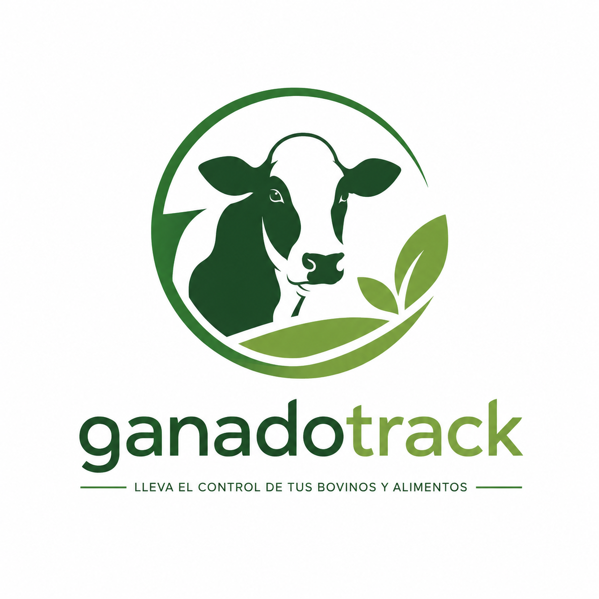
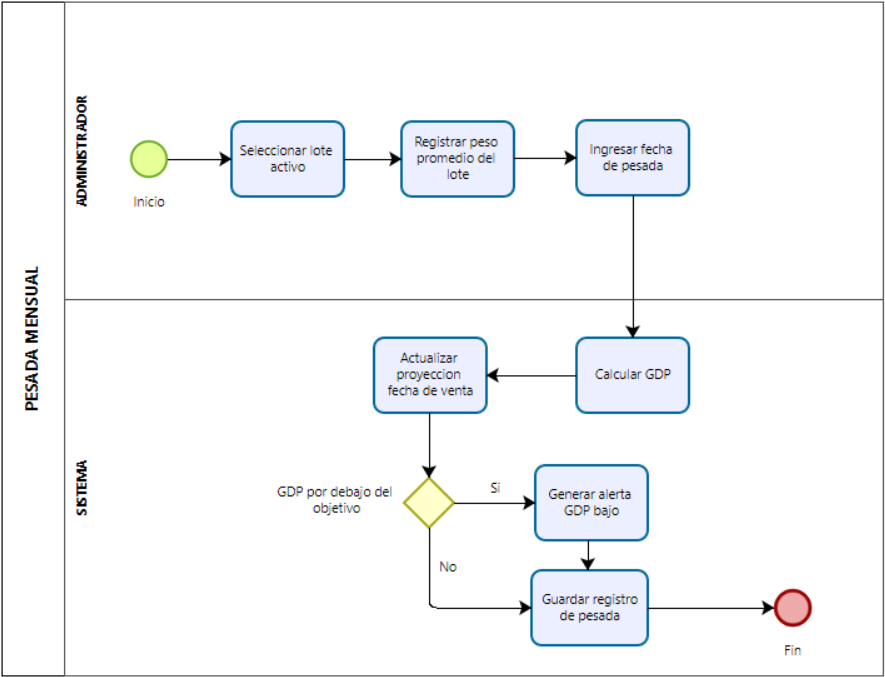
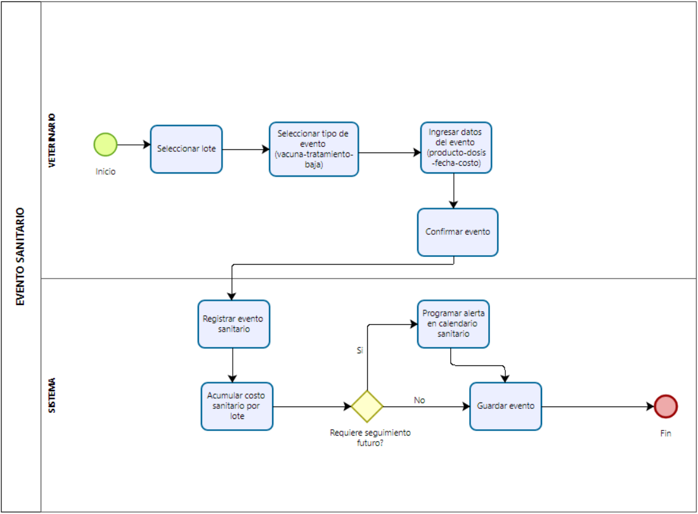

# Análisis y definición del sistema (secciones 1 a 12)

Versión final de las secciones 1 a 12. Reúne el documento de la 1ª entrega con las correcciones de [00-correcciones.md](00-correcciones.md) aplicadas y las ampliaciones de [10-alcance-y-requerimientos.md](10-alcance-y-requerimientos.md) integradas. Es el texto que se usa en el documento final.

# 1. Nombre del proyecto fundamentado

**GanadoTrack**

El nombre combina dos conceptos directos:

- **Ganado:** hace referencia explícita al sector productivo al que está dirigido el sistema, la ganadería bovina, actividad estratégica de la Argentina y núcleo de la operación del cliente.
- **Track** (del inglés *to track*: rastrear, seguir, monitorear): representa la función central del sistema, el seguimiento continuo de animales, alimentación, sanidad y costos a lo largo del ciclo de feedlot.

El resultado es un nombre corto, memorable y bilingüe (común en el sector agropecuario tecnológico), que comunica de forma inmediata el propósito de la herramienta: seguimiento ganadero digital.

# 2. Logo

El logo combina la silueta de un bovino con una línea de seguimiento, en los colores de la identidad visual del sistema: verde bosque, verde hoja y tonos tierra. Los mismos colores se usan en la interfaz (tema "Campo cálido"), en los informes PDF y en los diagramas de este documento.

# 3. Link a código / aplicación

<!-- incluir:03-link.md -->

# 4. Breve descripción

GanadoTrack es un sistema web de gestión para productores ganaderos que operan feedlots bovinos. Permite:

- Registrar los lotes de animales y su evolución de peso, con la Ganancia Diaria de Peso (GDP) y la proyección al peso objetivo.
- Controlar la alimentación diaria a partir de la ración de cada lote, el stock de insumos y su proyección.
- Gestionar la sanidad con un calendario armado automáticamente por protocolos y con alertas.
- Calcular el costo de producción por kilogramo de carne y el margen de cada lote.
- Anticipar riesgos a partir del clima de la zona y emitir informes en PDF y Excel.

Está diseñado para tres tipos de usuarios: el **administrador** (productor), el **encargado** de campo y el **veterinario**, cada uno con una interfaz adaptada a su rol. Se usa desde el navegador o instalado en el celular, y el encargado puede cargar la alimentación aunque no haya señal en el corral.

# 5. Objetivo principal

Desarrollar un sistema web que permita a productores ganaderos con operaciones de feedlot conocer en tiempo real el costo de producción por kilogramo de carne, la evolución de peso de sus lotes y el estado sanitario de sus animales, eliminando el registro manual en papel y reduciendo las pérdidas económicas causadas por falta de información oportuna.

# 6. Objetivos específicos

1. Registrar el ingreso de lotes al feedlot con peso promedio inicial, peso objetivo de salida y GDP objetivo.
2. Permitir al encargado registrar diariamente los kilogramos de alimento suministrados por lote, desde una interfaz simple y accesible desde el celular.
3. Calcular automáticamente la Ganancia Diaria de Peso (GDP) a partir de las pesadas mensuales y proyectar la fecha estimada de llegada al peso objetivo.
4. Generar alertas automáticas para eventos sanitarios programados (vacunaciones, tratamientos antiparasitarios) antes de su vencimiento.
5. Registrar eventos sanitarios y bajas de animales con sus causas, permitiendo al veterinario cargar esta información directamente en el sistema.
6. Calcular el costo acumulado por lote (alimentación + sanidad) y el costo de producción por kilogramo de carne, considerando el rendimiento al gancho (57 %, configurable).
7. Controlar el stock de insumos (suplemento proteico y silaje de sorgo) con alertas de nivel mínimo.
8. Proveer un dashboard visual con el estado actual de todos los lotes activos y las alertas pendientes.
9. Precargar la ración diaria de cada lote para que el encargado la confirme con un solo toque, y calcular la conversión alimenticia del engorde.
10. Generar automáticamente el calendario sanitario de cada tropa a partir de un protocolo definido por el veterinario.
11. Anticipar el quiebre de stock de los insumos y sugerir la compra necesaria, en especial ante un riesgo de sequía.
12. Informar el clima del establecimiento y los riesgos asociados para el ganado (estrés térmico, garrapata, sequía).
13. Emitir informes en PDF y una planilla Excel para el productor y su contador.
14. Permitir la carga de la alimentación en zonas del campo sin señal y su envío posterior sin duplicados.

Los objetivos 1 a 8 corresponden a la 1ª entrega (MVP); los objetivos 9 a 14 se agregaron en la versión final, a partir de problemas planteados en el relevamiento: la ración la define el veterinario, la sequía obliga a compras de urgencia, la garrapata es la principal amenaza sanitaria y hay sectores del campo sin señal.

# 7. Límites

El sistema **no** contempla:

- **Gestión del ciclo completo** (cría, parición, recría, pastoreo): estas etapas quedan fuera del alcance por la complejidad de las variables involucradas, tal como se acordó con el productor.
- **Identificación individual de animales por caravana:** el sistema trabaja exclusivamente por lote (tropa).
- **Integración directa con los sistemas del SENASA** (SIGSA, SIGAD): el sistema es complementario a la trazabilidad oficial, no la reemplaza.
- **Facturación o gestión contable:** los datos fiscales e impositivos siguen siendo responsabilidad del contador externo, que recibe una planilla Excel con los datos operativos.
- **Gestión de recursos humanos** (sueldos, legajos de empleados).
- **Gestión de maquinaria o vehículos** del campo.
- **Otras especies animales** (porcinos, ovinos, aves).
- **Aplicación móvil nativa (iOS/Android):** no se desarrolla. El sistema es una aplicación web *instalable* (PWA): se agrega a la pantalla de inicio del celular desde el navegador, sin pasar por las tiendas de aplicaciones.
- **Funcionamiento sin conexión de todos los módulos:** solo se contempla para la carga de la alimentación diaria del encargado, que es la tarea que se hace en el corral. Las demás pantallas trabajan con datos compartidos que deben estar actualizados; sin señal, el sistema lo indica con un aviso y no admite cambios hasta recuperarla.
- **Costo del animal al ingreso:** el costo calculado corresponde a la etapa de engorde (alimentación + sanidad). No incluye el costo de cría/recría del animal.
- **Gastos generales del establecimiento** (energía eléctrica, combustible, arrendamiento, mano de obra): quedan fuera de esta versión; se prevé incorporarlos como "otros gastos por lote" (ver Trabajo futuro).
- **Notificaciones fuera del sistema** (email, WhatsApp, notificaciones *push*): las alertas se consultan dentro del sistema.
- **Clima:** el pronóstico proviene de un servicio público (Open-Meteo). Los índices de riesgo son **orientativos** y no reemplazan el criterio del veterinario.

# 8. Alcance

La versión final de GanadoTrack cubre los siguientes módulos. Todos los importes se expresan en **pesos argentinos (ARS)**.

Tabla: Módulos y funcionalidades incluidas en la versión final

| Módulo | Funcionalidades incluidas |
|---|---|
| Gestión de lotes | Crear, editar y cerrar lotes. Fecha de ingreso, cantidad de animales, peso de entrada, peso objetivo y GDP objetivo. Protocolo sanitario al crear el lote. Cierre con resumen final |
| Alimentación | Registro diario de los kg entregados por el encargado. Cálculo automático del costo diario. Corrección de registros cargados por error |
| Ración y conversión | Ración por lote en kg por cabeza por día, con historial de cambios. Carga sugerida para el encargado (confirmación en un toque). Conversión alimenticia en materia seca entre pesadas |
| Stock de insumos | Control de suplemento comprado y silaje de sorgo propio. Registro y corrección de compras. Alertas de stock mínimo |
| Proyección de stock | Consumo diario previsto, días de cobertura, fecha de quiebre, compra sugerida y alerta anticipada |
| Pesadas | Registro de pesadas mensuales. Cálculo automático de la GDP. Proyección de la fecha de llegada al peso objetivo. Alerta de GDP baja |
| Sanidad | Calendario sanitario por lote. Alertas previas a los vencimientos. Registro de tratamientos de garrapata. Registro de bajas con causa. Costo sanitario acumulado |
| Protocolos sanitarios | Plantillas de calendario sanitario editables por el veterinario. Generación automática de los eventos al crear un lote o al aplicarlas a un lote existente |
| Costos | Costo acumulado por lote. Costo de engorde por kg de carne (rendimiento al gancho configurable, 57 %). Margen bruto estimado de engorde |
| Clima y riesgos | Clima actual y pronóstico de 7 días de la localidad del establecimiento. Índice de estrés térmico y riesgos de garrapata y de sequía, con alertas |
| Dashboard | Vista general de los lotes activos, alertas pendientes, clima y resumen financiero |
| Reportes | Informe del lote (y de cierre) en PDF, reporte mensual en PDF y planilla Excel para el contador |
| App instalable y sin conexión | Instalación en el celular. Carga de alimentación sin señal, con envío automático al recuperar la conexión |
| Usuarios y roles | 3 roles: Administrador, Encargado y Veterinario, con acceso diferenciado. Perfil propio (nombre y contraseña) |

## 8.1 Usuarios y roles

El propio productor definió los tres roles durante el relevamiento (Anexo I, Bloque 8).

Tabla: Usuarios del sistema, responsabilidades, permisos y nivel de interacción

| Usuario | Responsabilidades | Permisos en el sistema | Nivel de interacción |
|---|---|---|---|
| **Administrador** (productor) | Toma las decisiones productivas y comerciales; compra insumos; decide el cierre de los lotes | Acceso completo: dashboard, lotes, pesadas, costos, insumos, reportes, usuarios y configuración | Alto: consulta indicadores y reportes a diario desde la PC o el celular |
| **Encargado** | Prepara y entrega la ración diaria de cada lote | Solo la carga de la alimentación diaria (también sin conexión) y su perfil | Bajo y frecuente: uno o dos toques por lote cada día, desde el celular en el corral |
| **Veterinario** | Define el plan sanitario y la dieta; aplica tratamientos; registra las bajas | Sanidad (eventos, tratamientos, bajas), protocolos sanitarios, raciones, alertas sanitarias y su perfil | Medio: carga eventos en cada visita y define protocolos y raciones |

Además intervienen dos actores no humanos: el **Sistema** (proceso automático que genera las alertas) y el **servicio de clima** (Open-Meteo), descriptos en la sección 13.1.

# 9. Análisis del caso y herramientas utilizadas

## 9.1 Descripción del caso

El relevamiento se realizó sobre un establecimiento ganadero de ciclo completo ubicado en la región pampeana argentina. La operación comprende aproximadamente 450–600 cabezas de ganado bovino raza Angus, sobre 500 hectáreas de campo arrendado. El productor realiza todas las etapas del ciclo productivo: cría, recría, engorde en feedlot y comercialización a través de su propia carnicería.

Al momento del relevamiento, el establecimiento no contaba con ningún sistema de registro ni gestión administrativa. La información se manejaba de forma verbal o en papel, sin sistematización. El productor declaró desconocer su costo de producción por kilogramo de carne y no contar con seguimiento sanitario estructurado.

## 9.2 Caso de pérdida por falta de información sanitaria

Durante la entrevista, el productor describió un incidente crítico que evidencia la necesidad del sistema:

> "La garrapata transmite una enfermedad llamada Anaplasmosis. Por falta de seguimiento sanitario y control de los tratamientos antiparasitarios, el sistema inmune de los animales colapsó. Perdimos 26 vacas."

Estimando un valor promedio de mercado de USD 1.000 por cabeza (estimación de mercado del primer semestre de 2026), la pérdida representó aproximadamente USD 26.000, una cifra que podría haberse reducido significativamente con un sistema de alertas sanitarias y seguimiento de tratamientos.

Este caso constituye el principal argumento de negocio que justifica el desarrollo de GanadoTrack.

## 9.3 Herramientas de relevamiento utilizadas

**Entrevista semiestructurada:** se realizó una entrevista al productor y dueño del establecimiento mediante un cuestionario organizado en **9 bloques temáticos (0 a 8)**:

- Bloque 0: Tipo de operación y especie
- Bloque 1: Contexto del negocio
- Bloque 2: Compra e ingreso de animales
- Bloque 3: Alimentación
- Bloque 4: Seguimiento del crecimiento
- Bloque 5: Sanidad animal
- Bloque 6: Venta y rentabilidad
- Bloque 7: Gestión actual y dolor real
- Bloque 8: Tecnología y expectativas

**Mensajes de voz (WhatsApp):** el cierre del relevamiento se realizó mediante audios de WhatsApp, en los que el productor confirmó el foco del sistema en el feedlot y la necesidad de alertas sanitarias programadas. La transcripción completa está en el Anexo I.

## 9.4 Principales hallazgos del relevamiento

Tabla: Hallazgos del relevamiento y su impacto en el sistema

| Hallazgo | Impacto en el sistema |
|---|---|
| No hay ningún sistema de registro hoy | No existe un sistema previo: no hay datos que migrar ni herramientas que reemplazar, por lo que el sistema puede diseñarse desde cero según el proceso real del establecimiento |
| Desconoce su costo de producción | El módulo de costos es la funcionalidad de mayor valor |
| 26 vacas muertas por falta de control sanitario | El módulo de alertas sanitarias es prioritario; en la versión final, además, el calendario se arma solo con protocolos y el clima anticipa el riesgo de garrapata |
| Trabaja por lote, no por animal individual | El sistema gestiona tropas (lotes), no individuos |
| Tiene Starlink y señal de celular, pero no en todo el campo | Aplicación web responsive; en la versión final, la carga de alimentación funciona también sin señal (RF14) |
| El veterinario se comunica por WhatsApp y define la ración | El veterinario es usuario del sistema: carga los eventos sanitarios, define los protocolos y la ración de cada lote |
| Produce su propio silaje de sorgo | El silaje se registra como insumo con su costo por kg; las cargas de silaje propio suman stock como una compra |
| Compra el suplemento proteico semanalmente | Cada compra genera un stock de corto plazo que se consume durante la semana. Registrar ese stock permite anticipar la próxima compra y conocer el precio vigente para calcular el costo diario |
| En las sequías debe comprar alimento de urgencia | Proyección de stock con compra sugerida y alerta de riesgo de sequía (RF11 y RF12) |
| Vende en su carnicería propia | La unidad de cálculo es el kg al gancho (rendimiento 57 %, configurable) |

# 10. Requerimientos funcionales

Los requerimientos RF01 a RF08 provienen de la 1ª entrega, corregidos y ampliados. Los RF09 a RF14 se agregaron en la versión final.

**RF01: Gestión de lotes**
- El sistema debe permitir crear un nuevo lote ingresando: nombre o número de lote, fecha de ingreso, cantidad de animales, peso promedio de entrada (kg), peso objetivo de salida (kg) y **GDP objetivo (kg/día)**.
- Al crear el lote se puede elegir un protocolo sanitario (RF10).
- El sistema debe mostrar automáticamente los días transcurridos desde el ingreso del lote.
- El sistema debe permitir registrar el cierre de un lote al momento de la venta o faena, con un resumen final. Un lote cerrado no admite nuevas cargas.

**RF02: Registro de alimentación diaria**
- El sistema debe permitir al encargado seleccionar un lote y registrar los kg de suplemento proteico y de silaje de sorgo dados en el día.
- El sistema debe calcular automáticamente el costo diario de alimentación del lote (kg × precio por kg de cada insumo).
- El sistema debe acumular el costo total de alimentación por lote desde su ingreso.

**RF03: Control de stock de insumos**
- El sistema debe mantener el stock actual de suplemento proteico y de silaje de sorgo. Internamente ambos se registran en **kg**; el silaje se muestra además en toneladas para facilitar la lectura.
- El sistema debe descontar del stock la cantidad registrada en cada alimentación diaria.
- El sistema debe permitir registrar nuevas compras o cargas de insumos. El administrador puede corregir una compra registrada; el stock y el precio se ajustan en la misma operación y el stock nunca queda negativo.
- El sistema debe emitir una alerta cuando el stock de un insumo caiga por debajo del nivel mínimo configurado.
- El sistema debe registrar el porcentaje de materia seca de cada insumo (RF09).

**RF04: Registro de pesadas y cálculo de GDP**
- El sistema debe permitir registrar una pesada mensual por lote: fecha y peso promedio del lote (kg).
- El sistema debe calcular automáticamente la Ganancia Diaria de Peso entre pesadas: GDP = (peso actual − peso anterior) / días transcurridos.
- El sistema debe proyectar la fecha estimada de llegada al peso objetivo según la GDP actual.
- El sistema debe emitir una alerta cuando la GDP del lote sea inferior a la GDP objetivo del lote.
- Se puede eliminar la **última** pesada de un lote si se cargó por error; la GDP de las anteriores no cambia. Cada pesada muestra la conversión alimenticia (RF09).

**RF05: Gestión sanitaria y alertas**
- El sistema debe permitir crear un calendario sanitario por lote con eventos programados (nombre del evento, fecha, producto a aplicar).
- El sistema debe emitir una alerta automática 7 días antes de la fecha de cada evento sanitario programado (configurable) y otra cuando el evento esté vencido.
- El sistema debe permitir al veterinario registrar la ejecución de un evento sanitario: fecha real, producto usado, dosis y costo total.
- El sistema debe permitir registrar tratamientos de garrapata/anaplasmosis: fecha de inicio, producto, duración del tratamiento y costo; al registrarlo, programa el próximo control.
- El sistema debe permitir registrar bajas (muertes) en el lote: fecha, cantidad de animales y causa (enfermedad, accidente, sequía u otra).
- El sistema debe mantener un acumulado del costo sanitario total por lote.
- Un evento pendiente se puede reprogramar o corregir; uno realizado, no. El administrador puede eliminar una baja cargada por error y las cabezas del lote se restituyen.

**RF06: Cálculo de costos y rentabilidad**
- El sistema debe calcular el costo acumulado total por lote: alimentación + sanidad.
- El sistema debe calcular las **cabezas actuales** del lote: cantidad de ingreso − bajas registradas.
- El sistema debe calcular el **costo de engorde por kg de carne**: costo total acumulado / (peso promedio actual × cabezas actuales × rendimiento al gancho). El rendimiento al gancho es un parámetro configurable (valor inicial 57 %).
- El sistema debe permitir al administrador ingresar el precio de venta por kg en la carnicería.
- El sistema debe mostrar el **margen bruto estimado de engorde** por lote: (precio de venta por kg × kg de carne estimados) − costo total acumulado.

**RF07: Dashboard y reportes**
- El sistema debe mostrar un dashboard con todos los lotes activos, indicando para cada uno: días en feedlot, peso promedio actual, GDP de la última medición, costo acumulado y alertas pendientes.
- El sistema debe mostrar en el dashboard un resumen de las alertas activas (sanitarias, de stock, de stock proyectado y de clima) y el clima con sus riesgos (RF11 y RF12).
- El sistema debe permitir ver el historial de un lote cerrado con su resumen financiero final.

**RF08: Gestión de usuarios y roles**
- El sistema debe soportar tres roles de usuario: Administrador, Encargado y Veterinario.
- El administrador tiene acceso completo a todos los módulos y gestiona los usuarios.
- El encargado solo puede acceder al módulo de registro de alimentación diaria.
- El veterinario solo puede acceder a los módulos de sanidad (eventos, ejecuciones y bajas), protocolos sanitarios y raciones.
- El sistema debe requerir autenticación con usuario y contraseña para todos los roles.
- Cada usuario puede cambiar su nombre y su contraseña (con verificación de la contraseña actual) desde "Mi perfil".

<!-- incluir:10-alcance-y-requerimientos.md#10.1-sin-titulo -->

# 11. Requerimientos no funcionales

**RNF01: Usabilidad**
- La interfaz del encargado debe permitir registrar la alimentación diaria de un lote en no más de 3 clics desde el inicio de sesión. Con la ración definida, el registro se hace con **un toque** por lote.
- El sistema debe ser operable desde celulares y tablets mediante el navegador (diseño responsive).
- La pantalla del encargado tiene botones de al menos 48 px de alto y un "modo pleno sol" de alto contraste y letra grande.
- El sistema no debe requerir capacitación técnica previa para ser usado por el encargado o el veterinario.

**RNF02: Disponibilidad**
- El sistema debe estar disponible al menos el 95 % del tiempo (considerando la dependencia de la conexión Starlink del establecimiento).
- El sistema se publica en plataformas gestionadas con HTTPS (Vercel, Render y Neon).
- Si falla un servicio externo (clima), el resto del sistema sigue funcionando.

**RNF03: Rendimiento**
- El dashboard principal debe cargar en menos de 3 segundos con hasta 20 lotes activos simultáneos.
- El registro de alimentación diaria debe confirmarse en menos de 2 segundos.

**RNF04: Seguridad**
- Las contraseñas deben almacenarse hasheadas (bcrypt).
- La sesión debe expirar automáticamente tras 8 horas de inactividad.
- Cada rol debe tener acceso estrictamente restringido a sus funcionalidades (RBAC), verificado en el servidor.
- La comunicación entre cliente y servidor debe realizarse mediante HTTPS.

**RNF05: Escalabilidad**
- La arquitectura debe permitir agregar nuevos módulos (ciclo completo, identificación individual) sin rediseñar la base existente.
- La base de datos debe soportar el crecimiento histórico de lotes y registros sin degradación del rendimiento.

**RNF06: Mantenibilidad**
- El código debe estar documentado con comentarios en las funciones de cálculo (GDP, costo por kg, proyecciones).
- El proyecto debe seguir una estructura de carpetas estándar para React (frontend) y Node.js (backend).

**RNF07: Operación sin conexión**
- La carga de la alimentación diaria debe poder realizarse sin conexión a internet y enviarse automáticamente al recuperarla.
- El envío posterior debe ser **idempotente**: si se repite, no debe generar registros duplicados.

# 12. Modelos de procesos de negocio (BPMN)

## 12.1 Procesos automatizados

<!-- incluir:10-alcance-y-requerimientos.md#12-sin-titulo -->

## 12.3 Procesos que se mantienen de la 1ª entrega

**Proceso 3 – Pesada mensual y evaluación de progreso:** el administrador registra la fecha y el peso promedio; el sistema calcula la GDP, actualiza la proyección y, si la GDP está por debajo del objetivo, genera una alerta de bajo rendimiento.

**Proceso 4 – Registro de evento sanitario y alerta:** el sistema avisa los eventos que vencen en los próximos 7 días; el veterinario registra la ejecución y, si es un tratamiento de garrapata, el sistema programa el próximo control.

