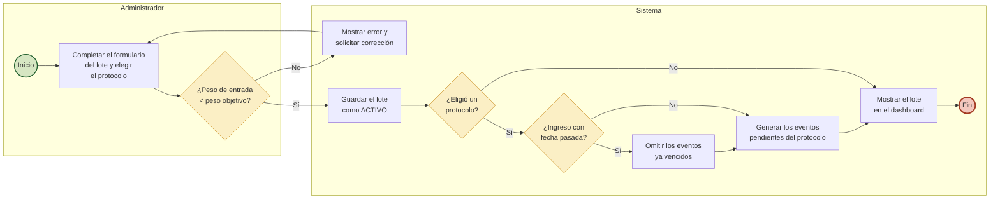
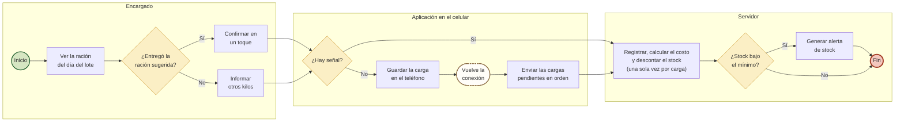
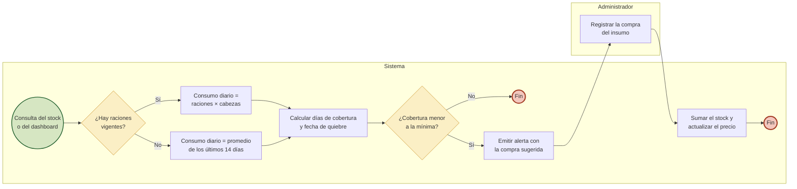
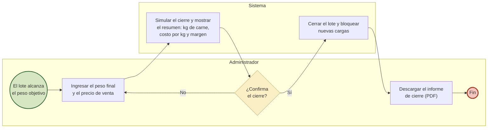

# Alcance y requerimientos de la versión final (secciones 6, 7, 8, 10, 11 y 12)

En la 2ª etapa, el proyecto pasó de MVP a **sistema terminado**. Se incorporaron seis funcionalidades que no estaban en la 1ª entrega. Surgieron del relevamiento y de los problemas que planteó el productor: ración por lote, protocolos sanitarios, proyección de stock ante la sequía, clima, reportes y uso sin señal en el campo.

Este archivo reúne los cambios a las secciones de objetivos, límites, alcance y requerimientos del documento de la 1ª entrega. Los RF01 a RF08 se mantienen, con las correcciones de [00-correcciones.md](00-correcciones.md) y las ampliaciones de la sección 10.2.

---

## 6. Objetivos específicos (agregar a continuación del 6.8)

> 6.9. Precargar la ración diaria de cada lote para que el encargado la confirme con un solo toque y calcular la conversión alimenticia del engorde.
>
> 6.10. Generar automáticamente el calendario sanitario de cada tropa a partir de un protocolo definido por el veterinario.
>
> 6.11. Anticipar el quiebre de stock de los insumos y sugerir la compra necesaria, en especial ante un riesgo de sequía.
>
> 6.12. Informar el clima del establecimiento y los riesgos asociados para el ganado (estrés térmico, garrapata, sequía).
>
> 6.13. Emitir informes en PDF y una planilla Excel para el productor y su contador.
>
> 6.14. Permitir la carga de la alimentación en zonas del campo sin señal y su envío posterior sin duplicados.

## 7. Límites (reemplazar las dos últimas viñetas)

En la 1ª entrega se excluía el modo offline. En la versión final, la **carga de la alimentación** funciona sin conexión (RF14), ya que es la tarea que se hace en el corral. El resto de los módulos sigue necesitando conexión, porque trabaja con datos compartidos que deben estar actualizados.

> ● **Aplicación móvil nativa (iOS/Android):** no se desarrolla. El sistema es una aplicación web *instalable* (PWA): se agrega a la pantalla de inicio del celular desde el navegador, sin pasar por las tiendas de aplicaciones.
>
> ● **Funcionamiento sin conexión:** solo se contempla para la carga de la alimentación diaria del encargado. Las demás pantallas necesitan conexión; sin señal, el sistema lo indica con un aviso y no admite cambios hasta recuperarla.
>
> ● **Costo del animal al ingreso:** el costo calculado corresponde a la etapa de engorde (alimentación + sanidad). No incluye el costo de cría/recría del animal ni los gastos generales del establecimiento.
>
> ● **Gastos generales** (energía eléctrica, combustible, arrendamiento, mano de obra): quedan fuera de esta versión (ver Trabajo futuro).
>
> ● **Notificaciones fuera del sistema** (email, WhatsApp, notificaciones *push*): las alertas se consultan dentro del sistema.
>
> ● **Clima:** el pronóstico proviene de un servicio público (Open-Meteo). Los índices de riesgo son **orientativos** y no reemplazan el criterio del veterinario.

## 8. Alcance (agregar filas a la tabla de módulos)

| Módulo | Funcionalidades incluidas |
|---|---|
| Ración y conversión | Ración por lote en kg por cabeza por día, con historial de cambios. Carga sugerida para el encargado (confirmación en un toque). Conversión alimenticia en materia seca entre pesadas |
| Protocolos sanitarios | Plantillas de calendario sanitario editables por el veterinario. Generación automática de los eventos al crear un lote o al aplicarlas a un lote existente |
| Proyección de stock | Consumo diario previsto, días de cobertura, fecha de quiebre, compra sugerida y alerta anticipada |
| Clima y riesgos | Clima actual y pronóstico de 7 días de la localidad del establecimiento. Índice de estrés térmico, riesgo de garrapata y de sequía, con alertas |
| Reportes | Informe del lote (y de cierre) en PDF, reporte mensual en PDF y planilla Excel para el contador |
| App instalable y sin conexión | Instalación en el celular. Carga de alimentación sin señal con envío automático al recuperar la conexión |
| Perfil y correcciones | Cambio de nombre y contraseña propios. Corrección de datos cargados por error (última pesada, baja, evento pendiente, compra) |

---

## 10. Requerimientos funcionales

### 10.1 Requerimientos nuevos

**RF09: Ración por lote y conversión alimenticia**
- El sistema debe permitir al veterinario o al administrador definir la ración de cada lote: kg por cabeza por día de cada insumo y la fecha desde la que rige.
- El sistema debe conservar el historial de raciones; un cambio con fecha futura no modifica la ración vigente hoy. Cargar 0 kg quita el insumo de la ración.
- El sistema debe calcular los kg del día de cada insumo: kg por cabeza por día × cabezas actuales del lote.
- El sistema debe mostrar al encargado la ración del día de cada lote y permitirle registrarla con un solo toque. También debe poder informar otros kilos si entregó una cantidad distinta.
- El sistema debe registrar el porcentaje de materia seca de cada insumo (configurable; valores iniciales: suplemento 90 %, silaje 35 %).
- El sistema debe calcular la conversión alimenticia entre pesadas y acumulada del lote: kg de materia seca consumidos / (aumento de peso promedio × cabezas).

**RF10: Protocolos sanitarios**
- El sistema debe permitir al veterinario crear, modificar y eliminar protocolos sanitarios. Cada protocolo es una lista de eventos (tipo, nombre, producto, día desde el ingreso) que pueden repetirse cada cierta cantidad de días.
- El sistema debe permitir marcar un protocolo como **por defecto**; solo uno puede serlo a la vez.
- Al crear un lote, el sistema debe generar los eventos sanitarios pendientes del protocolo elegido (fecha = ingreso + día del evento), en la misma operación que crea el lote.
- Si el lote se carga con fecha de ingreso anterior a hoy, el sistema debe permitir omitir los eventos con fecha ya pasada.
- El sistema debe permitir aplicar un protocolo a un lote ya existente.

**RF11: Proyección de stock de insumos**
- El sistema debe estimar el consumo diario de cada insumo como la suma de las raciones vigentes × cabezas actuales. Si no hay raciones definidas, debe usar el consumo real promedio de los últimos 14 días.
- El sistema debe calcular los días que alcanza el stock (cobertura), la fecha estimada de quiebre y la compra sugerida para cubrir un horizonte configurable (14 días) y terminar con el stock mínimo.
- El sistema debe emitir una alerta cuando la cobertura de un insumo sea menor a la mínima configurada (7 días).
- El sistema debe mostrar el stock proyectado a 30 días en un gráfico, junto con el stock mínimo.

**RF12: Clima y riesgos**
- El sistema debe permitir al administrador configurar la ubicación del establecimiento buscando la localidad por nombre.
- El sistema debe mostrar a todos los roles el clima actual. Al administrador le debe mostrar además el pronóstico de 7 días y la lluvia de los últimos 30 días.
- El sistema debe calcular tres índices orientativos:
  - **Índice de temperatura y humedad (ITH):** estrés térmico del ganado.
  - **Riesgo de garrapata:** según la temperatura y la humedad media de la semana.
  - **Riesgo de sequía:** según la lluvia de los últimos 30 días y la pronosticada para la semana.
- El sistema debe emitir alertas de clima:
  - Estrés térmico en nivel de peligro o superior.
  - Riesgo alto de garrapata en lotes sin tratamiento en los últimos 21 días.
  - Riesgo alto de sequía, junto con los días que alcanza el silaje.
- Si el servicio de clima no responde, el sistema debe seguir funcionando sin la información de clima.

**RF13: Reportes descargables**
- El sistema debe generar un **informe del lote en PDF** con:
  - Datos del lote e indicadores.
  - Tabla y gráfico de pesadas.
  - Alimentación por insumo, sanidad, bajas, costos, conversión alimenticia y margen.

  Para un lote cerrado, funciona como **informe de cierre**.
- El sistema debe generar un **reporte mensual en PDF** con los costos del mes por lote e insumo, los eventos sanitarios, las bajas y el stock.
- El sistema debe generar una **planilla Excel** para un rango de fechas, con una hoja por tipo de dato (lotes, alimentación, compras, sanidad, pesadas y bajas) y formatos de moneda y fecha.
- Los reportes solo están disponibles para el administrador.

**RF14: Aplicación instalable y carga sin conexión**
- El sistema debe poder instalarse en el celular o la PC desde el navegador y abrirse como una aplicación.
- Si no hay conexión al confirmar una carga de alimentación, el sistema debe guardarla en el dispositivo con la **fecha de captura** e informarlo al encargado.
- Al recuperar la conexión, el sistema debe enviar automáticamente las cargas guardadas, en orden.
- Un reenvío de la misma carga no debe duplicar registros ni descontar el stock dos veces.
- Si una carga guardada es rechazada (por ejemplo, por falta de stock), el sistema debe mostrarla con el motivo y permitir descartarla.

### 10.2 Ampliaciones a requerimientos existentes

| RF | Ampliación |
|---|---|
| RF01 | Al crear un lote se elige el protocolo sanitario (RF10). |
| RF03 | El administrador puede corregir una compra registrada; el stock y el precio se ajustan en la misma operación y el stock nunca queda negativo. Se registra la materia seca de cada insumo (RF09). |
| RF04 | Se puede eliminar la **última** pesada de un lote si se cargó por error; la GDP de las anteriores no cambia. Cada pesada muestra la conversión alimenticia (RF09). |
| RF05 | Un evento pendiente se puede reprogramar o corregir; uno realizado, no. El administrador puede eliminar una baja cargada por error y las cabezas del lote se restituyen. |
| RF07 | El dashboard muestra el clima y los riesgos (RF12) y las alertas de stock proyectado (RF11). |
| RF08 | Cada usuario puede cambiar su nombre y su contraseña (con verificación de la contraseña actual) desde "Mi perfil". |

## 11. Requerimientos no funcionales (agregar)

**RNF07: Operación sin conexión**
- La carga de la alimentación diaria debe poder realizarse sin conexión a internet y enviarse automáticamente al recuperarla.
- El envío posterior debe ser **idempotente**: si se repite, no debe generar registros duplicados.

**Ampliaciones:**
- **RNF01 Usabilidad:**
  - Con la ración definida, el encargado registra la alimentación con **un toque** por lote.
  - La pantalla del encargado tiene botones de al menos 48 px de alto y un "modo pleno sol" de alto contraste y letra grande.
- **RNF02 Disponibilidad:**
  - El sistema se publica en plataformas gestionadas con HTTPS (Vercel, Render y Neon).
  - Si falla un servicio externo (clima), el resto del sistema sigue funcionando.

## 12. Procesos automatizados (agregar al inicio de la sección 12)

La tabla resume qué procesos del establecimiento automatiza el sistema, cómo se hacían antes según el relevamiento y qué modelo BPMN los representa. Los procesos 1 a 4 ya estaban modelados en la 1ª entrega; en la versión final se amplían y se suman los procesos 5 y 6.

| # | Proceso | Antes (relevamiento) | Con GanadoTrack | RF / CU | Modelo BPMN |
|---|---|---|---|---|---|
| 1 | Ingreso de un lote | Datos anotados en papel; el calendario sanitario dependía de la memoria y de mensajes con el veterinario | Alta del lote con validación de pesos. El protocolo sanitario genera los eventos del calendario en la misma operación | RF01, RF10 · CU03, CU17 | Proceso 1, ampliado con la tarea "Generar eventos del protocolo" |
| 2 | Alimentación diaria | Kilos anotados en papel o informados de palabra; stock y costo sin calcular | Ración precargada que el encargado confirma en un toque. El sistema descuenta el stock y calcula el costo del día. Sin señal, la carga queda en el teléfono y se envía sola | RF02, RF03, RF09, RF14 · CU04, CU05, CU16, CU21 | Proceso 2, ampliado con la compuerta "¿Hay señal?" |
| 3 | Pesada mensual | Pesadas anotadas sin análisis | GDP, proyección al peso objetivo, conversión alimenticia y alerta de bajo rendimiento | RF04, RF09 · CU07 | Proceso 3 |
| 4 | Control sanitario | Coordinación por WhatsApp, sin avisos previos (pérdida de 26 vacas por anaplasmosis) | Alertas 7 días antes y de eventos vencidos, registro del evento, nuevo control de garrapata a los días del tratamiento y alerta de riesgo de garrapata según el clima | RF05, RF12 · CU08, CU09, CU14, CU19 | Proceso 4 |
| 5 | Abastecimiento de insumos | Compras sin anticipación; faltantes en épocas de sequía | Proyección de consumo, días de cobertura, fecha de quiebre, compra sugerida y alerta anticipada | RF03, RF11 · CU06, CU18 | Proceso 5 (nuevo) |
| 6 | Cierre del lote e informes | El productor no conocía su costo por kg ni el margen del lote | Cierre con resumen final, costo de engorde por kg y margen, informe PDF y planilla Excel para el contador | RF01, RF06, RF13 · CU11, CU13, CU20 | Proceso 6 (nuevo) |

### Modelos de los procesos ampliados y nuevos

Los procesos 3 (pesada mensual) y 4 (evento sanitario y alerta) se mantienen como en la 1ª entrega. Los procesos 1 y 2 se amplían y los procesos 5 y 6 son nuevos. Se representan con carriles (*lanes*) por participante, en notación BPMN simplificada: círculo verde = inicio, rectángulo = tarea, rombo = compuerta exclusiva, círculo rojo = fin.

**Proceso 1 – Ingreso de un lote (ampliado):** después de guardar el lote, si se eligió un protocolo sanitario, el sistema genera los eventos de su calendario en la misma operación. Si el lote se carga con una fecha de ingreso pasada, se pueden omitir los eventos ya vencidos.

**Proceso 2 – Alimentación diaria (ampliado):** el encargado ve la ración del día precargada y la confirma con un toque, o informa otros kilos. Si no hay señal, la aplicación guarda la carga en el teléfono y la envía sola al volver la conexión. El servidor la registra una sola vez (idempotencia).

**Proceso 5 – Abastecimiento de insumos (nuevo):** cada vez que se consulta el stock o el dashboard, el sistema proyecta el consumo y avisa con anticipación cuándo comprar y cuánto.

**Proceso 6 – Cierre del lote (nuevo):** cuando una pesada indica que el lote alcanzó el peso objetivo, el administrador simula el cierre, revisa el resumen y lo confirma. El lote cerrado queda bloqueado para nuevas cargas y su informe funciona como informe de cierre.

