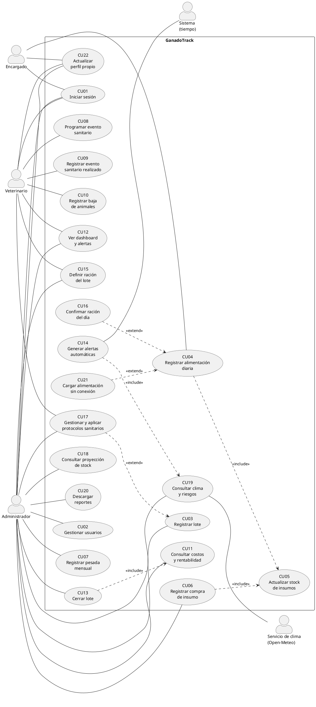

# 13. Casos de uso

## 13.1 Actores

| Actor | Tipo | Descripción | Permisos |
|---|---|---|---|
| Administrador (productor) | Primario | Dueño del establecimiento; toma las decisiones productivas y comerciales | Acceso completo a todos los módulos |
| Encargado | Primario | Empleado que prepara y entrega la ración diaria | Solo registro de alimentación diaria (también sin conexión) y su perfil |
| Veterinario | Primario | Profesional de cabecera; define el plan sanitario y la dieta | Sanidad (eventos, tratamientos, bajas), protocolos sanitarios, raciones, alertas sanitarias y su perfil |
| Sistema (tiempo) | Secundario | Proceso automático que evalúa fechas, stock, GDP y clima | Genera alertas |
| Servicio de clima (Open-Meteo) | Secundario (externo) | Servicio público de pronóstico meteorológico | Provee el clima y el pronóstico de la ubicación configurada |

## 13.2 Lista de casos de uso

| ID | Caso de uso | Actor principal | RF |
|---|---|---|---|
| CU01 | Iniciar sesión | Administrador, Encargado, Veterinario | RF08 |
| CU02 | Gestionar usuarios | Administrador | RF08 |
| CU03 | Registrar lote | Administrador | RF01 |
| CU04 | Registrar alimentación diaria | Encargado | RF02, RF03 |
| CU05 | Actualizar stock de insumos («include») | — | RF03 |
| CU06 | Registrar compra de insumo | Administrador | RF03 |
| CU07 | Registrar pesada mensual | Administrador | RF04 |
| CU08 | Programar evento sanitario | Veterinario | RF05 |
| CU09 | Registrar evento sanitario realizado | Veterinario | RF05 |
| CU10 | Registrar baja de animales | Veterinario | RF05 |
| CU11 | Consultar costos y rentabilidad del lote | Administrador | RF06 |
| CU12 | Ver dashboard y alertas | Administrador | RF07 |
| CU13 | Cerrar lote | Administrador | RF01, RF07 |
| CU14 | Generar alertas automáticas | Sistema | RF03, RF04, RF05, RF11, RF12 |
| CU15 | Definir ración del lote | Veterinario, Administrador | RF09 |
| CU16 | Confirmar la ración del día en un toque («extend» CU04) | Encargado | RF09, RNF01 |
| CU17 | Gestionar y aplicar protocolos sanitarios («extend» CU03) | Veterinario, Administrador | RF10 |
| CU18 | Consultar proyección de stock | Administrador | RF11 |
| CU19 | Consultar clima y riesgos | Administrador (los demás roles ven el clima actual) | RF12 |
| CU20 | Descargar reportes | Administrador | RF13 |
| CU21 | Cargar alimentación sin conexión («extend» CU04) | Encargado | RF14, RNF07 |
| CU22 | Actualizar perfil propio | Administrador, Encargado, Veterinario | RF08 |

Los casos CU15 a CU22 se agregaron en la versión final (sistema terminado). Las correcciones de datos (eliminar la última pesada o una baja, reprogramar un evento, corregir una compra) se modelan como flujos alternativos de CU07, CU10, CU08 y CU06.

## 13.3 Diagrama de casos de uso

Código PlantUML. Para obtener la imagen, pegarlo en <https://www.plantuml.com/plantuml/uml> y descargar el PNG, o usar la extensión *PlantUML* de VS Code.

> Notas:
> - El veterinario accede a CU12 solo para ver las alertas **sanitarias**, incluidas las de clima que afectan la sanidad (restricción RF08).
> - En «extend» la flecha va desde el caso que extiende hacia el caso base: CU16 y CU21 son variantes de CU04 que se activan cuando el lote tiene ración definida o cuando no hay conexión.
> - CU17 «extend» CU03: si al crear el lote se elige un protocolo sanitario, se generan sus eventos (punto de extensión "protocolo elegido"); con "Ninguno", el lote se crea sin calendario.

---

## 13.4 Fichas de casos de uso

### CU01 – Iniciar sesión
| Campo | Descripción |
|---|---|
| Actores | Administrador, Encargado, Veterinario |
| Precondición | El usuario existe y está activo. |
| Postcondición | El usuario queda autenticado por 8 h y accede a la pantalla de su rol. |
| Flujo principal | 1. El usuario ingresa email y contraseña. 2. El sistema valida las credenciales. 3. El sistema inicia la sesión. 4. El sistema muestra la pantalla de inicio según el rol: Administrador → Dashboard; Encargado → Cargar alimentación; Veterinario → Sanidad. |
| Flujo alternativo | 3a. La sesión expira tras 8 h sin actividad → el sistema solicita volver a ingresar. 3b. Se abre la app sin conexión en un dispositivo donde el usuario ya había ingresado → se usa la sesión guardada y el encargado puede seguir cargando (CU21). |
| Excepción | 2a. Credenciales incorrectas o usuario inactivo → mensaje "Email o contraseña incorrectos"; no se indica cuál de los dos falló. |

### CU02 – Gestionar usuarios
| Campo | Descripción |
|---|---|
| Actor | Administrador |
| Precondición | Sesión iniciada como Administrador. |
| Postcondición | El usuario queda creado, modificado o desactivado. |
| Flujo principal | 1. El administrador abre "Usuarios". 2. Selecciona "Nuevo usuario". 3. Ingresa nombre, email, rol y contraseña inicial. 4. Confirma. 5. El sistema guarda la contraseña hasheada y muestra el usuario en la lista. |
| Flujo alternativo | 2a. Edita un usuario existente (nombre, rol) o lo desactiva. Un usuario desactivado no puede iniciar sesión. |
| Excepción | 4a. El email ya existe → "Ya existe un usuario con ese email". 4b. El administrador intenta desactivarse a sí mismo → el sistema lo impide. |

### CU03 – Registrar lote
| Campo | Descripción |
|---|---|
| Actor | Administrador |
| Precondición | Sesión iniciada como Administrador. |
| Postcondición | El lote queda en estado ACTIVO y aparece en el dashboard. |
| Flujo principal | 1. El administrador selecciona "Nuevo lote". 2. Ingresa nombre, fecha de ingreso, cantidad de animales, peso promedio de entrada, peso objetivo y GDP objetivo. El sistema propone el protocolo sanitario marcado por defecto. 3. Confirma. 4. El sistema valida los datos y crea el lote. 5. El sistema genera los eventos sanitarios del protocolo en la misma operación (CU17). 6. El sistema confirma "Lote creado" con la cantidad de eventos programados. |
| Flujo alternativo | 2a. El administrador elige otro protocolo o "Ninguno (cargar eventos a mano)" → en el segundo caso no se generan eventos (CU08). 2b. La fecha de ingreso es anterior a hoy → el sistema ofrece omitir los eventos con fecha ya pasada (opción activada por defecto). |
| Excepción | 4a. El nombre ya existe → error. 4b. El peso objetivo es menor o igual al de entrada, la cantidad es ≤ 0 o la fecha es futura → error de validación; no se guarda. 5a. El protocolo elegido no existe → no se crea ni el lote ni sus eventos (transacción). |

### CU04 – Registrar alimentación diaria
| Campo | Descripción |
|---|---|
| Actor | Encargado (también puede hacerlo el Administrador) |
| Precondición | Sesión iniciada. Existe al menos un lote activo. |
| Postcondición | Los registros de alimentación quedan guardados con su costo. El stock de insumos se descuenta (CU05). |
| Flujo principal | 1. El encargado selecciona el lote. 2. Ingresa los kg de suplemento entregados. 3. Ingresa los kg de silaje entregados. 4. Confirma. 5. El sistema calcula el costo del día (kg × precio/kg de cada insumo) y lo suma al acumulado del lote. 6. El sistema descuenta los kg del stock (CU05). 7. El sistema muestra la confirmación con el costo del día. |
| Flujo alternativo | 1a. El lote tiene ración definida → el sistema muestra la ración del día y el encargado puede confirmarla en un toque (CU16). 2a/3a. Si se informa un solo insumo (el otro vacío o en 0), se registra solo ese. 4c. No hay conexión al confirmar → la carga se guarda en el teléfono (CU21). 6a. El stock de un insumo queda por debajo del mínimo → el sistema genera una alerta de stock para el Administrador (CU14). |
| Excepción | 4a. Ambos valores están vacíos o en 0 → "Ingresá al menos un valor"; no se guarda. 4b. Ya existe un registro de ese insumo para ese lote en la fecha → "Ya se registró la alimentación de hoy para este lote". 6b. Los kg superan el stock disponible → "Stock insuficiente"; no se guarda nada. |

### CU05 – Actualizar stock de insumos (incluido)
| Campo | Descripción |
|---|---|
| Invocado por | CU04 (descuenta) y CU06 (suma) |
| Precondición | El insumo existe. |
| Postcondición | El stock del insumo queda actualizado en la misma transacción que el registro que lo originó. |
| Flujo principal | 1. El sistema recibe el insumo, la cantidad en kg y la operación (sumar o restar). 2. Actualiza el stock. 3. Si el stock resultante es menor al mínimo, marca la condición de alerta (CU14). |
| Excepción | 2a. Resta mayor al stock disponible → se cancela toda la operación (rollback). |

### CU06 – Registrar compra de insumo
| Campo | Descripción |
|---|---|
| Actor | Administrador |
| Precondición | Sesión iniciada como Administrador. |
| Postcondición | La compra queda registrada, el stock aumenta (CU05) y el precio por kg del insumo se actualiza. |
| Flujo principal | 1. El administrador abre "Insumos". 2. Selecciona el insumo (suplemento o silaje). 3. Ingresa fecha, cantidad en kg y precio total. 4. Confirma. 5. El sistema suma la cantidad al stock (CU05) y actualiza el precio/kg = precio total / cantidad. |
| Flujo alternativo | 3a. Silaje de producción propia: el administrador ingresa el costo estimado por tonelada producida. 3b. Desde la proyección de stock, "Comprar N kg" precarga la cantidad sugerida (CU18). 6a. **Corregir una compra:** el administrador edita la cantidad o el precio de una compra registrada; el sistema ajusta el stock por la diferencia y recalcula el precio vigente en la misma transacción. |
| Excepción | 4a. Cantidad o precio ≤ 0 → error de validación. 6b. La corrección dejaría el stock negativo (el insumo ya se consumió) → error; no se modifica nada. |

### CU07 – Registrar pesada mensual
| Campo | Descripción |
|---|---|
| Actor | Administrador |
| Precondición | El lote está ACTIVO. |
| Postcondición | La pesada queda guardada, la GDP calculada y la proyección de llegada al objetivo actualizada. |
| Flujo principal | 1. El administrador selecciona el lote. 2. Ingresa la fecha y el peso promedio. 3. El sistema calcula la GDP = (peso actual − peso anterior) / días transcurridos. Si es la primera pesada, el peso anterior es el peso de ingreso. 4. El sistema proyecta la fecha de llegada al peso objetivo. 5. El sistema muestra GDP actual, días restantes y costo acumulado. |
| Flujo alternativo A | 3a. GDP calculada < GDP objetivo del lote → alerta de bajo rendimiento en el dashboard (CU14). |
| Flujo alternativo B | 3b. Peso ≥ peso objetivo → el sistema informa que el lote alcanzó el objetivo y sugiere cerrarlo (CU13). |
| Flujo alternativo C | 5a. El sistema muestra la conversión alimenticia del período (kg de materia seca por kg ganado, RF09). 6a. **Pesada cargada por error:** el administrador elimina la última pesada del lote, previa confirmación; las pesadas anteriores y su GDP no cambian. |
| Excepción | 2a. Fecha anterior o igual a la última pesada, o anterior al ingreso → error. 2b. Peso ≤ 0 → error de validación. |

### CU08 – Programar evento sanitario
| Campo | Descripción |
|---|---|
| Actor | Veterinario (también el Administrador) |
| Precondición | El lote está ACTIVO. |
| Postcondición | El evento queda en el calendario sanitario del lote en estado PENDIENTE. |
| Flujo principal | 1. El veterinario selecciona el lote. 2. Selecciona "Programar evento". 3. Ingresa el tipo (vacuna, antiparasitario, tratamiento de garrapata, otro), el nombre, el producto previsto y la fecha programada. 4. Confirma. 5. El sistema agrega el evento al calendario. |
| Flujo alternativo | 1a. Los eventos también se generan automáticamente al crear el lote con un protocolo (CU17). 2a. **Reprogramar:** el veterinario modifica la fecha, el nombre o el producto de un evento pendiente. 2b. Elimina un evento pendiente que ya no corresponde. |
| Excepción | 3a. Fecha programada anterior a hoy → error. 2c. El evento ya fue realizado → no se puede modificar ni eliminar (409). |

### CU09 – Registrar evento sanitario realizado
| Campo | Descripción |
|---|---|
| Actor | Veterinario (también el Administrador) |
| Precondición | Sesión iniciada. El lote tiene un evento pendiente, o se registra uno no programado. |
| Postcondición | El evento queda REALIZADO y su costo se suma al acumulado sanitario del lote. |
| Flujo principal | 1. El veterinario selecciona el lote. 2. Selecciona el evento pendiente (o "Nuevo evento no programado"). 3. Ingresa fecha real, producto utilizado, dosis y costo total. 4. Confirma. 5. El sistema marca el evento como realizado y suma el costo al acumulado sanitario. |
| Flujo alternativo A | 3a. El evento es un tratamiento de garrapata → el sistema solicita además la duración del tratamiento (días) y programa automáticamente un nuevo evento de control en fecha real + duración (CU08). |
| Flujo alternativo B | El veterinario necesita registrar muertes → deriva a CU10. |
| Excepción | 3b. No se ingresa el costo → el sistema permite guardarlo en $0 mostrando la advertencia "El costo sanitario del lote quedará subestimado". |

### CU10 – Registrar baja de animales
| Campo | Descripción |
|---|---|
| Actor | Veterinario (también el Administrador) |
| Precondición | El lote está ACTIVO. |
| Postcondición | La baja queda registrada y las cabezas actuales del lote disminuyen. |
| Flujo principal | 1. El veterinario selecciona el lote. 2. Selecciona "Registrar baja". 3. Ingresa fecha, cantidad de animales y causa (enfermedad, accidente, sequía, otra) con una observación opcional. 4. Confirma. 5. El sistema actualiza las cabezas actuales y recalcula los costos por kg. |
| Flujo alternativo | 5a. **Baja cargada por error:** el administrador la elimina, previa confirmación; las cabezas del lote se restituyen y los costos por kg se recalculan. |
| Excepción | 3a. Cantidad mayor a las cabezas actuales del lote o ≤ 0 → error. 5b. El veterinario intenta eliminar una baja → no tiene permiso (solo el administrador). |

### CU11 – Consultar costos y rentabilidad del lote
| Campo | Descripción |
|---|---|
| Actor | Administrador |
| Precondición | El lote existe. |
| Postcondición | — (consulta) |
| Flujo principal | 1. El administrador abre el detalle del lote, pestaña "Costos". 2. El sistema muestra: costo de alimentación, costo sanitario, costo total, cabezas actuales, kg de carne estimados (peso × cabezas × 57 %), costo por kg de carne y margen bruto estimado. |
| Flujo alternativo | 2a. El precio de venta no está cargado → el sistema muestra los costos y solicita el precio de venta por kg para calcular el margen. El administrador lo ingresa y el sistema recalcula. |
| Excepción | 2b. El lote no tiene pesadas → se usa el peso de ingreso y se indica que el cálculo es preliminar. |

### CU12 – Ver dashboard y alertas
| Campo | Descripción |
|---|---|
| Actor | Administrador (el Veterinario ve solo las alertas sanitarias) |
| Precondición | Sesión iniciada. |
| Postcondición | — (consulta) |
| Flujo principal | 1. El administrador inicia sesión o abre "Dashboard". 2. El sistema muestra, por cada lote activo: días en feedlot, cabezas, peso promedio actual, última GDP, costo acumulado y cantidad de alertas. 3. El sistema muestra el panel de alertas activas (sanitarias, de stock, de stock proyectado, de GDP y de clima) ordenadas por urgencia. 4. El sistema muestra el clima del campo y sus riesgos (CU19) y el stock de insumos. 5. El administrador selecciona un lote o una alerta para ver el detalle. |
| Flujo alternativo | 2a. No hay lotes activos → el sistema invita a crear el primero (CU03). |

### CU13 – Cerrar lote
| Campo | Descripción |
|---|---|
| Actor | Administrador |
| Precondición | El lote está ACTIVO. |
| Postcondición | El lote pasa a CERRADO, deja de admitir registros y queda en el historial con su resumen financiero final. |
| Flujo principal | 1. El administrador abre el lote y selecciona "Cerrar lote". 2. Ingresa la fecha de cierre (venta/faena), el peso final promedio y el precio de venta por kg. 3. El sistema muestra el resumen final (CU11): costo total, kg de carne, costo por kg y margen. 4. El administrador confirma. 5. El sistema cierra el lote. |
| Excepción | 2a. Fecha de cierre anterior al ingreso → error. 4a. El lote tiene eventos sanitarios pendientes → advertencia; el administrador puede confirmar igual. |

### CU14 – Generar alertas automáticas
| Campo | Descripción |
|---|---|
| Actor | Sistema |
| Disparador | Cada vez que se consulta el dashboard o las alertas (evaluación en tiempo real sobre los datos). |
| Postcondición | Las alertas vigentes quedan visibles para el rol correspondiente. |
| Flujo principal | 1. El sistema revisa los eventos sanitarios PENDIENTES: si faltan 7 días o menos → alerta "Próximo evento"; si la fecha ya pasó → alerta "Evento vencido". 2. Revisa los insumos: stock < mínimo → alerta de stock. 3. Proyecta el consumo (CU18): si el stock alcanza para menos días que la cobertura mínima → alerta de stock proyectado. 4. Revisa la última pesada de cada lote activo: GDP < GDP objetivo → alerta de bajo rendimiento. 5. Consulta el clima (CU19): ITH en nivel de peligro o emergencia → alerta de estrés térmico; riesgo alto de garrapata → alerta por cada lote sin tratamiento de garrapata en los últimos 21 días; riesgo alto de sequía → alerta con los días que alcanza el silaje. 6. Filtra según el rol (el veterinario recibe solo las sanitarias y las de clima sanitario) y devuelve las alertas ordenadas por severidad. |
| Flujo alternativo | 5a. El servicio de clima no responde o la ubicación no está configurada → se omiten las alertas de clima y el resto se genera normalmente. |
| Nota | Los 7 días de anticipación y la cobertura mínima (7 días) son parámetros configurables. |

### CU15 – Definir ración del lote
| Campo | Descripción |
|---|---|
| Actor | Veterinario (también el Administrador) |
| Precondición | Sesión iniciada. El lote está ACTIVO. |
| Postcondición | La ración queda registrada con su fecha de vigencia; desde esa fecha, el encargado ve los kg del día calculados. |
| Flujo principal | 1. El veterinario abre "Raciones". 2. El sistema muestra cada lote activo con sus cabezas, la ración vigente y los kg del día. 3. El veterinario edita la ración de un lote: kg por cabeza por día de cada insumo y la fecha desde la que rige. 4. Confirma. 5. El sistema guarda la ración (conservando las anteriores como historial) y recalcula los kg del día = kg por cabeza × cabezas actuales. |
| Flujo alternativo | 3a. Ingresa 0 kg en un insumo → ese insumo deja de formar parte de la ración. 3b. La fecha de vigencia es futura → la ración actual sigue rigiendo hasta esa fecha. |
| Excepción | 3c. Kg negativos o mayores a 80 por cabeza, fecha anterior al ingreso del lote o lote cerrado → error; no se guarda. 3d. El encargado intenta modificar una ración → no tiene permiso (403). |

### CU16 – Confirmar la ración del día en un toque
| Campo | Descripción |
|---|---|
| Actor | Encargado (también el Administrador) |
| Extiende a | CU04, cuando el lote tiene ración definida (punto de extensión: paso 1) |
| Precondición | Sesión iniciada. El lote tiene ración vigente y no se cargó su alimentación hoy. |
| Postcondición | Igual que CU04: registros guardados con su costo y stock descontado (CU05). |
| Flujo principal | 1. El encargado abre "Comida de hoy". 2. El sistema muestra cada lote con su estado (Pendiente, Carga parcial, Cargado hoy) y la "Ración de hoy" con los kg de cada insumo. 3. El encargado toca "Confirmar ración de hoy". 4. El sistema registra los kg sugeridos (continúa en el paso 5 de CU04). 5. La tarjeta pasa a "Cargado hoy" con los kg entregados. |
| Flujo alternativo | 3a. Entregó otra cantidad → toca "Di otros kilos"; el sistema abre el formulario con los kg sugeridos precargados para modificarlos (paso 2 de CU04). 3b. Activa "Modo pleno sol" → letra más grande y alto contraste. |
| Excepción | Las de CU04 (stock insuficiente, registro duplicado). |

### CU17 – Gestionar y aplicar protocolos sanitarios
| Campo | Descripción |
|---|---|
| Actor | Veterinario (también el Administrador) |
| Extiende a | CU03, cuando al crear el lote se elige un protocolo (punto de extensión: paso 5) |
| Precondición | Sesión iniciada como Veterinario o Administrador. |
| Postcondición | El protocolo queda guardado y disponible al crear lotes; si se aplicó a un lote, sus eventos quedan PENDIENTES en el calendario. |
| Flujo principal | 1. El veterinario abre "Protocolos". 2. Selecciona "Nuevo protocolo". 3. Ingresa nombre y descripción, y agrega los eventos: tipo, nombre, producto, día desde el ingreso y, si se repite, cada cuántos días y cuántas aplicaciones. 4. Opcionalmente lo marca "Usar por defecto al crear lotes". 5. Confirma. 6. El sistema guarda el protocolo y muestra su línea de tiempo. |
| Flujo alternativo | 2a. Edita o elimina un protocolo existente (los lotes ya creados no cambian). 4a. Marca otro protocolo como "por defecto" → el anterior deja de serlo. 7a. **Aplicar a un lote existente:** desde el calendario sanitario del lote, "Aplicar protocolo" genera los eventos con fecha = ingreso del lote + día de cada evento, con la opción de omitir los ya pasados. |
| Excepción | 3a. Evento repetido sin frecuencia, día fuera de 0–365 o nombre duplicado → error de validación. 3b. El encargado intenta acceder → 403. |

### CU18 – Consultar proyección de stock
| Campo | Descripción |
|---|---|
| Actor | Administrador |
| Precondición | Sesión iniciada como Administrador. |
| Postcondición | — (consulta). |
| Flujo principal | 1. El administrador abre "Insumos y stock". 2. El sistema calcula, para cada insumo, el consumo diario previsto (raciones vigentes × cabezas). 3. Muestra los días de cobertura ("Alcanza para N días, hasta dd/mm"), el consumo previsto y el gráfico de stock proyectado a 30 días con la línea del mínimo. 4. Si la cobertura es menor a la mínima, muestra la compra sugerida ("Comprar N kg"). 5. El administrador puede registrar la compra con la cantidad precargada (CU06). |
| Flujo alternativo | 2a. No hay raciones definidas → el sistema usa el consumo real promedio de los últimos 14 días. 2b. No hay consumo previsto ni histórico → informa "Sin consumo previsto: definí las raciones de los lotes". |

### CU19 – Consultar clima y riesgos
| Campo | Descripción |
|---|---|
| Actores | Administrador; Encargado y Veterinario (solo el clima actual en la barra superior). Secundario: Servicio de clima |
| Precondición | Sesión iniciada. La ubicación del establecimiento está configurada. |
| Postcondición | — (consulta). |
| Flujo principal | 1. El administrador abre el Dashboard. 2. El sistema solicita al servicio de clima el estado actual, el pronóstico de 7 días y la lluvia de los últimos 30 días de la ubicación configurada. 3. Calcula el ITH (estrés térmico), el riesgo de garrapata y el riesgo de sequía. 4. Muestra el panel "Clima del campo" con el pronóstico y los "Riesgos (orientativos)". |
| Flujo alternativo | 2a. Hay un dato consultado hace menos de 30 minutos → se usa sin volver a consultar. 0a. **Configurar la ubicación:** en "Configuración", el administrador busca la localidad por nombre, elige un resultado y lo guarda. |
| Excepción | 2b. El servicio no responde → "El servicio de clima no responde en este momento"; el resto del sistema sigue funcionando. 0b. Ubicación sin configurar → el panel invita a configurarla. |

### CU20 – Descargar reportes
| Campo | Descripción |
|---|---|
| Actor | Administrador |
| Precondición | Sesión iniciada como Administrador. |
| Postcondición | El archivo queda descargado en el dispositivo. |
| Flujo principal | 1. El administrador abre "Reportes". 2. Elige el reporte: **Informe de lote** (elige el lote), **Reporte mensual** (elige el mes) o **Planilla para el contador** (elige el rango de fechas). 3. Presiona "Descargar". 4. El sistema genera el PDF o el Excel con los datos al momento y lo descarga. |
| Flujo alternativo | 1a. Desde el detalle de un lote, "Informe PDF" (o "Informe de cierre" si el lote está cerrado) descarga directamente el informe de ese lote. |
| Excepción | 2a. Mes o rango de fechas inválido → error de validación. 3a. Otro rol intenta descargar un reporte → 403. |

### CU21 – Cargar alimentación sin conexión
| Campo | Descripción |
|---|---|
| Actor | Encargado |
| Extiende a | CU04/CU16, cuando no hay conexión al confirmar (punto de extensión: paso 4) |
| Precondición | La app se abrió al menos una vez con conexión en ese dispositivo (datos del día y sesión guardados). |
| Postcondición | La carga queda guardada en el teléfono y, al volver la señal, registrada en el sistema una sola vez, con la fecha en que se capturó. |
| Flujo principal | 1. El sistema detecta que no hay conexión y muestra el aviso "Sin conexión: podés seguir cargando". 2. El encargado confirma la ración (CU16) o informa los kilos (CU04). 3. El sistema guarda la carga en el teléfono con un identificador único y la fecha de captura, y marca el lote "En el teléfono". 4. Al volver la conexión (o al tocar "Enviar ahora"), el sistema envía las cargas guardadas, en orden. 5. El servidor registra cada carga y descuenta el stock. 6. El aviso de cargas pendientes desaparece. |
| Flujo alternativo | 5a. La misma carga llega dos veces (por ejemplo, se cortó la señal durante el envío) → el servidor reconoce el identificador y no la registra de nuevo. |
| Excepción | 5b. El servidor rechaza la carga (stock insuficiente, ya cargada, lote cerrado) → queda marcada "No se pudo enviar" con el motivo; el encargado puede descartarla y avisar al administrador. |

### CU22 – Actualizar perfil propio
| Campo | Descripción |
|---|---|
| Actores | Administrador, Encargado, Veterinario |
| Precondición | Sesión iniciada. |
| Postcondición | El nombre o la contraseña del usuario quedan actualizados. |
| Flujo principal | 1. El usuario abre el menú de usuario → "Mi perfil". 2. Modifica su nombre y presiona "Guardar nombre". 3. El sistema actualiza el nombre en la barra superior. |
| Flujo alternativo | 2a. **Cambiar contraseña:** ingresa la contraseña actual, la nueva y su repetición → el sistema verifica la actual, guarda la nueva (hash bcrypt) y la sesión sigue activa. |
| Excepción | 2b. La contraseña actual es incorrecta → error; tras varios intentos se aplica el mismo límite que en el login. 2c. La nueva contraseña tiene menos de 8 caracteres o no coincide con la repetición → error de validación. |
