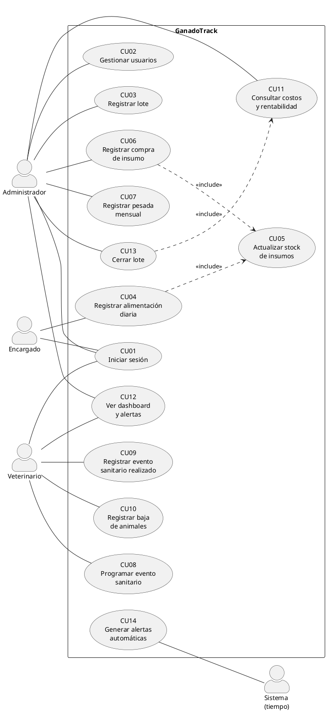

# 13. Casos de uso

## 13.1 Actores

| Actor | Tipo | Descripción | Permisos |
|---|---|---|---|
| Administrador (productor) | Primario | Dueño del establecimiento; toma las decisiones productivas y comerciales | Acceso completo a todos los módulos |
| Encargado | Primario | Empleado que prepara y entrega la ración diaria | Solo registro de alimentación diaria |
| Veterinario | Primario | Profesional de cabecera; define el plan sanitario | Solo módulo de sanidad (eventos, tratamientos, bajas) y alertas sanitarias |
| Sistema (tiempo) | Secundario | Proceso automático que evalúa fechas, stock y GDP | Genera alertas |

## 13.2 Lista de casos de uso

| ID | Caso de uso | Actor principal | RF |
|---|---|---|---|
| CU01 | Iniciar sesión | Administrador, Encargado, Veterinario | RF08 |
| CU02 | Gestionar usuarios | Administrador | RF08 |
| CU03 | Registrar lote | Administrador | RF01 |
| CU04 | Registrar alimentación diaria | Encargado | RF02, RF03 |
| CU05 | Actualizar stock de insumos («include») | — | RF03 |
| CU06 | Registrar compra de insumo | Administrador | RF03 |
| CU07 | Registrar pesada mensual | Administrador | RF04 |
| CU08 | Programar evento sanitario | Veterinario | RF05 |
| CU09 | Registrar evento sanitario realizado | Veterinario | RF05 |
| CU10 | Registrar baja de animales | Veterinario | RF05 |
| CU11 | Consultar costos y rentabilidad del lote | Administrador | RF06 |
| CU12 | Ver dashboard y alertas | Administrador | RF07 |
| CU13 | Cerrar lote | Administrador | RF01, RF07 |
| CU14 | Generar alertas automáticas | Sistema | RF03, RF04, RF05 |

## 13.3 Diagrama de casos de uso

Código PlantUML. Para obtener la imagen, pegarlo en <https://www.plantuml.com/plantuml/uml> y descargar el PNG, o usar la extensión *PlantUML* de VS Code.

> Nota: el veterinario accede a CU12 solo para ver las alertas **sanitarias** (restricción RF08).

---

## 13.4 Fichas de casos de uso

### CU01 – Iniciar sesión
| Campo | Descripción |
|---|---|
| Actores | Administrador, Encargado, Veterinario |
| Precondición | El usuario existe y está activo. |
| Postcondición | El usuario queda autenticado por 8 h y accede a la pantalla de su rol. |
| Flujo principal | 1. El usuario ingresa email y contraseña. 2. El sistema valida las credenciales. 3. El sistema inicia la sesión. 4. El sistema muestra la pantalla de inicio según el rol: Administrador → Dashboard; Encargado → Cargar alimentación; Veterinario → Sanidad. |
| Flujo alternativo | 3a. La sesión expira tras 8 h sin actividad → el sistema solicita volver a ingresar. |
| Excepción | 2a. Credenciales incorrectas o usuario inactivo → mensaje "Email o contraseña incorrectos"; no se indica cuál de los dos falló. |

### CU02 – Gestionar usuarios
| Campo | Descripción |
|---|---|
| Actor | Administrador |
| Precondición | Sesión iniciada como Administrador. |
| Postcondición | El usuario queda creado, modificado o desactivado. |
| Flujo principal | 1. El administrador abre "Usuarios". 2. Selecciona "Nuevo usuario". 3. Ingresa nombre, email, rol y contraseña inicial. 4. Confirma. 5. El sistema guarda la contraseña hasheada y muestra el usuario en la lista. |
| Flujo alternativo | 2a. Edita un usuario existente (nombre, rol) o lo desactiva. Un usuario desactivado no puede iniciar sesión. |
| Excepción | 4a. El email ya existe → "Ya existe un usuario con ese email". 4b. El administrador intenta desactivarse a sí mismo → el sistema lo impide. |

### CU03 – Registrar lote
| Campo | Descripción |
|---|---|
| Actor | Administrador |
| Precondición | Sesión iniciada como Administrador. |
| Postcondición | El lote queda en estado ACTIVO y aparece en el dashboard. |
| Flujo principal | 1. El administrador selecciona "Nuevo lote". 2. Ingresa nombre, fecha de ingreso, cantidad de animales, peso promedio de entrada, peso objetivo y GDP objetivo. 3. Confirma. 4. El sistema valida los datos y crea el lote. 5. El sistema muestra el detalle del lote con 0 días en feedlot. |
| Flujo alternativo | 2a. El administrador programa en el mismo momento el calendario sanitario inicial (deriva a CU08). |
| Excepción | 4a. El nombre ya existe → error. 4b. El peso objetivo es menor o igual al de entrada, la cantidad es ≤ 0 o la fecha es futura → error de validación; no se guarda. |

### CU04 – Registrar alimentación diaria
| Campo | Descripción |
|---|---|
| Actor | Encargado (también puede hacerlo el Administrador) |
| Precondición | Sesión iniciada. Existe al menos un lote activo. |
| Postcondición | Los registros de alimentación quedan guardados con su costo. El stock de insumos se descuenta (CU05). |
| Flujo principal | 1. El encargado selecciona el lote. 2. Ingresa los kg de suplemento entregados. 3. Ingresa los kg de silaje entregados. 4. Confirma. 5. El sistema calcula el costo del día (kg × precio/kg de cada insumo) y lo suma al acumulado del lote. 6. El sistema descuenta los kg del stock (CU05). 7. El sistema muestra la confirmación con el costo del día. |
| Flujo alternativo | 6a. El stock de un insumo queda por debajo del mínimo → el sistema genera una alerta de stock para el Administrador (CU14). 2a/3a. Si se informa un solo insumo (el otro vacío o en 0), se registra solo ese. |
| Excepción | 4a. Ambos valores están vacíos o en 0 → "Ingresá al menos un valor"; no se guarda. 4b. Ya existe un registro de ese insumo para ese lote en la fecha → "Ya se registró la alimentación de hoy para este lote". 6b. Los kg superan el stock disponible → "Stock insuficiente"; no se guarda nada. |

### CU05 – Actualizar stock de insumos (incluido)
| Campo | Descripción |
|---|---|
| Invocado por | CU04 (descuenta) y CU06 (suma) |
| Precondición | El insumo existe. |
| Postcondición | El stock del insumo queda actualizado en la misma transacción que el registro que lo originó. |
| Flujo principal | 1. El sistema recibe el insumo, la cantidad en kg y la operación (sumar o restar). 2. Actualiza el stock. 3. Si el stock resultante es menor al mínimo, marca la condición de alerta (CU14). |
| Excepción | 2a. Resta mayor al stock disponible → se cancela toda la operación (rollback). |

### CU06 – Registrar compra de insumo
| Campo | Descripción |
|---|---|
| Actor | Administrador |
| Precondición | Sesión iniciada como Administrador. |
| Postcondición | La compra queda registrada, el stock aumenta (CU05) y el precio por kg del insumo se actualiza. |
| Flujo principal | 1. El administrador abre "Insumos". 2. Selecciona el insumo (suplemento o silaje). 3. Ingresa fecha, cantidad en kg y precio total. 4. Confirma. 5. El sistema suma la cantidad al stock (CU05) y actualiza el precio/kg = precio total / cantidad. |
| Flujo alternativo | 3a. Silaje de producción propia: el administrador ingresa el costo estimado por tonelada producida. |
| Excepción | 4a. Cantidad o precio ≤ 0 → error de validación. |

### CU07 – Registrar pesada mensual
| Campo | Descripción |
|---|---|
| Actor | Administrador |
| Precondición | El lote está ACTIVO. |
| Postcondición | La pesada queda guardada, la GDP calculada y la proyección de llegada al objetivo actualizada. |
| Flujo principal | 1. El administrador selecciona el lote. 2. Ingresa la fecha y el peso promedio. 3. El sistema calcula la GDP = (peso actual − peso anterior) / días transcurridos. Si es la primera pesada, el peso anterior es el peso de ingreso. 4. El sistema proyecta la fecha de llegada al peso objetivo. 5. El sistema muestra GDP actual, días restantes y costo acumulado. |
| Flujo alternativo A | 3a. GDP calculada < GDP objetivo del lote → alerta de bajo rendimiento en el dashboard (CU14). |
| Flujo alternativo B | 3b. Peso ≥ peso objetivo → el sistema informa que el lote alcanzó el objetivo y sugiere cerrarlo (CU13). |
| Excepción | 2a. Fecha anterior o igual a la última pesada, o anterior al ingreso → error. 2b. Peso ≤ 0 → error de validación. |

### CU08 – Programar evento sanitario
| Campo | Descripción |
|---|---|
| Actor | Veterinario (también el Administrador) |
| Precondición | El lote está ACTIVO. |
| Postcondición | El evento queda en el calendario sanitario del lote en estado PENDIENTE. |
| Flujo principal | 1. El veterinario selecciona el lote. 2. Selecciona "Programar evento". 3. Ingresa el tipo (vacuna, antiparasitario, tratamiento de garrapata, otro), el nombre, el producto previsto y la fecha programada. 4. Confirma. 5. El sistema agrega el evento al calendario. |
| Excepción | 3a. Fecha programada anterior a hoy → error. |

### CU09 – Registrar evento sanitario realizado
| Campo | Descripción |
|---|---|
| Actor | Veterinario (también el Administrador) |
| Precondición | Sesión iniciada. El lote tiene un evento pendiente, o se registra uno no programado. |
| Postcondición | El evento queda REALIZADO y su costo se suma al acumulado sanitario del lote. |
| Flujo principal | 1. El veterinario selecciona el lote. 2. Selecciona el evento pendiente (o "Nuevo evento no programado"). 3. Ingresa fecha real, producto utilizado, dosis y costo total. 4. Confirma. 5. El sistema marca el evento como realizado y suma el costo al acumulado sanitario. |
| Flujo alternativo A | 3a. El evento es un tratamiento de garrapata → el sistema solicita además la duración del tratamiento (días) y programa automáticamente un nuevo evento de control en fecha real + duración (CU08). |
| Flujo alternativo B | El veterinario necesita registrar muertes → deriva a CU10. |
| Excepción | 3b. No se ingresa el costo → el sistema permite guardarlo en $0 mostrando la advertencia "El costo sanitario del lote quedará subestimado". |

### CU10 – Registrar baja de animales
| Campo | Descripción |
|---|---|
| Actor | Veterinario (también el Administrador) |
| Precondición | El lote está ACTIVO. |
| Postcondición | La baja queda registrada y las cabezas actuales del lote disminuyen. |
| Flujo principal | 1. El veterinario selecciona el lote. 2. Selecciona "Registrar baja". 3. Ingresa fecha, cantidad de animales y causa (enfermedad, accidente, sequía, otra) con una observación opcional. 4. Confirma. 5. El sistema actualiza las cabezas actuales y recalcula los costos por kg. |
| Excepción | 3a. Cantidad mayor a las cabezas actuales del lote o ≤ 0 → error. |

### CU11 – Consultar costos y rentabilidad del lote
| Campo | Descripción |
|---|---|
| Actor | Administrador |
| Precondición | El lote existe. |
| Postcondición | — (consulta) |
| Flujo principal | 1. El administrador abre el detalle del lote, pestaña "Costos". 2. El sistema muestra: costo de alimentación, costo sanitario, costo total, cabezas actuales, kg de carne estimados (peso × cabezas × 57 %), costo por kg de carne y margen bruto estimado. |
| Flujo alternativo | 2a. El precio de venta no está cargado → el sistema muestra los costos y solicita el precio de venta por kg para calcular el margen. El administrador lo ingresa y el sistema recalcula. |
| Excepción | 2b. El lote no tiene pesadas → se usa el peso de ingreso y se indica que el cálculo es preliminar. |

### CU12 – Ver dashboard y alertas
| Campo | Descripción |
|---|---|
| Actor | Administrador (el Veterinario ve solo las alertas sanitarias) |
| Precondición | Sesión iniciada. |
| Postcondición | — (consulta) |
| Flujo principal | 1. El administrador inicia sesión o abre "Dashboard". 2. El sistema muestra, por cada lote activo: días en feedlot, cabezas, peso promedio actual, última GDP, costo acumulado y cantidad de alertas. 3. El sistema muestra el panel de alertas activas (sanitarias, de stock y de GDP) ordenadas por urgencia. 4. El administrador selecciona un lote o una alerta para ver el detalle. |
| Flujo alternativo | 2a. No hay lotes activos → el sistema invita a crear el primero (CU03). |

### CU13 – Cerrar lote
| Campo | Descripción |
|---|---|
| Actor | Administrador |
| Precondición | El lote está ACTIVO. |
| Postcondición | El lote pasa a CERRADO, deja de admitir registros y queda en el historial con su resumen financiero final. |
| Flujo principal | 1. El administrador abre el lote y selecciona "Cerrar lote". 2. Ingresa la fecha de cierre (venta/faena), el peso final promedio y el precio de venta por kg. 3. El sistema muestra el resumen final (CU11): costo total, kg de carne, costo por kg y margen. 4. El administrador confirma. 5. El sistema cierra el lote. |
| Excepción | 2a. Fecha de cierre anterior al ingreso → error. 4a. El lote tiene eventos sanitarios pendientes → advertencia; el administrador puede confirmar igual. |

### CU14 – Generar alertas automáticas
| Campo | Descripción |
|---|---|
| Actor | Sistema |
| Disparador | Cada vez que se consulta el dashboard o las alertas (evaluación en tiempo real sobre los datos). |
| Postcondición | Las alertas vigentes quedan visibles para el rol correspondiente. |
| Flujo principal | 1. El sistema revisa los eventos sanitarios PENDIENTES: si faltan 7 días o menos → alerta "Próximo evento"; si la fecha ya pasó → alerta "Evento vencido". 2. Revisa los insumos: stock < mínimo → alerta de stock. 3. Revisa la última pesada de cada lote activo: GDP < GDP objetivo → alerta de bajo rendimiento. 4. Devuelve las alertas ordenadas por severidad. |
| Nota | Los 7 días de anticipación son un parámetro configurable. |
