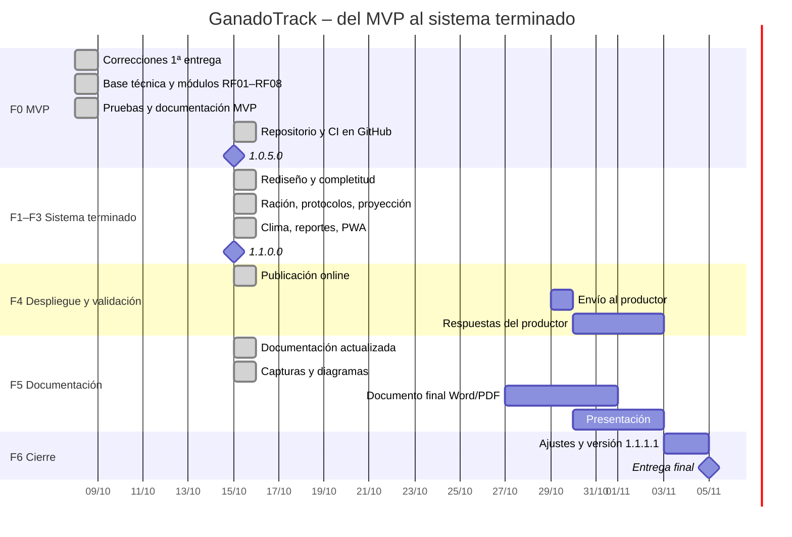

# 14. Cronograma del trabajo

Período de desarrollo: **08/10/2026 al 05/11/2026** (entrega final).
La 1ª entrega (análisis, requerimientos, BPMN y casos de uso) se completó en el primer cuatrimestre de 2026.

El trabajo se organizó en dos etapas:
1. **MVP de la 2ª entrega (08/10):** los 8 requerimientos funcionales originales.
2. **Sistema terminado (15/10):** al ampliarse el plazo al 05/11, el objetivo pasó de MVP a sistema terminado. Se replanificó en fases F0 a F6, con seis funcionalidades nuevas, rediseño visual, publicación online, validación con el productor y los entregables finales.

## 14.1 Fases, hitos y versiones

Las versiones siguen la convención de la cátedra **W.X.Y.Z**: número impar para versión liberada y par para versión de desarrollo (ver sección 16). Cada fase corresponde a un *milestone* de GitHub.

| Fase | Plan | Real | Contenido | Versión |
|---|---|---|---|---|
| F0 – MVP | 08/10 – 16/10 | ✅ 08/10 (repositorio publicado el 15/10) | Base técnica, módulos RF01–RF08, pruebas, documentación de la 2ª entrega | `ganadotrack-1.0.5.0` |
| F1 – Rediseño y completitud | 16/10 – 19/10 | ✅ 15/10 | Estilo "Campo cálido", perfil, corrección de datos, página 404, ajustes de producción | `1.0.7.0` |
| F2 – Gestión | 20/10 – 23/10 | ✅ 15/10 | Ración y carga en 1 toque, protocolos sanitarios, proyección de stock | `1.0.9.0` |
| F3 – Tecnología | 24/10 – 27/10 | ✅ 15/10 | Clima y riesgos, reportes PDF/Excel, PWA con carga sin conexión | `1.1.0.0` |
| F4 – Pruebas, despliegue y validación | 28/10 – 29/10 | 🟡 En curso | Cobertura ✅, CI en GitHub ✅, publicación online ✅ (15/10), prueba en celular ✅, envío al productor (29/10) | `1.1.1.0` (candidata, 15/10) |
| F5 – Documentación y entregables | 30/10 – 03/11 | 🟡 En curso | Documentación actualizada, documento final Word/PDF, presentación | — |
| F6 – Cierre | 04/11 | ⏳ | Ajustes por la validación, versión final y ensayo de la defensa | **`ganadotrack-1.1.1.1`** |
| Entrega final | 05/11 | — | Documento + repositorio + aplicación + presentación | — |

## 14.2 Tareas (issues de GitHub)

| # | Tarea | Fase | Fin previsto | Estado al 15/10 |
|---|---|---|---|---|
| 1 | Correcciones a la 1ª entrega (CU, ER, RF06) | F0 | 09/10 | ✅ Completada |
| 2 | Repositorio, CI y entorno Docker | F0 | 09/10 | ✅ Completada (CI en verde en GitHub) |
| 3 | Modelo de datos, migraciones, vista y trigger | F0 | 10/10 | ✅ Completada |
| 4 | RF08 – Autenticación JWT y control de roles | F0 | 12/10 | ✅ Completada |
| 5–8 | RF01, RF03, RF02, RF04 – Lotes, insumos, alimentación, pesadas | F0 | 19/10 | ✅ Completadas |
| 9–12 | RF05, CU14, RF06, RF07 – Sanidad, alertas, costos, dashboard | F0 | 26/10 | ✅ Completadas |
| 13 | Pruebas automatizadas y E2E | F0 | 29/10 | ✅ Completada |
| 18 | Rediseño visual "Campo cálido" | F1 | 19/10 | ✅ Completada |
| 19 | Completitud: perfil, correcciones, 404, producción | F1 | 19/10 | ✅ Completada |
| 20 | RF09 – Ración por lote y carga en 1 toque | F2 | 23/10 | ✅ Completada |
| 21 | RF10 – Protocolos sanitarios automáticos | F2 | 23/10 | ✅ Completada |
| 22 | RF11 – Proyección de stock | F2 | 23/10 | ✅ Completada |
| 23 | RF12 – Clima y riesgos | F3 | 27/10 | ✅ Completada |
| 24 | RF13 – Reportes PDF y Excel | F3 | 27/10 | ✅ Completada |
| 25 | RF14 – App instalable y modo sin conexión | F3 | 27/10 | ✅ Completada |
| 26 | Preparación de despliegue y validación | F4 | 29/10 | ✅ Completada |
| 16 | Despliegue online | F4 | 29/10 | ✅ Publicado el 15/10 (Vercel + Render + Neon); prueba de humo y prueba en celular |
| 14 | Validación con el productor | F4 | 29/10 – 02/11 | ⏳ Material listo; envío el 29/10 |
| 15 | Documentación y manuales | F5 | 03/11 | 🟡 Actualizada con RF09–RF14 |
| 28 | Capturas y diagramas finales | F5 | 26/10 | ✅ Completada el 15/10 (28 capturas, 8 de GitHub y 9 diagramas) |
| 27 | Documento final en Word y PDF | F5 | 31/10 | ⏳ Pendiente |
| 17 | Presentación final | F5 | 02/11 | ⏳ Pendiente |
| 29 | Versión final `ganadotrack-1.1.1.1` | F6 | 04/11 | ⏳ Pendiente |

> El desarrollo avanzó más rápido que lo planificado: las fases F1 a F3, previstas del 16/10 al 27/10, quedaron implementadas y probadas el 15/10. El tiempo ganado se reasigna a la publicación, la validación con el productor y los entregables. La validación tiene fecha fija porque depende de la disponibilidad del productor.
>
> El historial de Git se ordenó al publicar el repositorio (15/10); por eso los commits del MVP figuran con esa fecha.

## 14.3 Diagrama de Gantt

