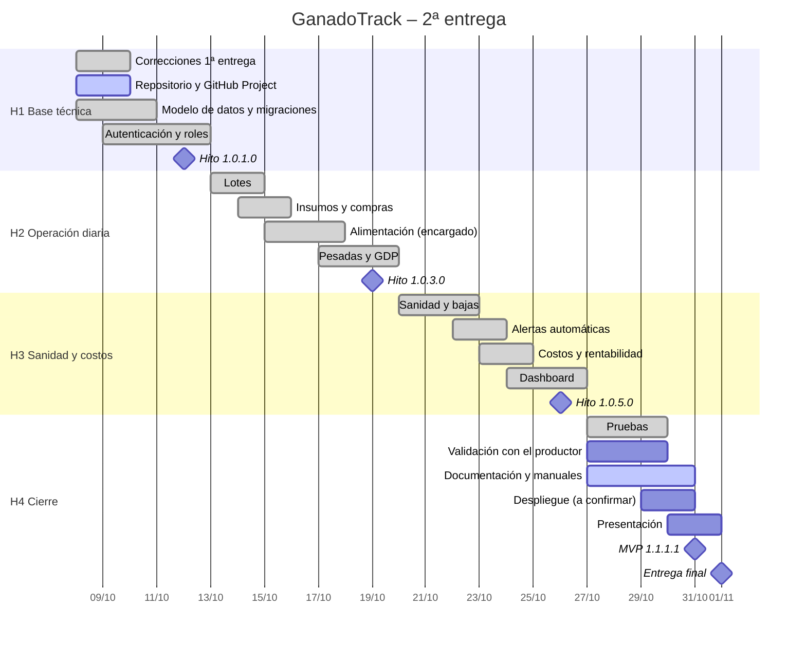

# 14. Cronograma del trabajo

Período de desarrollo de la 2ª entrega: **08/10/2026 al 01/11/2026** (entrega final).
La 1ª entrega (análisis, requerimientos, BPMN y casos de uso) se completó en el primer cuatrimestre de 2026.

## 14.1 Hitos y versiones

Las versiones siguen la convención de la cátedra **W.X.Y.Z**, con número impar para versión liberada y par para versión de desarrollo (ver sección 16).

| Hito | Fecha | Entregable | Versión |
|---|---|---|---|
| H1 – Base técnica | 12/10/2026 | Repositorio, base de datos, autenticación y roles, correcciones de la 1ª entrega | 1.0.1.0 |
| H2 – Operación diaria | 19/10/2026 | Lotes, insumos, alimentación con stock, pesadas con GDP | 1.0.3.0 |
| H3 – Sanidad y costos | 26/10/2026 | Sanidad con alertas, bajas, costos, dashboard | 1.0.5.0 |
| H4 – MVP liberado | 31/10/2026 | Pruebas, documentación completa, manuales | **1.1.1.1** |
| Entrega final | 01/11/2026 | Documento + repositorio + presentación | — |

## 14.2 Tareas

| # | Tarea | Inicio | Fin | Hito | Estado al 08/10 |
|---|---|---|---|---|---|
| 1 | Correcciones a la 1ª entrega (CU, ER, RF06) | 08/10 | 09/10 | H1 | ✅ Completada |
| 2 | Repositorio, GitHub Project, issues y ramas | 08/10 | 09/10 | H1 | 🟡 Repo local listo; falta publicarlo en GitHub |
| 3 | Modelo de datos, migraciones, vista y trigger | 08/10 | 10/10 | H1 | ✅ Completada |
| 4 | Autenticación JWT y control de roles | 09/10 | 12/10 | H1 | ✅ Completada |
| 5 | Módulo lotes (RF01) | 13/10 | 14/10 | H2 | ✅ Completada |
| 6 | Módulo insumos y compras (RF03) | 14/10 | 15/10 | H2 | ✅ Completada |
| 7 | Alimentación diaria + pantalla del encargado (RF02) | 15/10 | 17/10 | H2 | ✅ Completada |
| 8 | Pesadas, GDP y proyección (RF04) | 17/10 | 19/10 | H2 | ✅ Completada |
| 9 | Sanidad: calendario, eventos, garrapata, bajas (RF05) | 20/10 | 22/10 | H3 | ✅ Completada |
| 10 | Alertas automáticas (CU14) | 22/10 | 23/10 | H3 | ✅ Completada |
| 11 | Costos y rentabilidad (RF06) | 23/10 | 24/10 | H3 | ✅ Completada |
| 12 | Dashboard (RF07) | 24/10 | 26/10 | H3 | ✅ Completada |
| 13 | Pruebas automatizadas y E2E | 27/10 | 29/10 | H4 | ✅ Completada (58 + E2E) |
| 14 | Validación con el productor (aceptación) | 27/10 | 29/10 | H4 | ⏳ Pendiente |
| 15 | Documentación: arquitectura, datos, API, manuales | 27/10 | 30/10 | H4 | 🟡 Borrador completo; falta pasarla al Word |
| 16 | Despliegue online (si la cátedra lo solicita) | 29/10 | 30/10 | H4 | ⏳ A confirmar con la docente |
| 17 | Presentación final | 30/10 | 31/10 | H4 | ⏳ Pendiente |

> El desarrollo avanzó más rápido que lo planificado: las tareas 3 a 13 quedaron implementadas y probadas en la primera semana. El tiempo restante se reasigna a la validación con el productor, el despliegue, la documentación y la presentación.

## 14.3 Diagrama de Gantt

