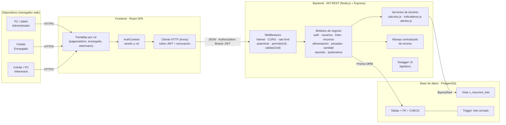
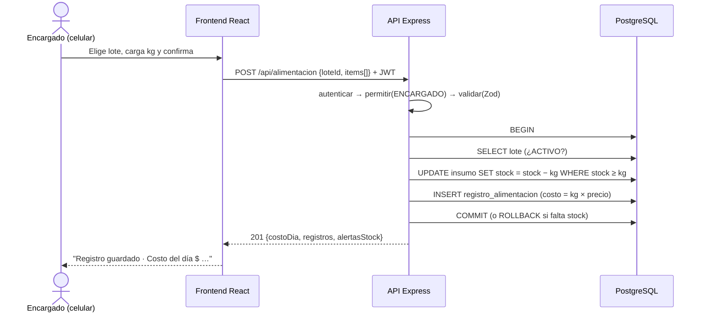
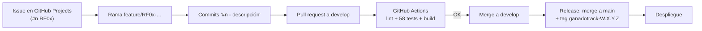

# 15. Arquitectura y herramientas de desarrollo

## 15.1 Tipo de arquitectura

GanadoTrack utiliza una **arquitectura cliente-servidor en tres capas**, con el frontend como **aplicación de una sola página (SPA)** y el backend como **API REST organizada en capas y por módulos de negocio**:

1. **Capa de presentación:** aplicación web React que se ejecuta en el navegador (PC, tablet o celular).
2. **Capa de lógica de negocio:** API REST en Node.js/Express, que valida, aplica las reglas del feedlot y calcula los indicadores.
3. **Capa de datos:** base de datos relacional PostgreSQL, a la que se accede mediante el ORM Prisma.

### Justificación

| Necesidad del caso | Cómo la resuelve la arquitectura |
|---|---|
| Tres tipos de usuario con dispositivos distintos: el encargado usa el celular en el campo; el productor, PC o tablet (RNF01) | Una sola aplicación web responsive sirve a todos los dispositivos, sin instalar nada ni mantener apps nativas |
| Conexión por Starlink y señal de celular (RNF02) | La SPA descarga la interfaz una vez y después solo intercambia JSON liviano con la API |
| Reglas de negocio críticas: costo por kg, GDP, alertas sanitarias | Se centralizan en el backend: ningún cliente puede saltearlas y se prueban con tests automatizados |
| Restricción estricta por rol (RNF04, RF08) | La autorización se verifica en el servidor en cada petición, no solo ocultando botones en la interfaz |
| Datos relacionados entre sí (lote → pesadas, alimentación, eventos, bajas) e integridad de costos | Una base relacional con claves foráneas, restricciones CHECK y transacciones garantiza la consistencia |
| Crecimiento futuro: ciclo completo, caravanas, SENASA (RNF05) | Cada área es un módulo independiente; agregar un módulo nuevo no requiere modificar los existentes |
| Proyecto de una sola persona con plazo acotado | Un único lenguaje (JavaScript) en frontend y backend reduce la curva de aprendizaje y el cambio de contexto |

Se descartaron otras alternativas:
- **Microservicios:** agregan complejidad operativa (varios despliegues, comunicación entre servicios) que no se justifica para un establecimiento con un solo productor.
- **Aplicación monolítica con vistas generadas en el servidor:** acopla la interfaz a la lógica y dificulta una experiencia móvil fluida.

## 15.2 Diagrama de arquitectura



> Para la entrega en Word: pegar el bloque en <https://mermaid.live> y exportar como PNG (Figura "Arquitectura de GanadoTrack").

## 15.3 Capas y componentes del backend

Cada módulo de `backend/src/modules/` tiene la misma estructura, con una responsabilidad por archivo:

| Archivo | Responsabilidad | Ejemplo (módulo alimentación) |
|---|---|---|
| `*.routes.js` | Define las rutas HTTP, los roles permitidos y el esquema de validación | `POST /alimentacion` → `permitir('ENCARGADO','ADMIN')` → `validar(...)` |
| `*.schema.js` | Reglas de validación de los datos de entrada (Zod) | `kg` ≥ 0, al menos un insumo con kg > 0, sin insumos repetidos |
| `*.controller.js` | Traduce HTTP ↔ servicio: lee `req` y responde con el código adecuado | Responde `201` con el resultado |
| `*.service.js` | Lógica de negocio y acceso a datos | Transacción: valida lote, descuenta stock, calcula costo, guarda |

Los **servicios de dominio** compartidos son:
- `services/calculos.js`: funciones puras (GDP, proyección, kg de carne al gancho, costo por kg, margen), documentadas y cubiertas con tests unitarios (RNF06).
- `services/indicadores.js`: combina la vista SQL `v_resumen_lote` con los cálculos para obtener los indicadores de cada lote.
- `services/alertas.js`: genera las alertas sanitarias, de stock y de GDP (CU14).

## 15.4 Comunicación entre frontend, backend y base de datos



- **Protocolo:** HTTP/HTTPS con cuerpos JSON. Las fechas viajan como `AAAA-MM-DD` y los importes como números.
- **Acceso a datos:** Prisma traduce las operaciones a SQL parametrizado (previene inyección SQL). Las consultas agregadas usan la vista `v_resumen_lote` mediante `$queryRaw` con parámetros.
- **Transacciones:** las operaciones que modifican varias tablas (alimentación + stock, compra + stock, evento de garrapata + nuevo control, baja + validación de cabezas) se ejecutan en una única transacción. O se guarda todo o no se guarda nada.

## 15.5 Diseño de la API

API REST con prefijo `/api`, recursos en plural, verbos HTTP estándar y códigos de estado semánticos. El detalle completo está en [api.md](api.md) y en Swagger UI (`/api/docs`).

| Recurso | Operaciones | Roles |
|---|---|---|
| `/auth` | `POST /login`, `GET /me` | Público / autenticado |
| `/usuarios` | listar, crear, modificar | ADMIN |
| `/lotes` | listar, crear, detalle, editar, `POST /:id/cierre` | ADMIN |
| `/insumos` | listar, configurar, compras | ADMIN |
| `/alimentacion` | `GET /opciones`, registrar, historial, eliminar | ENCARGADO (registrar), ADMIN |
| `/pesadas` | listar, registrar | ADMIN |
| `/sanidad` | eventos (programar, realizar, no programado), bajas | VETERINARIO, ADMIN |
| `/dashboard`, `/costos/:id`, `/alertas` | consultas | ADMIN (alertas también VETERINARIO) |
| `/parametros` | consultar, modificar | ADMIN |

## 15.6 Autenticación y autorización

- **Autenticación:** el usuario envía email y contraseña a `POST /api/auth/login`. La contraseña se compara con el hash **bcrypt** guardado (RNF04) y, si es correcta, la API emite un **token JWT** firmado (HS256) que incluye el id y el rol del usuario.
- **Expiración por inactividad (RNF04):** el token vence a las **8 horas**. Mientras el usuario sigue trabajando, cada respuesta incluye un token renovado (encabezado `X-Token-Renovado`) que el frontend guarda automáticamente. Si pasan 8 horas sin actividad, el token vence y el sistema pide iniciar sesión nuevamente.
- **Autorización por rol (RBAC, RF08):** cada ruta declara los roles permitidos con el middleware `permitir(...)`. El frontend también oculta las opciones no permitidas, pero la restricción real está en el servidor: un encargado que intente llamar a `/api/lotes` recibe `403`.
- **Usuario desactivado:** en cada petición se verifica que el usuario siga activo, de modo que desactivarlo corta el acceso de inmediato aunque tenga un token vigente.

## 15.7 Consideraciones de seguridad

| Riesgo | Medida aplicada |
|---|---|
| Robo de contraseñas desde la base | Hash bcrypt (10 rondas); nunca se devuelven en la API |
| Fuerza bruta en el login | Límite de 20 intentos cada 15 minutos por IP (`express-rate-limit`); mensaje genérico que no revela si el email existe |
| Acceso indebido entre roles | RBAC en el servidor en cada ruta; pruebas automáticas CP-05 a CP-08 |
| Inyección SQL | Consultas parametrizadas de Prisma; `$queryRaw` con plantillas parametrizadas |
| Datos inválidos o maliciosos | Validación de todo dato de entrada con Zod; límite de 100 kB por petición |
| Cabeceras HTTP inseguras | `helmet` (CSP, X-Frame-Options, HSTS, etc.) |
| Peticiones desde otros sitios | CORS restringido al origen del frontend |
| Exposición de credenciales | Secretos en variables de entorno (`.env`, excluido de Git); `.env.example` sin valores reales |
| Intercepción de datos en tránsito | HTTPS obligatorio en producción, provisto por la plataforma de despliegue (RNF04) |
| Integridad ante errores de la aplicación | Restricciones CHECK, claves foráneas y trigger en la base de datos como segunda barrera |

## 15.8 Manejo de errores y validación de datos

- **Validación en dos niveles:**
  1. En el **frontend**, campos obligatorios y tipos de entrada numéricos, como ayuda al usuario.
  2. En el **backend**, con esquemas Zod. Es la validación que realmente cuenta.

  Las reglas de negocio que dependen de los datos guardados se validan en los servicios: stock suficiente, fecha posterior a la última pesada, cantidad de bajas ≤ cabezas actuales, lote activo.
- **Errores tipados:** los servicios lanzan `AppError(status, mensaje)` y un middleware central (`manejarErrores.js`) los transforma en respuestas uniformes:

  ```json
  { "error": "Datos inválidos",
    "detalles": [{ "campo": "pesoObjetivo", "mensaje": "El peso objetivo debe ser mayor al peso de ingreso" }] }
  ```

| Código | Cuándo |
|---|---|
| 400 | Datos inválidos o regla de negocio violada (fecha futura, baja mayor a las cabezas) |
| 401 | Sin sesión, token vencido o usuario desactivado |
| 403 | El rol no tiene permiso |
| 404 | Recurso inexistente |
| 409 | Conflicto: stock insuficiente, registro duplicado, lote cerrado |
| 500 | Error inesperado (se registra en el log del servidor; al cliente se le muestra un mensaje genérico) |

- **En la interfaz:** el texto del error se muestra junto al formulario. Si se pierde la conexión, se informa "No se pudo conectar con el servidor", y si la sesión expira, se redirige al login.

## 15.9 Escalabilidad y mantenimiento

- **Nuevos módulos (RNF05):** agregar, por ejemplo, el módulo "cría" o "identificación por caravana" implica crear una carpeta en `modules/`, sus modelos en `schema.prisma` y una migración. Los módulos existentes no se modifican.
- **Crecimiento de datos:** índices en las columnas de búsqueda frecuente (`lote.estado`, `registro_alimentacion(lote_id, fecha)`, `evento_sanitario(estado, fecha_programada)`). Con ~5 lotes activos y 2 registros diarios, el volumen anual ronda los 4.000 registros, muy por debajo de la capacidad de PostgreSQL.
- **Rendimiento (RNF03):** el dashboard se resuelve con una única consulta agregada a la vista SQL. Medido en el recorrido de prueba: **≈ 1 s** de carga completa y **≈ 130 ms** para confirmar una carga de alimentación. Ambos valores están dentro de lo exigido (3 s y 2 s, respectivamente). El frontend divide el código por pantalla (*lazy loading*), así el encargado descarga solo su pantalla (~180 kB comprimidos en total).
- **Escalado horizontal:** la API no guarda estado de sesión (JWT), por lo que pueden ejecutarse varias instancias detrás de un balanceador si fuera necesario.
- **Mantenibilidad (RNF06):**
  - Estructura de carpetas estándar.
  - Funciones de cálculo comentadas.
  - ESLint y Prettier.
  - Pruebas automatizadas que se ejecutan en cada cambio (CI).
  - Migraciones versionadas.

## 15.10 Atributos de calidad

| Atributo | Objetivo | Cómo lo logra la arquitectura | Verificación |
|---|---|---|---|
| Seguridad | Acceso restringido por rol, credenciales protegidas | JWT + RBAC en el servidor, bcrypt, helmet, rate limit, validación | CP-01 a CP-09 |
| Integridad de datos | Costos y stock siempre consistentes | Transacciones, FK, CHECK, trigger, unicidad por lote/insumo/día | CP-13, CP-14, CP-37 |
| Usabilidad | Encargado: ≤ 3 clics desde el login, uso en el celular | Pantalla única por rol, diseño responsive (MUI), botones grandes | Recorrido E2E en 390 px |
| Rendimiento | Dashboard < 3 s, registro < 2 s | Vista agregada, índices, *code splitting* | Medición E2E: 1 s / 0,13 s |
| Mantenibilidad | Fácil de modificar y extender | Módulos con capas, funciones puras documentadas, ESLint, CI | 58 pruebas automáticas |
| Disponibilidad | ≥ 95 % | API sin estado, despliegue en plataforma gestionada | Monitoreo de la plataforma |
| Escalabilidad | Agregar módulos sin rediseño | Modularidad por dominio, migraciones incrementales | — |

## 15.11 Herramientas y tecnologías

| Tecnología | Finalidad en el proyecto | Justificación de la elección | Componente | Beneficios |
|---|---|---|---|---|
| **React 19** | Construir la interfaz de usuario | Biblioteca de UI más difundida, basada en componentes reutilizables; mucha documentación y comunidad | Frontend | Reutilización de componentes (diálogos, tarjetas), interfaz reactiva sin recargar la página |
| **Vite** | Servidor de desarrollo y empaquetado | Arranque e inicio casi instantáneos; configuración mínima | Frontend | Recarga en caliente, *build* optimizado con división de código |
| **Material UI (MUI) 7** | Componentes visuales y diseño responsive | Componentes accesibles y probados (formularios, tablas, diálogos); sistema de grillas para celular | Frontend | Interfaz profesional y consistente sin diseñar cada componente desde cero |
| **React Router** | Navegación entre pantallas | Estándar de facto para SPA en React | Frontend | Rutas protegidas por rol |
| **Axios** | Comunicación HTTP con la API | Interceptores para agregar el token y renovarlo automáticamente | Frontend | Manejo centralizado de sesión y errores |
| **Recharts** | Gráfico de evolución de peso | Gráficos declarativos en React, livianos | Frontend | Visualización de la GDP frente al objetivo |
| **Node.js** | Entorno de ejecución del backend | Mismo lenguaje (JavaScript) que el frontend; ideal para APIs de E/S | Backend | Un solo lenguaje en todo el proyecto |
| **Express 5** | Framework de la API REST | Minimalista y muy documentado; v5 maneja errores asíncronos automáticamente | Backend | Middlewares para seguridad, validación y errores |
| **Zod** | Validación de datos de entrada | Esquemas declarativos con mensajes en español | Backend | Datos garantizados antes de llegar a la lógica de negocio |
| **jsonwebtoken + bcryptjs** | Autenticación y hash de contraseñas | Estándares de la industria (JWT, bcrypt) exigidos por RNF04 | Backend | Sesiones sin estado, contraseñas protegidas |
| **helmet, cors, express-rate-limit** | Seguridad HTTP | Mitigan ataques comunes con configuración mínima | Backend | Cumplimiento de buenas prácticas OWASP |
| **PostgreSQL 17** | Persistencia de datos | Base relacional robusta y gratuita; soporta CHECK, vistas, triggers y transacciones | Base de datos | Integridad y consistencia de la información |
| **Prisma ORM 6** | Acceso a datos y migraciones | Define el modelo en un archivo, genera las migraciones SQL versionadas y consultas seguras | Backend / BD | Menos código repetido, esquema versionado en Git, prevención de inyección SQL |
| **Docker / Docker Compose** | Ejecutar PostgreSQL en desarrollo | Misma base de datos en cualquier PC con un solo comando | Infraestructura | Entorno reproducible, sin instalar Postgres manualmente |
| **Git + GitHub** | Control de versiones | Estándar de la industria; ramas, *pull requests*, *tags* de versión | Todo el proyecto | Historial de cambios, trazabilidad commit ↔ issue |
| **GitHub Projects** | Gestión y seguimiento de tareas | Integrado con el repositorio: issues, tablero Kanban, *milestones* | Gestión | Trazabilidad requisito → tarea → commit (ver sección 16) |
| **Vitest + Supertest** | Pruebas unitarias y de integración | Rápido, compatible con módulos ES; Supertest prueba la API real contra una base de pruebas | Backend | 58 pruebas automáticas que verifican los RF |
| **Playwright** | Pruebas end-to-end en el navegador | Automatiza el recorrido completo con los tres roles y genera capturas | Frontend + Backend | Verificación de la integración completa y del diseño responsive |
| **ESLint + Prettier** | Calidad y formato del código | Detectan errores y unifican el estilo | Todo el código | Código legible y homogéneo |
| **GitHub Actions** | Integración continua | Ejecuta lint, pruebas y *build* en cada *push* | Repositorio | Detecta errores antes de integrarlos a `main` |
| **Swagger UI (OpenAPI 3)** | Documentación de la API | Estándar para describir APIs REST; permite probar los endpoints desde el navegador | Backend | API autodocumentada en `/api/docs` |
| **Markdown + Mermaid** | Documentación del proyecto y diagramas | Texto plano versionable junto al código; diagramas como código | Documentación | Documentación siempre sincronizada con el sistema |
| **VS Code** | Entorno de desarrollo | Extensiones para JavaScript, Prisma, ESLint y Git | Desarrollo | Productividad |
| **Vercel / Render / Neon** *(opcional)* | Despliegue del frontend, la API y la base de datos | Planes gratuitos, HTTPS automático, despliegue desde GitHub | Producción | Acceso desde el campo por internet (pendiente de confirmar con la cátedra) |

### Integración de las herramientas en el proceso de desarrollo


