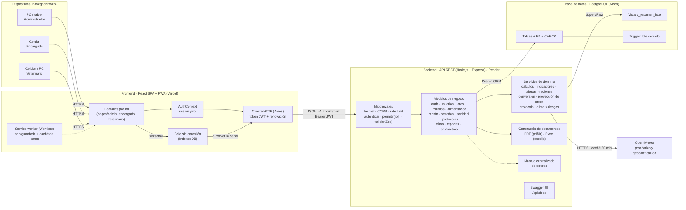
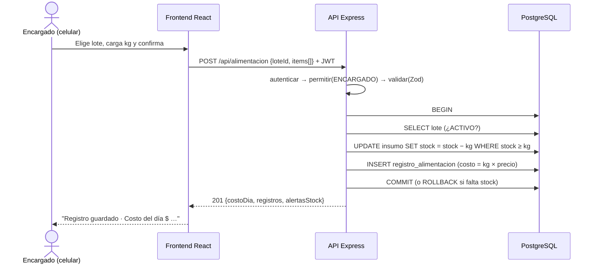
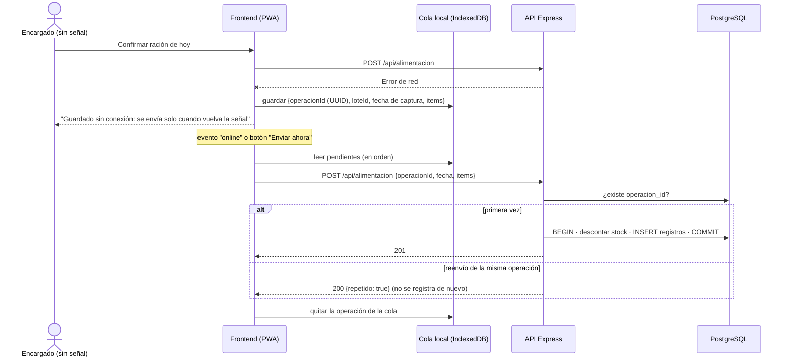
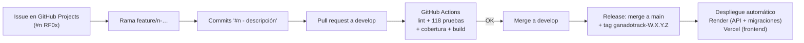
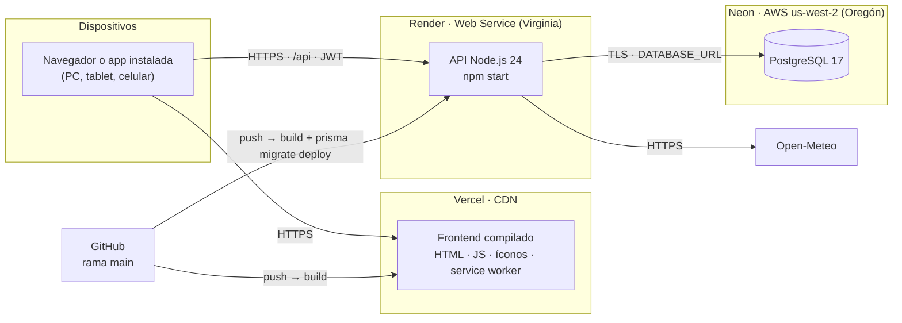

# 15. Arquitectura y herramientas de desarrollo

## 15.1 Tipo de arquitectura

GanadoTrack utiliza una **arquitectura cliente-servidor en tres capas**, con el frontend como **aplicación de una sola página (SPA)** y el backend como **API REST organizada en capas y por módulos de negocio**:

1. **Capa de presentación:** aplicación web React que se ejecuta en el navegador (PC, tablet o celular).
2. **Capa de lógica de negocio:** API REST en Node.js/Express, que valida, aplica las reglas del feedlot y calcula los indicadores.
3. **Capa de datos:** base de datos relacional PostgreSQL, a la que se accede mediante el ORM Prisma.

### Justificación

| Necesidad del caso | Cómo la resuelve la arquitectura |
|---|---|
| Tres tipos de usuario con dispositivos distintos: el encargado usa el celular en el campo; el productor, PC o tablet (RNF01) | Una sola aplicación web responsive sirve a todos los dispositivos, sin instalar nada ni mantener apps nativas |
| Conexión por Starlink y señal de celular (RNF02) | La SPA descarga la interfaz una vez y después solo intercambia JSON liviano con la API |
| Corrales sin señal (RF14, RNF07) | La SPA es además una **PWA**: un *service worker* guarda la aplicación en el teléfono, y las cargas de alimentación sin conexión quedan en una cola local (IndexedDB) que se envía sola al volver la señal |
| Datos externos poco confiables (clima) | La API actúa como intermediaria (*proxy*) del servicio de clima, con caché y tiempo de espera; si el servicio falla, el sistema sigue funcionando |
| Reglas de negocio críticas: costo por kg, GDP, alertas sanitarias | Se centralizan en el backend: ningún cliente puede saltearlas y se prueban con tests automatizados |
| Restricción estricta por rol (RNF04, RF08) | La autorización se verifica en el servidor en cada petición, no solo ocultando botones en la interfaz |
| Datos relacionados entre sí (lote → pesadas, alimentación, eventos, bajas) e integridad de costos | Una base relacional con claves foráneas, restricciones CHECK y transacciones garantiza la consistencia |
| Crecimiento futuro: ciclo completo, caravanas, SENASA (RNF05) | Cada área es un módulo independiente; agregar un módulo nuevo no requiere modificar los existentes |
| Proyecto de una sola persona con plazo acotado | Un único lenguaje (JavaScript) en frontend y backend reduce la curva de aprendizaje y el cambio de contexto |

Se descartaron otras alternativas:
- **Microservicios:** agregan complejidad operativa (varios despliegues, comunicación entre servicios) que no se justifica para un establecimiento con un solo productor.
- **Aplicación monolítica con vistas generadas en el servidor:** acopla la interfaz a la lógica y dificulta una experiencia móvil fluida.

## 15.2 Diagrama de arquitectura



> Para la entrega en Word, la figura se genera como PNG con `docs/herramientas/render-diagramas.mjs` (Figura "Arquitectura de GanadoTrack").

## 15.3 Capas y componentes del backend

Cada módulo de `backend/src/modules/` tiene la misma estructura, con una responsabilidad por archivo:

| Archivo | Responsabilidad | Ejemplo (módulo alimentación) |
|---|---|---|
| `*.routes.js` | Define las rutas HTTP, los roles permitidos y el esquema de validación | `POST /alimentacion` → `permitir('ENCARGADO','ADMIN')` → `validar(...)` |
| `*.schema.js` | Reglas de validación de los datos de entrada (Zod) | `kg` ≥ 0, al menos un insumo con kg > 0, sin insumos repetidos |
| `*.controller.js` | Traduce HTTP ↔ servicio: lee `req` y responde con el código adecuado | Responde `201` con el resultado |
| `*.service.js` | Lógica de negocio y acceso a datos | Transacción: valida lote, descuenta stock, calcula costo, guarda |

Los **servicios de dominio** compartidos son:

| Servicio | Responsabilidad |
|---|---|
| `calculos.js` | Funciones puras documentadas y cubiertas con pruebas unitarias (RNF06): GDP, proyección al objetivo, kg de carne al gancho, costo por kg, margen, kg sugeridos de la ración, materia seca, conversión alimenticia, días de cobertura, compra sugerida y stock proyectado |
| `indicadores.js` | Combina la vista SQL `v_resumen_lote` con los cálculos para obtener los indicadores de cada lote |
| `alertas.js` | Genera las alertas sanitarias, de stock, de stock proyectado, de GDP y de clima, filtradas por rol (CU14) |
| `raciones.js` | Ración vigente de cada lote a una fecha y kg del día según las cabezas actuales (RF09) |
| `conversion.js` | Conversión alimenticia del lote entre pesadas y acumulada (RF09) |
| `proyeccionStock.js` | Consumo previsto, cobertura, fecha de quiebre y compra sugerida de cada insumo (RF11) |
| `protocolo.js` | Planifica las fechas de los eventos de un protocolo y los crea dentro de la transacción del lote (RF10) |
| `clima.js` y `riesgosClima.js` | Consulta a Open-Meteo con caché de 30 minutos y tiempo de espera de 8 s; cálculo puro del ITH y de los riesgos de garrapata y sequía (RF12) |
| `parametros.js` | Lectura de los parámetros configurables con sus valores por defecto |

El módulo `reportes/` incluye además `pdf.js`, con los bloques reutilizables del PDF (encabezado con el logo, secciones, tablas, indicadores y gráfico de línea), y `documentos.js`, que arma el informe de lote, el reporte mensual y la planilla Excel.

### Frontend

| Carpeta | Responsabilidad |
|---|---|
| `pages/` | Una pantalla por función, agrupadas por rol (14 pantallas, cargadas bajo demanda) |
| `components/` | Layout con menú por rol, componentes comunes (indicadores, estados vacíos, diálogos de confirmación), ilustraciones SVG propias y panel de clima |
| `api/` y `context/` | Cliente HTTP con el token y su renovación; sesión del usuario (guardada para abrir la app sin conexión) |
| `offline/` | Cola de cargas sin conexión en IndexedDB, detección de conexión y botón de instalación |
| `theme.js` | Tema "Campo cálido": paleta del logo, tipografías Bitter y Nunito Sans, formas y estados |

## 15.4 Comunicación entre frontend, backend y base de datos



- **Protocolo:** HTTP/HTTPS con cuerpos JSON. Las fechas viajan como `AAAA-MM-DD` y los importes como números.
- **Acceso a datos:** Prisma traduce las operaciones a SQL parametrizado (previene inyección SQL). Las consultas agregadas usan la vista `v_resumen_lote` mediante `$queryRaw` con parámetros.
- **Transacciones:** las operaciones que modifican varias tablas se ejecutan en una única transacción: o se guarda todo o no se guarda nada. Son las siguientes:
  - Alimentación + stock.
  - Compra o corrección de compra + stock.
  - Evento de garrapata + nuevo control.
  - Baja + validación de cabezas.
  - Lote + eventos del protocolo.
  - Cambio del protocolo por defecto.

### Carga sin conexión y sincronización (RF14)



- **Idempotencia:** el celular genera un identificador único (UUID) por carga. La base tiene un índice único (`operacion_id`, `insumo_id`), así que, aunque la misma carga llegue dos veces (por ejemplo, porque se cortó la señal durante el envío), se registra una sola vez.
- **Fecha de captura:** la carga se registra con la fecha en que se hizo en el corral, no con la del envío.
- **Errores de negocio:** si el servidor rechaza la carga (por ejemplo, por stock insuficiente), queda marcada con el motivo para que el encargado la descarte y avise al administrador. No se reintenta indefinidamente.
- **Service worker:** guarda la aplicación (*app shell*, fuentes e íconos, ≈ 1,9 MB) y aplica la estrategia *NetworkFirst* a las consultas que necesita el encargado: lotes y ración del día (`/alimentacion/opciones`), usuario (`/auth/me`) y clima. Si hay red, usa siempre datos frescos; si no, usa los últimos guardados.

## 15.5 Diseño de la API

API REST con prefijo `/api`, recursos en plural, verbos HTTP estándar y códigos de estado semánticos. El detalle completo está en [api.md](api.md) y en Swagger UI (`/api/docs`).

| Recurso | Operaciones | Roles |
|---|---|---|
| `/auth` | `POST /login`, `GET /me`, `PATCH /perfil`, `PATCH /password` | Público / autenticado |
| `/usuarios` | listar, crear, modificar | ADMIN |
| `/lotes` | listar, crear (con protocolo), detalle, editar, `POST /:id/cierre` | ADMIN |
| `/raciones`, `/lotes/:id/racion` | raciones de los lotes activos; consultar y definir la ración de un lote | VETERINARIO, ADMIN |
| `/protocolos`, `/lotes/:id/aplicar-protocolo` | CRUD de protocolos; aplicar uno a un lote | VETERINARIO, ADMIN |
| `/insumos` | listar con proyección, configurar, compras y corrección de compras | ADMIN |
| `/alimentacion` | `GET /opciones` (con ración sugerida), registrar (idempotente), historial, eliminar | ENCARGADO (registrar), ADMIN |
| `/pesadas` | listar (con conversión), registrar, eliminar la última | ADMIN |
| `/sanidad` | eventos (programar, realizar, no programado, reprogramar), bajas | VETERINARIO, ADMIN (eliminar baja: solo ADMIN) |
| `/clima` | clima y riesgos; consultar, buscar y guardar la ubicación | Todos (ubicación: ADMIN) |
| `/dashboard`, `/costos/:id`, `/alertas` | consultas | ADMIN (alertas también VETERINARIO) |
| `/reportes` | informe de lote (PDF), reporte mensual (PDF), planilla (Excel) | ADMIN |
| `/parametros` | consultar, modificar | ADMIN |

En total: **54 operaciones** sobre **41 rutas**, todas documentadas en OpenAPI.

## 15.6 Autenticación y autorización

- **Autenticación:** el usuario envía email y contraseña a `POST /api/auth/login`. La contraseña se compara con el hash **bcrypt** guardado (RNF04) y, si es correcta, la API emite un **token JWT** firmado (HS256) que incluye el id y el rol del usuario.
- **Expiración por inactividad (RNF04):** el token vence a las **8 horas**. Mientras el usuario sigue trabajando, cada respuesta incluye un token renovado (encabezado `X-Token-Renovado`) que el frontend guarda automáticamente. Si pasan 8 horas sin actividad, el token vence y el sistema pide iniciar sesión nuevamente.
- **Autorización por rol (RBAC, RF08):** cada ruta declara los roles permitidos con el middleware `permitir(...)`. El frontend también oculta las opciones no permitidas, pero la restricción real está en el servidor: un encargado que intente llamar a `/api/lotes` recibe `403`.
- **Usuario desactivado:** en cada petición se verifica que el usuario siga activo, de modo que desactivarlo corta el acceso de inmediato aunque tenga un token vigente.

## 15.7 Consideraciones de seguridad

| Riesgo | Medida aplicada |
|---|---|
| Robo de contraseñas desde la base | Hash bcrypt (10 rondas); nunca se devuelven en la API |
| Fuerza bruta en el login | Límite de 20 intentos cada 15 minutos por IP (`express-rate-limit`); mensaje genérico que no revela si el email existe |
| Acceso indebido entre roles | RBAC en el servidor en cada ruta; pruebas automáticas CP-05 a CP-08 |
| Inyección SQL | Consultas parametrizadas de Prisma; `$queryRaw` con plantillas parametrizadas |
| Datos inválidos o maliciosos | Validación de todo dato de entrada con Zod; límite de 100 kB por petición |
| Cabeceras HTTP inseguras | `helmet` (CSP, X-Frame-Options, HSTS, etc.) |
| Peticiones desde otros sitios | CORS restringido al origen del frontend |
| Exposición de credenciales | Secretos en variables de entorno (`.env`, excluido de Git); `.env.example` sin valores reales |
| Intercepción de datos en tránsito | HTTPS obligatorio en producción, provisto por la plataforma de despliegue (RNF04) |
| Integridad ante errores de la aplicación | Restricciones CHECK, claves foráneas y trigger en la base de datos como segunda barrera |
| Cambio de contraseña por un tercero con la sesión abierta | Se exige la contraseña actual, con el mismo límite de intentos que el login |
| Reenvíos duplicados desde el celular | Identificador de operación único (idempotencia) |
| Límite de intentos evadido detrás del proxy de la plataforma | `trust proxy` configurado para que el límite se aplique a la IP real del cliente |
| Exposición de la ubicación del establecimiento a terceros | El navegador no consulta el servicio de clima directamente: lo hace la API, que solo envía coordenadas |
| Datos guardados en el celular | La cola sin conexión guarda solo las cargas pendientes (lote, fecha y kg) y las quita al sincronizarlas. Al cerrar sesión se borran del dispositivo el token y los datos del usuario |

## 15.8 Manejo de errores y validación de datos

- **Validación en dos niveles:**
  1. En el **frontend**, campos obligatorios y tipos de entrada numéricos, como ayuda al usuario.
  2. En el **backend**, con esquemas Zod. Es la validación que realmente cuenta.

  Las reglas de negocio que dependen de los datos guardados se validan en los servicios: stock suficiente, fecha posterior a la última pesada, cantidad de bajas ≤ cabezas actuales, lote activo.
- **Errores tipados:** los servicios lanzan `AppError(status, mensaje)` y un middleware central (`manejarErrores.js`) los transforma en respuestas uniformes:

  ```json
  { "error": "Datos inválidos",
    "detalles": [{ "campo": "pesoObjetivo", "mensaje": "El peso objetivo debe ser mayor al peso de ingreso" }] }
  ```

| Código | Cuándo |
|---|---|
| 400 | Datos inválidos o regla de negocio violada (fecha futura, baja mayor a las cabezas) |
| 401 | Sin sesión, token vencido o usuario desactivado |
| 403 | El rol no tiene permiso |
| 404 | Recurso inexistente |
| 409 | Conflicto: stock insuficiente, registro duplicado, lote cerrado |
| 500 | Error inesperado (se registra en el log del servidor; al cliente se le muestra un mensaje genérico) |

- **En la interfaz:** el texto del error se muestra junto al formulario. Si se pierde la conexión, se informa "No se pudo conectar con el servidor", y si la sesión expira, se redirige al login.

## 15.9 Escalabilidad y mantenimiento

- **Nuevos módulos (RNF05):** agregar, por ejemplo, el módulo "cría" o "identificación por caravana" implica crear una carpeta en `modules/`, sus modelos en `schema.prisma` y una migración. Los módulos existentes no se modifican.
- **Crecimiento de datos:** índices en las columnas de búsqueda frecuente (`lote.estado`, `registro_alimentacion(lote_id, fecha)`, `evento_sanitario(estado, fecha_programada)`). Con ~5 lotes activos y 2 registros diarios, el volumen anual ronda los 4.000 registros, muy por debajo de la capacidad de PostgreSQL.
- **Rendimiento (RNF03):** el dashboard se resuelve con una única consulta agregada a la vista SQL. Medido en el recorrido de prueba del 15/10/2026: **≈ 1,1 s** de carga completa del dashboard (incluido el clima) y **≈ 170 ms** para confirmar la ración del día. Ambos valores están dentro de lo exigido (3 s y 2 s, respectivamente). El frontend divide el código por pantalla (*lazy loading*): el código común pesa ≈ 117 kB comprimidos y la pantalla del encargado agrega solo 3,4 kB. Una vez instalada, la app abre desde el teléfono sin volver a descargarse.
- **Servicios externos:** el clima se guarda en caché 30 minutos por ubicación. Así, con cualquier cantidad de usuarios, se hacen como máximo unas 50 consultas diarias a Open-Meteo, muy por debajo de su límite gratuito.
- **Escalado horizontal:** la API no guarda estado de sesión (JWT), por lo que pueden ejecutarse varias instancias detrás de un balanceador si fuera necesario.
- **Mantenibilidad (RNF06):**
  - Estructura de carpetas estándar.
  - Funciones de cálculo comentadas.
  - ESLint y Prettier.
  - Pruebas automatizadas que se ejecutan en cada cambio (CI).
  - Migraciones versionadas.

## 15.10 Atributos de calidad

| Atributo | Objetivo | Cómo lo logra la arquitectura | Verificación |
|---|---|---|---|
| Seguridad | Acceso restringido por rol, credenciales protegidas | JWT + RBAC en el servidor, bcrypt, helmet, rate limit, validación | CP-01 a CP-09 |
| Integridad de datos | Costos y stock siempre consistentes | Transacciones, FK, CHECK, trigger, unicidad por lote/insumo/día | CP-13, CP-14, CP-37 |
| Usabilidad | Encargado: ≤ 3 clics desde el login, uso en el celular y a pleno sol | Pantalla única por rol, ración precargada (1 toque), botones de 48 px o más, modo pleno sol, diseño responsive | Recorrido E2E en 390 px |
| Rendimiento | Dashboard < 3 s, registro < 2 s | Vista agregada, índices, *code splitting*, caché del clima | Medición E2E: 1,1 s / 0,17 s |
| Mantenibilidad | Fácil de modificar y extender | Módulos con capas, funciones puras documentadas, ESLint, CI con cobertura | 118 pruebas automáticas; 88 % de cobertura de líneas en el backend |
| Disponibilidad | ≥ 95 %; carga sin señal | API sin estado en plataforma gestionada, PWA con cola sin conexión, degradación elegante si falla el clima | E2E sin conexión; CP-71, CP-76, CP-77 |
| Escalabilidad | Agregar módulos sin rediseño | Modularidad por dominio, migraciones aditivas | En la versión final se agregaron 3 módulos (ración, protocolos, clima) sin cambiar la arquitectura ni las capas |

## 15.11 Herramientas y tecnologías

| Tecnología | Finalidad en el proyecto | Justificación de la elección | Componente | Beneficios |
|---|---|---|---|---|
| **React 19** | Construir la interfaz de usuario | Biblioteca de UI más difundida, basada en componentes reutilizables; mucha documentación y comunidad | Frontend | Reutilización de componentes (diálogos, tarjetas), interfaz reactiva sin recargar la página |
| **Vite** | Servidor de desarrollo y empaquetado | Arranque e inicio casi instantáneos; configuración mínima | Frontend | Recarga en caliente, *build* optimizado con división de código |
| **Material UI (MUI) 7** | Componentes visuales y diseño responsive | Componentes accesibles y probados (formularios, tablas, diálogos); sistema de grillas para celular | Frontend | Interfaz profesional y consistente sin diseñar cada componente desde cero |
| **React Router** | Navegación entre pantallas | Estándar de facto para SPA en React | Frontend | Rutas protegidas por rol |
| **Axios** | Comunicación HTTP con la API | Interceptores para agregar el token y renovarlo automáticamente | Frontend | Manejo centralizado de sesión y errores |
| **Recharts** | Gráficos de evolución de peso y de stock proyectado | Gráficos declarativos en React, livianos | Frontend | Visualización de la GDP frente al objetivo y del quiebre de stock |
| **vite-plugin-pwa (Workbox)** | Aplicación instalable y *service worker* | Genera el manifiesto y el *service worker* a partir de la configuración de Vite, con estrategias de caché probadas | Frontend | La app se instala en el celular y abre sin conexión |
| **idb-keyval** | Cola de cargas sin conexión | Interfaz mínima sobre IndexedDB, el almacenamiento persistente del navegador (≈ 600 bytes) | Frontend | Las cargas sobreviven al cierre de la app o del teléfono |
| **@fontsource (Bitter, Nunito Sans)** | Tipografías del estilo "Campo cálido" | Fuentes incluidas en la app, sin depender de servicios externos | Frontend | Funcionan sin conexión y sin rastreo de terceros |
| **sharp** | Generación de los íconos de la app a partir del logo | Procesamiento de imágenes rápido desde un script de Node | Frontend (herramienta) | Íconos de 64 a 512 px y versión *maskable* consistentes con el logo |
| **Node.js** | Entorno de ejecución del backend | Mismo lenguaje (JavaScript) que el frontend; ideal para APIs de E/S | Backend | Un solo lenguaje en todo el proyecto |
| **Express 5** | Framework de la API REST | Minimalista y muy documentado; v5 maneja errores asíncronos automáticamente | Backend | Middlewares para seguridad, validación y errores |
| **Zod** | Validación de datos de entrada | Esquemas declarativos con mensajes en español | Backend | Datos garantizados antes de llegar a la lógica de negocio |
| **jsonwebtoken + bcryptjs** | Autenticación y hash de contraseñas | Estándares de la industria (JWT, bcrypt) exigidos por RNF04 | Backend | Sesiones sin estado, contraseñas protegidas |
| **helmet, cors, express-rate-limit** | Seguridad HTTP | Mitigan ataques comunes con configuración mínima | Backend | Cumplimiento de buenas prácticas OWASP |
| **pdfkit** | Informes en PDF | Genera el PDF en el servidor sin navegador ni servicios externos; permite dibujar tablas y gráficos | Backend | Informes de lote, de cierre y mensual con el estilo del sistema |
| **exceljs** | Planilla Excel para el contador | Crea archivos .xlsx reales con formatos de moneda y fecha, y varias hojas | Backend | El contador abre los datos directamente en Excel |
| **Open-Meteo** | Pronóstico, lluvia histórica y búsqueda de localidades | Servicio público gratuito y sin clave de acceso, con datos para Argentina | Backend (servicio externo) | Clima y riesgos sin costo ni registro |
| **morgan** | Registro de peticiones | Formato estándar (*combined*) en producción | Backend | Diagnóstico de errores en el servidor publicado |
| **PostgreSQL 17** | Persistencia de datos | Base relacional robusta y gratuita; soporta CHECK, vistas, triggers y transacciones | Base de datos | Integridad y consistencia de la información |
| **Prisma ORM 6** | Acceso a datos y migraciones | Define el modelo en un archivo, genera las migraciones SQL versionadas y consultas seguras | Backend / BD | Menos código repetido, esquema versionado en Git, prevención de inyección SQL |
| **Docker / Docker Compose** | Ejecutar PostgreSQL en desarrollo | Misma base de datos en cualquier PC con un solo comando | Infraestructura | Entorno reproducible, sin instalar Postgres manualmente |
| **Git + GitHub** | Control de versiones | Estándar de la industria; ramas, *pull requests*, *tags* de versión | Todo el proyecto | Historial de cambios, trazabilidad commit ↔ issue |
| **GitHub Projects** | Gestión y seguimiento de tareas | Integrado con el repositorio: issues, tablero Kanban, *milestones* | Gestión | Trazabilidad requisito → tarea → commit (ver sección 16) |
| **Vitest + Supertest** | Pruebas unitarias y de integración | Rápido, compatible con módulos ES; Supertest prueba la API real contra una base de pruebas | Backend y frontend | 118 pruebas automáticas que verifican los RF, con reporte de cobertura (v8) |
| **fake-indexeddb** | Pruebas de la cola sin conexión | Simula IndexedDB en Node | Frontend (pruebas) | La cola se prueba sin navegador |
| **Playwright** | Pruebas end-to-end en el navegador | Automatiza el recorrido completo con los tres roles, simula la pérdida de conexión, descarga los reportes y genera capturas y videos | Frontend + Backend | Verificación de la integración completa, del modo sin conexión y del diseño responsive |
| **ESLint + Prettier** | Calidad y formato del código | Detectan errores y unifican el estilo | Todo el código | Código legible y homogéneo |
| **GitHub Actions** | Integración continua y mantenimiento | Ejecuta lint, pruebas con cobertura y *build* en cada *push* y *pull request*; un flujo programado mantiene activa la API en horario de uso | Repositorio | Detecta errores antes de integrarlos a `main` |
| **Swagger UI (OpenAPI 3)** | Documentación de la API | Estándar para describir APIs REST; permite probar los endpoints desde el navegador | Backend | API autodocumentada en `/api/docs` |
| **Markdown + Mermaid** | Documentación del proyecto y diagramas | Texto plano versionable junto al código; diagramas como código | Documentación | Documentación siempre sincronizada con el sistema |
| **VS Code** | Entorno de desarrollo | Extensiones para JavaScript, Prisma, ESLint y Git | Desarrollo | Productividad |
| **Vercel** | Publicación del frontend | Especializado en aplicaciones estáticas; CDN global, HTTPS y despliegue automático desde GitHub en el plan gratuito | Producción | La app carga rápido desde el campo y se actualiza sola con cada versión |
| **Render** | Publicación de la API | Ejecuta Node.js desde el repositorio con una configuración versionada (`render.yaml`); plan gratuito con HTTPS | Producción | Infraestructura como código: la configuración del servidor queda en Git |
| **Neon** | Base de datos PostgreSQL gestionada | PostgreSQL estándar (el mismo que en desarrollo), plan gratuito con historial de restauración | Producción | Sin administrar un servidor de base de datos |

### Integración de las herramientas en el proceso de desarrollo



## 15.12 Despliegue



| Componente | Plataforma | Configuración versionada | Variables (cargadas en la plataforma, nunca en Git) |
|---|---|---|---|
| Frontend | Vercel | `frontend/vercel.json`: *rewrite* de todas las rutas a la SPA y caché del *service worker* | `VITE_API_URL` |
| API | Render | `render.yaml`: Node 24, *build* con migraciones, *health check* en `/api/health`, región Virginia | `DATABASE_URL`, `CORS_ORIGIN`, `SEED_PASSWORD` (`JWT_SECRET` lo genera Render) |
| Base de datos | Neon | Migraciones de Prisma | — |

- La API (Virginia) y la base (Oregón) quedaron en regiones distintas de EE. UU.; cada consulta suma unos 65 ms de ida y vuelta. Medido en producción, el dashboard responde en ≈ 1,25 s, dentro del límite de RNF03 (3 s). Si hiciera falta, se puede mover la API a Oregón cambiando `region` en `render.yaml` y volviendo a crear el servicio.
- El plan gratuito de Render "duerme" la API tras 15 minutos sin uso. La primera visita tarda unos 50 s en despertarla. Para evitarlo en horario de trabajo, el flujo `mantener-activa.yml` de GitHub Actions consulta `/api/health` cada 14 minutos en días hábiles.
- Cada *push* a `main` vuelve a publicar ambos componentes y aplica las migraciones pendientes.
