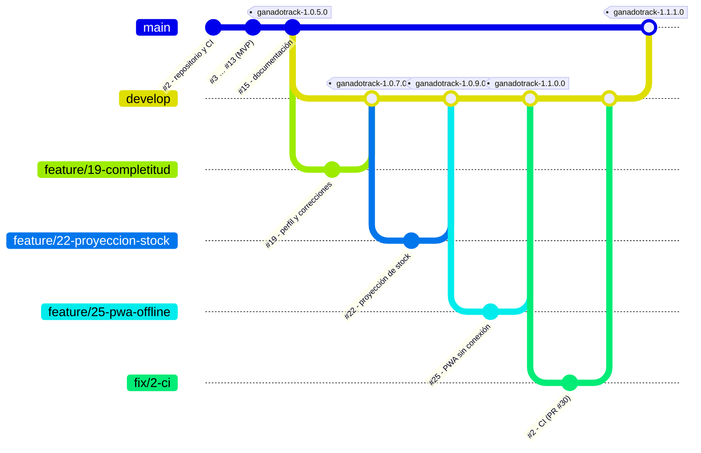

# 16. Seguimiento del proyecto (GitHub Projects)

## 16.1 Herramientas

| Necesidad | Herramienta |
|---|---|
| Control de versiones del código y la documentación | **Git**, con el repositorio remoto en **GitHub** |
| Gestión y seguimiento de tareas | **GitHub Projects** (tablero Kanban) + **Issues** |
| Planificación por hitos | **Milestones** de GitHub (uno por hito del cronograma) |
| Verificación automática de cada cambio | **GitHub Actions** (lint + pruebas + build) |
| Identificación de versiones | **Tags** de Git |

Se eligió GitHub Projects porque integra en un mismo lugar el código, las tareas y las versiones. Así, la **trazabilidad** que pide la cátedra (requisito → tarea → código → prueba) se obtiene con enlaces automáticos y sin herramientas externas.

## 16.2 Organización de las tareas

- **Un issue por requerimiento o tarea.** El título lleva el código del requerimiento, por ejemplo: `#7 RF02 – Registro de alimentación diaria`. La descripción incluye los criterios de aceptación tomados del caso de uso.
- **Etiquetas (labels)**, con los colores del logo:
  - Por módulo: `lotes`, `alimentacion`, `insumos`, `pesadas`, `sanidad`, `costos`, `dashboard`, `usuarios`, `clima`, `reportes`, `pwa`, `diseno`, `infra`.
  - Por tipo: `feature`, `bug`, `docs`, `test`.
  - Por prioridad: `prioridad-alta`.
- **Milestones:** uno por fase del cronograma (sección 14), con su fecha límite:
  - `F0 MVP – ganadotrack-1.0.5.0`
  - `F1 Rediseño y completitud – 1.0.7.0`
  - `F2 Gestión – 1.0.9.0`
  - `F3 Tecnología – 1.1.0.0`
  - `F4 Pruebas, despliegue y validación`
  - `F5 Documentación y entregables`
  - `F6 Cierre – ganadotrack-1.1.1.1`
- **Tablero Kanban** ([GitHub Projects](https://github.com/users/mateogit114730/projects/1)): columnas *Backlog → Por hacer → En progreso → En revisión → Hecho*. Cuando se integra el *pull request* que dice `Closes #7`, el issue pasa solo a *Hecho*.
- **Numeración:** los issues #1 a #29 se crearon en orden, de modo que el número de cada issue coincide con el que usan los commits. Los números siguientes (#30 en adelante) corresponden a *pull requests*.

### Issues del proyecto

| # | Issue | Milestone | Etiquetas | Estado (15/10) |
|---|---|---|---|---|
| 1 | Correcciones a la 1ª entrega | F0 | docs | Cerrado |
| 2 | Configurar repositorio, CI y entorno Docker | F0 | infra, test | Cerrado |
| 3 | Modelo de datos y migraciones | F0 | feature, infra | Cerrado |
| 4 | RF08 – Autenticación y roles | F0 | usuarios, feature, prioridad-alta | Cerrado |
| 5 | RF01 – Gestión de lotes | F0 | lotes, feature | Cerrado |
| 6 | RF03 – Stock y compras de insumos | F0 | insumos, feature | Cerrado |
| 7 | RF02 – Registro de alimentación diaria | F0 | alimentacion, feature, prioridad-alta | Cerrado |
| 8 | RF04 – Pesadas, GDP y proyección | F0 | pesadas, feature | Cerrado |
| 9 | RF05 – Calendario sanitario, tratamientos y bajas | F0 | sanidad, feature, prioridad-alta | Cerrado |
| 10 | CU14 – Alertas automáticas | F0 | sanidad, feature, prioridad-alta | Cerrado |
| 11 | RF06 – Costos y rentabilidad | F0 | costos, feature, prioridad-alta | Cerrado |
| 12 | RF07 – Dashboard | F0 | dashboard, feature | Cerrado |
| 13 | Pruebas automatizadas y E2E | F0 | test | Cerrado |
| 14 | Validación con el productor | F4 | test | Por hacer |
| 15 | Documentación y manuales | F5 | docs | En progreso |
| 16 | Despliegue | F4 | infra | Por hacer |
| 17 | Presentación final | F5 | docs | Backlog |
| 18 | Rediseño visual "Campo cálido" | F1 | diseno, feature | Cerrado |
| 19 | Completitud del sistema | F1 | usuarios, feature | Cerrado |
| 20 | RF09 – Ración por lote y carga en 1 toque | F2 | alimentacion, feature, prioridad-alta | Cerrado |
| 21 | RF10 – Protocolos sanitarios automáticos | F2 | sanidad, feature | Cerrado |
| 22 | RF11 – Proyección de stock | F2 | insumos, feature | Cerrado |
| 23 | RF12 – Clima y riesgos | F3 | clima, feature | Cerrado |
| 24 | RF13 – Reportes PDF y Excel | F3 | reportes, feature | Cerrado |
| 25 | RF14 – App instalable y modo sin conexión | F3 | pwa, alimentacion, feature | Cerrado |
| 26 | Preparación de despliegue y validación | F4 | infra, test | Cerrado |
| 27 | Documento final en Word y PDF | F5 | docs, prioridad-alta | Backlog |
| 28 | Capturas y diagramas finales | F5 | docs | Backlog |
| 29 | Versión final ganadotrack-1.1.1.1 | F6 | infra | Backlog |

Cada issue incluye la descripción y sus **criterios de aceptación** como lista de verificación. Al cerrarlo, se deja un comentario con el commit que lo resolvió.

## 16.3 Flujo de ramas



*El diagrama muestra solo algunas ramas: en el repositorio hay una rama `feature/<n>-…` por cada issue del #18 al #26.*

| Rama | Uso |
|---|---|
| `main` | Solo versiones liberadas. Cada *merge* lleva un tag de versión |
| `develop` | Integración de las funcionalidades terminadas |
| `feature/<n>-descripcion` | Una rama por issue (por ejemplo `feature/21-protocolo-sanitario`); se integra a `develop` con *merge* `--no-ff` o mediante un *pull request* |
| `fix/<n>-descripcion` | Corrección de errores (por ejemplo `fix/2-ci`, PR #30) |

**Reglas:**
- No se hacen commits directos a `main`.
- Todo *pull request* debe pasar el pipeline de GitHub Actions (lint + 118 pruebas con cobertura + build) antes de integrarse.
- Al ser un proyecto individual, la revisión del *pull request* la hace el propio autor con el checklist de la sección 16.6.

## 16.4 Convención de commits (trazabilidad)

Cada commit referencia el issue que resuelve, como se vio en clase:

```
git commit -m "#7 - Registro de alimentación diaria con descuento de stock"
git commit -m "#9 - Reprogramación automática del control de garrapata"
git commit -m "#11 - Fix: el costo por kg descuenta las bajas"
```

GitHub convierte `#7` en un enlace al issue. Desde el issue se ven todos los commits que lo implementaron y desde cada commit se llega al requerimiento. La matriz de trazabilidad completa (RF → CU → endpoint → prueba) está en [pruebas.md](pruebas.md#4-matriz-de-trazabilidad).

## 16.5 Versionado

Nomenclatura: **`ganadotrack-W.X.Y.Z`**

| Dígito | Significado |
|---|---|
| W | Cambio de plataforma o de arquitectura |
| X | Cambios de gran impacto (nuevo módulo mayor) |
| Y | Cambios relevantes para el cliente (nueva funcionalidad visible) |
| Z | Revisiones y correcciones |

Siguiendo la convención de la cátedra, un **valor impar** indica versión liberada (despliegue) y un **valor par**, versión de desarrollo.

| Versión | Contenido |
|---|---|
| `ganadotrack-1.0.5.0` | MVP de la 2ª entrega: RF01–RF08 (en `main`) |
| `ganadotrack-1.0.7.0` | Rediseño "Campo cálido" y completitud (F1) |
| `ganadotrack-1.0.9.0` | Ración y carga en 1 toque, protocolos sanitarios, proyección de stock (F2) |
| `ganadotrack-1.1.0.0` | Clima y riesgos, reportes PDF/Excel, PWA sin conexión (F3) |
| `ganadotrack-1.1.1.0` | Versión candidata para la publicación y la validación con el productor (en `main`, 15/10) |
| **`ganadotrack-1.1.1.1`** | **Versión final para la entrega del 05/11** |
| 1.3.x.x (futuro) | Costos completos, notificaciones, identificación individual |

Los tags se crean con `git tag -a ganadotrack-1.1.1.1 -m "…"` y se publican con `git push origin <tag>`. Las versiones liberadas en `main` tienen además un *release* de GitHub con el detalle de los cambios.

### Artefactos bajo control de configuración

| Artefacto | Herramienta | Ubicación |
|---|---|---|
| Código fuente | Git | `backend/`, `frontend/`, `e2e/` |
| Esquema y migraciones de la base | Git (Prisma) | `backend/prisma/` |
| Archivos de configuración | Git (sin secretos) | `.env.example`, `docker-compose.yml`, `.github/workflows/` |
| Documentación | Git (Markdown) | `docs/` |
| Documento de entrega (Word/PDF) y presentación | Git (copia por versión) | `docs/entregas/` |
| Configuración de despliegue | Git | `render.yaml`, `frontend/vercel.json` |

## 16.6 Checklist de revisión de cada pull request

- [ ] El título y los commits referencian el issue (`#n`).
- [ ] Pasa el pipeline de CI (lint, pruebas con cobertura y build).
- [ ] Incluye pruebas para la regla de negocio nueva o modificada.
- [ ] Si cambia el modelo de datos, incluye la migración.
- [ ] Si cambia la API, se actualizó `openapi.yaml`.
- [ ] No incluye credenciales ni archivos `.env`.

## 16.7 Evidencias

Repositorio publicado el 15/10/2026: <https://github.com/mateogit114730/ganadotrack>.

| Evidencia | Enlace | Figura |
|---|---|---|
| Tablero de GitHub Projects con las columnas y los 29 issues | <https://github.com/users/mateogit114730/projects/1> | `capturas/github/tablero.png` |
| Milestones F0–F6 con su porcentaje de avance | <https://github.com/mateogit114730/ganadotrack/milestones> | `capturas/github/milestones.png` |
| Historial de commits que referencian issues | <https://github.com/mateogit114730/ganadotrack/commits/develop> | `capturas/github/commits.png` |
| Ejecuciones de GitHub Actions en verde | <https://github.com/mateogit114730/ganadotrack/actions> | `capturas/github/actions.png` |
| Tags de versión | <https://github.com/mateogit114730/ganadotrack/tags> | `capturas/github/tags.png` |
| *Pull request* con la CI como control (PR #30) | <https://github.com/mateogit114730/ganadotrack/pull/30> | `capturas/github/pull-request.png` |

**Ejemplo de control de cambios (PR #30):**
1. La primera ejecución de la CI en GitHub falló: el *lockfile* no era compatible con npm 10 y un script no pasaba el lint.
2. La corrección se hizo en la rama `fix/2-ci`.
3. Se abrió el PR #30 hacia `develop`.
4. Recién se integró cuando la CI quedó en verde.

Así se ve el flujo completo: issue → rama → commit `#2 - …` → PR → CI → *merge*.
