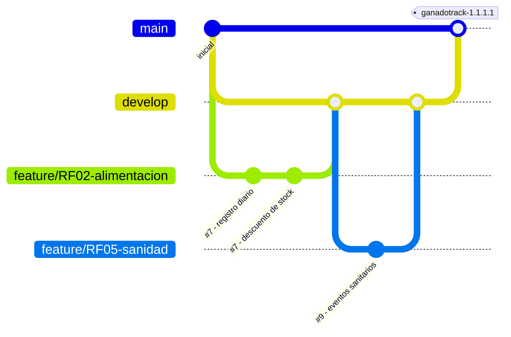

# 16. Seguimiento del proyecto (GitHub Projects)

## 16.1 Herramientas

| Necesidad | Herramienta |
|---|---|
| Control de versiones del código y la documentación | **Git**, con el repositorio remoto en **GitHub** |
| Gestión y seguimiento de tareas | **GitHub Projects** (tablero Kanban) + **Issues** |
| Planificación por hitos | **Milestones** de GitHub (uno por hito del cronograma) |
| Verificación automática de cada cambio | **GitHub Actions** (lint + pruebas + build) |
| Identificación de versiones | **Tags** de Git |

Se eligió GitHub Projects porque integra en un mismo lugar el código, las tareas y las versiones. Así, la **trazabilidad** que pide la cátedra (requisito → tarea → código → prueba) se obtiene con enlaces automáticos y sin herramientas externas.

## 16.2 Organización de las tareas

- **Un issue por requerimiento o tarea.** El título lleva el código del requerimiento, por ejemplo: `#7 RF02 – Registro de alimentación diaria`. La descripción incluye los criterios de aceptación tomados del caso de uso.
- **Etiquetas (labels):**
  - Por módulo: `lotes`, `alimentacion`, `insumos`, `pesadas`, `sanidad`, `costos`, `dashboard`, `usuarios`.
  - Por tipo: `feature`, `bug`, `docs`, `test`.
  - Por prioridad: `prioridad-alta`.
- **Milestones:** `H1 Base técnica`, `H2 Operación diaria`, `H3 Sanidad y costos`, `H4 MVP 1.1.1.1`, con las fechas del cronograma (sección 14).
- **Tablero Kanban:** columnas *Backlog → Por hacer → En progreso → En revisión → Hecho*. Cuando se integra el *pull request* que dice `Closes #7`, el issue pasa solo a *Hecho*.

### Issues iniciales del proyecto

| # | Issue | Milestone | Etiquetas |
|---|---|---|---|
| 1 | Correcciones a la 1ª entrega | H1 | docs |
| 2 | Configurar repositorio, CI y entorno Docker | H1 | test |
| 3 | Modelo de datos y migraciones | H1 | feature |
| 4 | RF08 – Autenticación y roles | H1 | usuarios, feature, prioridad-alta |
| 5 | RF01 – Gestión de lotes | H2 | lotes, feature |
| 6 | RF03 – Stock y compras de insumos | H2 | insumos, feature |
| 7 | RF02 – Registro de alimentación diaria | H2 | alimentacion, feature, prioridad-alta |
| 8 | RF04 – Pesadas, GDP y proyección | H2 | pesadas, feature |
| 9 | RF05 – Calendario sanitario, tratamientos y bajas | H3 | sanidad, feature, prioridad-alta |
| 10 | CU14 – Alertas automáticas | H3 | sanidad, feature, prioridad-alta |
| 11 | RF06 – Costos y rentabilidad | H3 | costos, feature, prioridad-alta |
| 12 | RF07 – Dashboard | H3 | dashboard, feature |
| 13 | Pruebas automatizadas y E2E | H4 | test |
| 14 | Validación con el productor | H4 | test |
| 15 | Documentación y manuales | H4 | docs |
| 16 | Despliegue | H4 | — |
| 17 | Presentación final | H4 | docs |

## 16.3 Flujo de ramas



| Rama | Uso |
|---|---|
| `main` | Solo versiones liberadas. Cada *merge* lleva un tag de versión |
| `develop` | Integración de las funcionalidades terminadas |
| `feature/RFxx-descripcion` | Una rama por requerimiento o issue; se integra a `develop` mediante un *pull request* |
| `fix/descripcion` | Corrección de errores |

**Reglas:**
- No se hacen commits directos a `main`.
- Todo *pull request* debe pasar el pipeline de GitHub Actions (lint + 58 pruebas + build) antes de integrarse.
- Al ser un proyecto individual, la revisión del *pull request* la hace el propio autor con el checklist de la sección 16.6.

## 16.4 Convención de commits (trazabilidad)

Cada commit referencia el issue que resuelve, como se vio en clase:

```
git commit -m "#7 - Registro de alimentación diaria con descuento de stock"
git commit -m "#9 - Reprogramación automática del control de garrapata"
git commit -m "#11 - Fix: el costo por kg descuenta las bajas"
```

GitHub convierte `#7` en un enlace al issue. Desde el issue se ven todos los commits que lo implementaron y desde cada commit se llega al requerimiento. La matriz de trazabilidad completa (RF → CU → endpoint → prueba) está en [pruebas.md](pruebas.md#4-matriz-de-trazabilidad).

## 16.5 Versionado

Nomenclatura: **`ganadotrack-W.X.Y.Z`**

| Dígito | Significado |
|---|---|
| W | Cambio de plataforma o de arquitectura |
| X | Cambios de gran impacto (nuevo módulo mayor) |
| Y | Cambios relevantes para el cliente (nueva funcionalidad visible) |
| Z | Revisiones y correcciones |

Siguiendo la convención de la cátedra, un **valor impar** indica versión liberada (despliegue) y un **valor par**, versión de desarrollo.

| Versión | Contenido |
|---|---|
| 1.0.1.0 | Base técnica: datos, autenticación, roles |
| 1.0.3.0 | Lotes, insumos, alimentación, pesadas |
| 1.0.5.0 | Sanidad, alertas, costos, dashboard |
| **1.1.1.1** | **MVP liberado para la entrega final** |
| 1.3.x.x (futuro) | Módulos de ciclo completo e identificación individual |

Los tags se crean con `git tag -a ganadotrack-1.1.1.1 -m "MVP entrega final"` y se publican con `git push --tags`.

### Artefactos bajo control de configuración

| Artefacto | Herramienta | Ubicación |
|---|---|---|
| Código fuente | Git | `backend/`, `frontend/`, `e2e/` |
| Esquema y migraciones de la base | Git (Prisma) | `backend/prisma/` |
| Archivos de configuración | Git (sin secretos) | `.env.example`, `docker-compose.yml`, `.github/workflows/` |
| Documentación | Git (Markdown) | `docs/` |
| Documento de entrega (Word/PDF) | Google Drive + copia en el repositorio por versión | `docs/entregas/` |

## 16.6 Checklist de revisión de cada pull request

- [ ] El título y los commits referencian el issue (`#n`).
- [ ] Pasa el pipeline de CI (lint, pruebas y build).
- [ ] Incluye pruebas para la regla de negocio nueva o modificada.
- [ ] Si cambia el modelo de datos, incluye la migración.
- [ ] Si cambia la API, se actualizó `openapi.yaml`.
- [ ] No incluye credenciales ni archivos `.env`.

## 16.7 Evidencias

*(Agregar capturas una vez publicado el repositorio en GitHub.)*
- Figura: tablero de GitHub Projects con las columnas y los issues.
- Figura: milestones con su porcentaje de avance.
- Figura: historial de commits que referencian issues.
- Figura: ejecución de GitHub Actions en verde.
