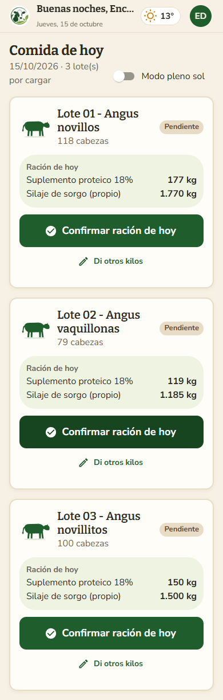
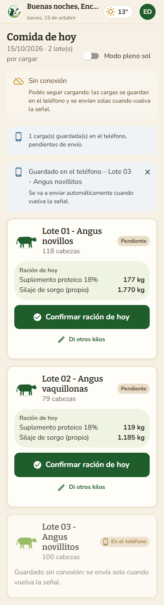
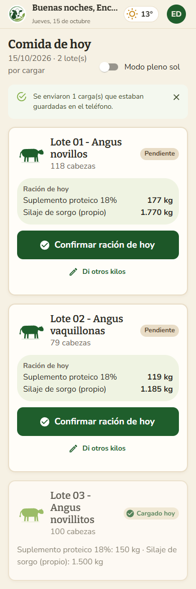
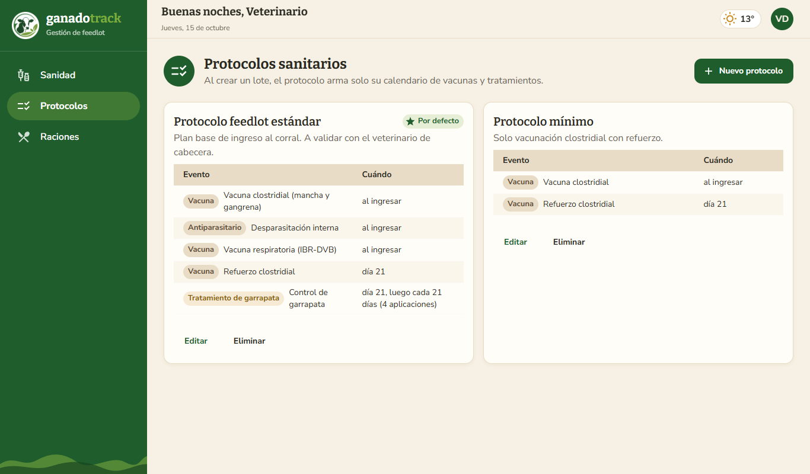
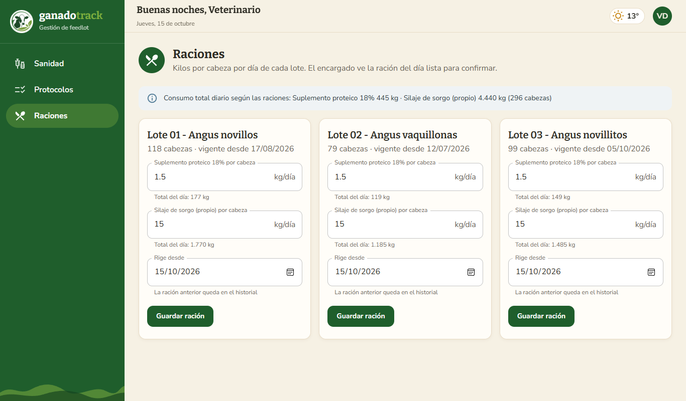
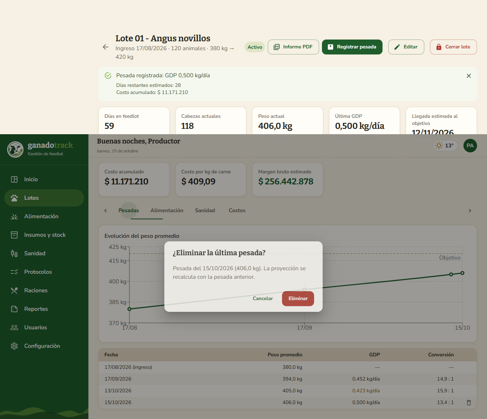
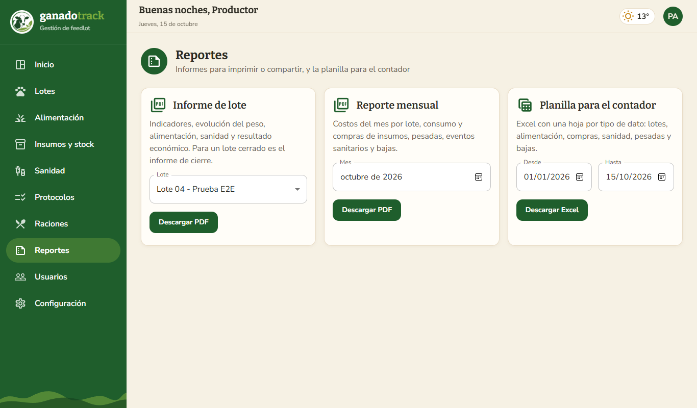
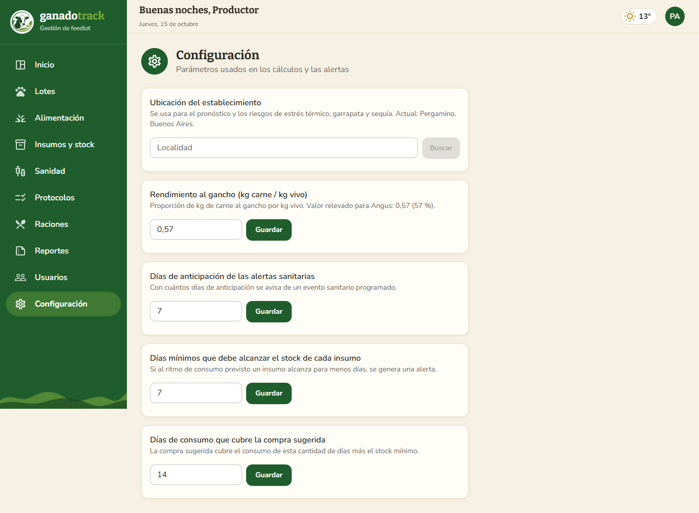
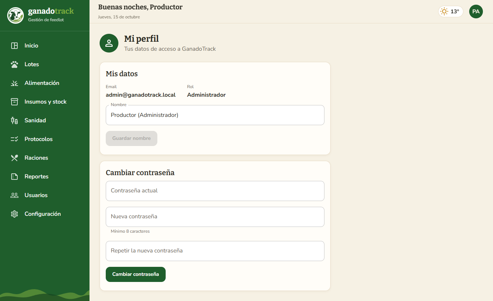

# Manual de usuario – GanadoTrack

GanadoTrack se usa desde el navegador (Chrome, Edge, Safari) en computadora, tablet o celular. También se puede **instalar como aplicación** en el celular (ver sección 6). Cada persona ingresa con su email y contraseña, y ve solo las opciones de su rol.

| Rol | Qué puede hacer |
|---|---|
| **Administrador** (productor) | Todo: lotes, pesadas, costos, insumos y proyección de stock, sanidad, protocolos, raciones, reportes, usuarios y configuración |
| **Encargado** | Cargar la comida del día de cada lote, incluso sin señal |
| **Veterinario** | Calendario sanitario, tratamientos, bajas, protocolos sanitarios, raciones y alertas sanitarias |

## 1. Ingresar al sistema

1. Abrir la dirección de GanadoTrack en el navegador (o la app instalada).
2. Escribir el email y la contraseña, y presionar **Ingresar**.
3. El sistema abre la pantalla de inicio de cada rol.

**Barra superior:** muestra el saludo, la fecha y el **clima actual** del campo.

**Menú de usuario:** se abre tocando el círculo con las iniciales, arriba a la derecha. Tiene tres opciones:
- **Mi perfil.**
- **Instalar la app**: aparece cuando el navegador lo permite.
- **Cerrar sesión.**

La sesión se cierra sola después de 8 horas sin uso.

---

## 2. Encargado: la comida de hoy

La pantalla **Comida de hoy** muestra una tarjeta por cada lote del corral, con sus cabezas y su estado:

| Estado | Significado |
|---|---|
| *Pendiente* | Todavía no se cargó la comida de hoy |
| *Carga parcial* | Se cargó solo uno de los insumos |
| *Cargado hoy* | Listo; debajo se ven los kilos registrados |
| *En el teléfono* | Se cargó sin señal y se va a enviar sola (ver 2.2) |

### 2.1 Confirmar la ración en un toque

Si el veterinario definió la ración del lote, la tarjeta muestra la **Ración de hoy** ya calculada para las cabezas actuales.

- Si se dio exactamente eso → tocar **Confirmar ración de hoy**. Listo.
- Si se dio otra cantidad → tocar **Di otros kilos**. Se abre el formulario con los kilos sugeridos. Se cambian los que correspondan y se toca **Confirmar**.
- Si el lote no tiene ración definida, el botón es **Cargar kilos** y se escriben los kilos de cada insumo. Si un insumo no se dio, se deja vacío.

| Ración del día | Formulario "Di otros kilos" | Confirmación |
|---|---|---|
|  |  |  |

El sistema descuenta los kilos del stock y avisa si algún insumo quedó por debajo del mínimo.

**Modo pleno sol:** el interruptor de arriba agranda la letra y aumenta el contraste para ver mejor la pantalla al aire libre.

### 2.2 Trabajar sin señal

En los corrales sin señal se puede seguir cargando igual:

1. Arriba aparece el aviso **Sin conexión**.
2. Confirmar la ración (o cargar los kilos) como siempre.
3. La tarjeta pasa a **En el teléfono**: la carga quedó guardada en el celular, con la fecha de hoy.
4. Cuando vuelve la señal, las cargas se envían solas. También se puede tocar **Enviar ahora** en el aviso de cargas pendientes.

| Sin señal | Al volver la señal |
|---|---|
|  |  |

> Para que funcione sin señal, la app tiene que haberse abierto al menos una vez **con** señal ese día, para descargar los lotes y la ración. No hace falta tenerla instalada, pero es más cómodo.

Si al enviarse una carga el sistema la rechaza (por ejemplo, porque no hay stock suficiente), aparece en rojo **"No se pudo enviar la carga de …"** con el motivo. En ese caso, avisar al administrador y tocar **Descartar**.

**Mensajes posibles:**
- *"Ingresá los kilos de al menos un insumo"*: no se cargó ningún valor.
- *"Stock insuficiente…"*: hay menos insumo en stock que lo que se quiere registrar. Avisar al administrador para que registre la compra.
- *"Ya se registró … en esa fecha"*: ese insumo ya se cargó hoy para ese lote. Si fue un error, el administrador puede eliminar el registro.

---

## 3. Veterinario

### 3.1 Sanidad

La pantalla muestra, de arriba hacia abajo:
- **Alertas sanitarias:** en rojo los eventos vencidos y en naranja los que vencen en los próximos 7 días. También aparecen las de **clima** que afectan la sanidad: riesgo alto de garrapata en lotes sin tratamiento reciente y estrés térmico.
- **Eventos pendientes:** el calendario de cada lote.
- **Historial** de eventos realizados y de bajas.

El selector **Lote** permite ver un solo lote.

**Programar un evento:** **Programar evento** → elegir el lote, el tipo (vacuna, antiparasitario, tratamiento de garrapata, otro), el nombre, la fecha y el producto previsto. Un evento pendiente se puede **reprogramar** (cambiar fecha, nombre o producto) con el botón **Editar** de su tarjeta, o eliminar.

**Registrar un evento realizado:** en la tarjeta del evento pendiente, presionar **Registrar realizado** y cargar la fecha, el producto, la dosis y el costo.
- Si no se carga el costo, se guarda en $ 0 con una advertencia (el costo sanitario del lote queda incompleto).
- En un **tratamiento de garrapata** hay que indicar la **duración en días**: al terminar el tratamiento, el sistema programa automáticamente un control.

**Evento no programado:** sirve para registrar algo que no estaba en el calendario, como un tratamiento de urgencia.

**Registrar una baja:** **Registrar baja** → elegir el lote, la fecha, la cantidad de animales y la causa (enfermedad, accidente, sequía, otra). Las cabezas del lote se descuentan y los costos por kg se recalculan.

### 3.2 Protocolos sanitarios

Un protocolo es el **plan sanitario tipo** de una tropa. Cuando el administrador crea un lote con un protocolo, el sistema arma solo todo su calendario de vacunas y tratamientos.

1. **Nuevo protocolo** → nombre y descripción.
2. Agregar los eventos. Para cada uno se indica:
   - **Tipo**, **Evento** (nombre) y **Producto**.
   - **Día desde el ingreso**: 0 = el día que entra la tropa.
   - Si se repite: **Cada (días)** y **Aplicaciones**. Por ejemplo, el control de garrapata el día 21, cada 21 días, 4 aplicaciones.
3. Marcar **Usar por defecto al crear lotes** si es el plan habitual. Solo un protocolo puede estar por defecto.
4. Guardar. La tabla muestra **cuándo** se aplica cada evento.

Editar o eliminar un protocolo no cambia los calendarios de los lotes ya creados.

### 3.3 Raciones

Define cuántos **kilos por cabeza por día** de cada insumo recibe cada lote. Con eso, el encargado ve la ración del día lista para confirmar.

1. En la tarjeta del lote, escribir los kg por cabeza de cada insumo. Debajo se ve el **total del día** para las cabezas actuales.
2. Elegir desde cuándo **rige** (por defecto, hoy). Si se pone una fecha futura, la ración actual sigue hasta ese día.
3. **Guardar ración**. La anterior queda en el historial.

Para quitar un insumo de la ración, cargar 0. Arriba se muestra el consumo total diario de todos los lotes.

---

## 4. Administrador

### 4.1 Dashboard

Resumen del feedlot con:
- **Indicadores generales:** cabezas, costo acumulado, carne estimada y margen.
- **Lotes en el corral:** días, peso, GDP, costo, fecha estimada de llegada al objetivo, avance y evolución del peso.
- **Clima del campo:** temperatura actual, pronóstico de 7 días y **riesgos orientativos** (estrés térmico, garrapata y sequía).
- **Alertas:** agrupadas en sanidad, stock, ganancia de peso y clima.
- **Stock de insumos:** con los días que alcanza cada uno.

Tocar un lote, o el enlace *Ver lote* de una alerta, abre su detalle.

> **Los riesgos de clima son orientativos.** Se calculan con el pronóstico y no reemplazan el criterio del veterinario:
> - **Estrés térmico:** según el índice de temperatura y humedad, desde 72.
> - **Garrapata:** alto con más de 20 °C y 70 % de humedad en la semana.
> - **Sequía:** alto con menos de 20 mm de lluvia en 30 días y menos de 5 mm pronosticados.

### 4.2 Lotes
- **Nuevo lote:** nombre, fecha de ingreso, cantidad de animales, peso de ingreso, peso objetivo, GDP objetivo (ganancia diaria esperada, por ejemplo 0,45 kg/día) y **Protocolo sanitario**.
  - El sistema propone el protocolo marcado por defecto y, al guardar, informa cuántos eventos sanitarios programó.
  - Si el lote ingresó antes de hoy, la opción *"no programar los eventos con fecha ya pasada"* evita cargar vacunas que ya se dieron.
- Las pestañas *Activos / Cerrados / Todos* filtran la lista.

### 4.3 Detalle del lote
Muestra los indicadores principales, el botón **Informe PDF** y cuatro pestañas:
- **Pesadas:** gráfico de evolución del peso frente al objetivo y tabla con la GDP y la **conversión alimenticia** de cada pesada. Esta última indica cuántos kg de materia seca hicieron falta por kg ganado: cuanto menor, mejor. El ícono 🗑 elimina **la última** pesada si se cargó por error.
- **Alimentación:** registros diarios. El ícono 🗑 elimina un registro cargado por error y devuelve los kilos al stock.
- **Sanidad:** calendario y bajas del lote.
  - **Aplicar protocolo** genera el calendario de un protocolo en un lote que no lo tenía.
  - El ícono 🗑 de una baja la elimina y devuelve las cabezas.
- **Costos:** desglose por insumo y por tipo de evento, kg de carne estimados, costo por kg, conversión acumulada y margen.

**Registrar pesada:** botón *Registrar pesada* → fecha y peso promedio del lote.
- El sistema calcula la GDP desde la pesada anterior y actualiza la fecha estimada de llegada al objetivo.
- Si la GDP es menor al objetivo, genera una alerta.
- Si el lote llegó al peso objetivo, sugiere cerrarlo.

Antes de eliminar algo, el sistema siempre pide confirmación:

**Precio de venta:** con *Editar* se carga el precio de venta por kg al gancho, que se usa para calcular el margen.

**Cerrar lote:** *Cerrar lote* → fecha de venta/faena, peso final y precio.
1. Primero se muestra el **resumen final**.
2. Recién al presionar *Confirmar cierre* el lote pasa al historial.

Un lote cerrado no admite más registros y su botón pasa a **Informe de cierre**.

> **Cómo se calcula el costo por kg:** costo total (alimentación + sanidad) ÷ (peso promedio × cabezas actuales × 57 %). Es el **costo de engorde**: no incluye el valor del animal al ingresar al feedlot.

### 4.4 Insumos y stock
Cada insumo muestra:
- El stock actual (el silaje en toneladas), el mínimo y el precio vigente.
- **Hasta cuándo alcanza:** "Alcanza para N días, hasta dd/mm", según el consumo previsto por las raciones (o el consumo real de las últimas dos semanas si no hay raciones). El chip se pone rojo si alcanza para menos de la cobertura mínima.
- El **gráfico de stock proyectado a 30 días**, con la línea punteada del mínimo.
- **Comprar N kg:** la compra sugerida para cubrir las próximas dos semanas y terminar con el stock mínimo. Abre el registro de compra con esa cantidad precargada.

Acciones:
- **Registrar compra** (suplemento) o **Cargar silaje** (producción propia): cantidad en kg y precio o costo total. El stock aumenta y el precio por kg se actualiza.
- **Configurar:** stock mínimo, precio por kg y **% de materia seca** (para la conversión alimenticia).
- **Corregir una compra:** el lápiz ✎ del historial permite corregir la cantidad o el precio. El stock se ajusta solo; si el insumo ya se consumió, no se permite dejar el stock negativo.

### 4.5 Reportes
Informes listos para imprimir o compartir:
- **Informe de lote (PDF):** elegir el lote. Incluye indicadores, pesadas con gráfico, alimentación, sanidad, bajas, costos y margen. Para un lote cerrado es el informe de cierre.
- **Reporte mensual (PDF):** elegir el mes. Incluye costos por lote e insumo, eventos sanitarios, bajas y stock.
- **Planilla para el contador (Excel):** elegir el rango de fechas. Tiene una hoja por tipo de dato: lotes, alimentación, compras, sanidad, pesadas y bajas.

### 4.6 Usuarios
Desde esta pantalla el administrador puede:
- Dar de alta usuarios con su rol.
- Cambiar el rol de un usuario.
- Desactivar un usuario: pierde el acceso de inmediato.
- Cambiar la contraseña de un usuario.

### 4.7 Configuración
- **Ubicación del establecimiento:**
  1. Escribir la localidad.
  2. Presionar **Buscar**.
  3. Elegir el resultado correcto.

  Se usa para el clima y los riesgos.
- **Parámetros de cálculo:**
  - Rendimiento al gancho (0,57).
  - Días de anticipación de las alertas sanitarias (7).
  - Días mínimos que debe alcanzar el stock (7).
  - Días de consumo que cubre la compra sugerida (14).

---

## 5. Mi perfil

Disponible para todos los roles desde el menú de usuario → **Mi perfil**:
- **Mis datos:** cambiar el nombre y presionar **Guardar nombre**.
- **Cambiar contraseña:**
  1. Escribir la contraseña actual.
  2. Escribir la nueva (al menos 8 caracteres) y repetirla.
  3. Presionar **Cambiar contraseña**.

---

## 6. Instalar la app en el celular

Instalada, GanadoTrack abre como cualquier aplicación, con su ícono en la pantalla de inicio y sin la barra del navegador.

- **Android (Chrome o Edge):** ingresar a GanadoTrack, abrir el menú de usuario y tocar **Instalar la app**. Si no aparece, usar el menú ⋮ del navegador → *Instalar aplicación* o *Agregar a la pantalla principal*.
- **iPhone (Safari):** botón *Compartir* → *Agregar a pantalla de inicio*.
- **PC (Chrome o Edge):** ícono de instalación en la barra de direcciones, o menú de usuario → **Instalar la app**.

Las actualizaciones se instalan solas la próxima vez que se abre la app con señal.

---

## 7. Uso en el celular

Todas las pantallas se adaptan al celular. En el caso del administrador y del veterinario, el menú se abre con el botón ☰.

| Dashboard en el celular | Menú |
|---|---|
|  |  |

---

## 8. Problemas frecuentes

| Situación | Qué hacer |
|---|---|
| La primera vez del día la app tarda en responder (unos 50 segundos) | Es normal en el servidor gratuito: la API "despierta" después de un rato sin uso. Esperar y volver a intentar |
| Aparece "Sin conexión" | El encargado puede seguir cargando (sección 2.2). Las demás pantallas necesitan señal |
| El panel de clima dice que el servicio no responde | El servicio externo de clima no está disponible. El resto del sistema funciona normalmente; volver a mirar más tarde |
| El clima pide configurar la ubicación | El administrador debe cargar la localidad en *Configuración* |
| Se escribe una dirección que no existe | Aparece la página "Esta tranquera está cerrada", con un botón para volver al inicio |
| Se olvidó la contraseña | El administrador puede asignar una nueva desde *Usuarios* |
