# Manual de usuario – GanadoTrack

GanadoTrack se usa desde el navegador (Chrome, Edge, Safari), en computadora, tablet o celular, y no requiere instalación. Cada persona ingresa con su email y contraseña, y ve solo las opciones de su rol.

| Rol | Qué puede hacer |
|---|---|
| **Administrador** (productor) | Todo: lotes, pesadas, costos, insumos, sanidad, usuarios y configuración |
| **Encargado** | Cargar la alimentación diaria de cada lote |
| **Veterinario** | Calendario sanitario, tratamientos, bajas y alertas sanitarias |

## 1. Ingresar al sistema

1. Abrir la dirección de GanadoTrack en el navegador.
2. Escribir el email y la contraseña, y presionar **Ingresar**.
3. El sistema abre la pantalla de inicio de cada rol.

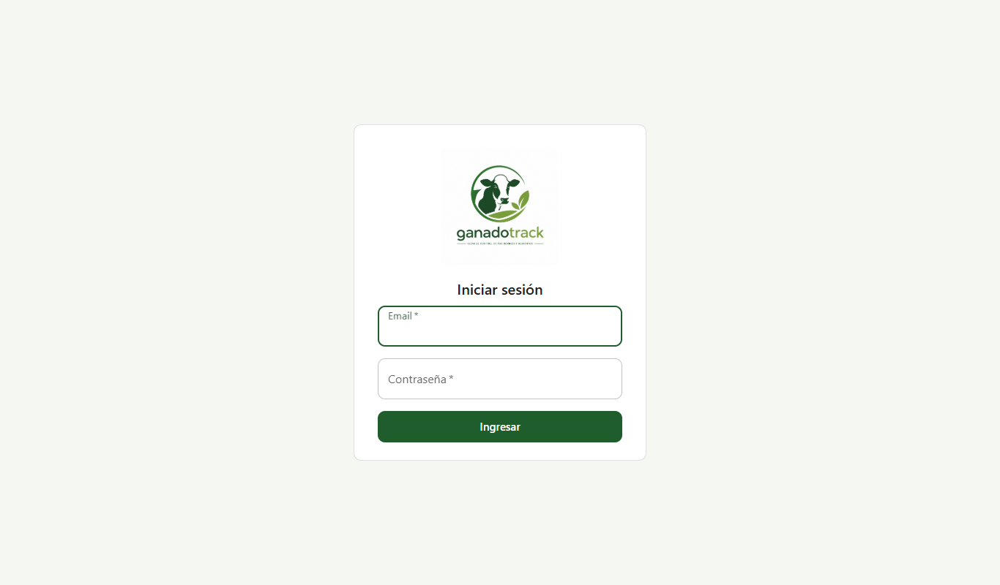

La sesión se cierra sola después de 8 horas sin uso. Para salir antes, usar el botón ⇥ arriba a la derecha.

---

## 2. Encargado: cargar la alimentación del día

Pensado para usar desde el celular, en tres pasos:

1. **Tocar el lote** al que se le dio de comer. Los lotes ya cargados hoy aparecen como *Cargado hoy*.
2. **Escribir los kilos** de suplemento y de silaje entregados. Si un insumo no se dio, dejarlo vacío.
3. Tocar **Confirmar**.

| Paso 1 y 2 | Confirmación |
|---|---|
| 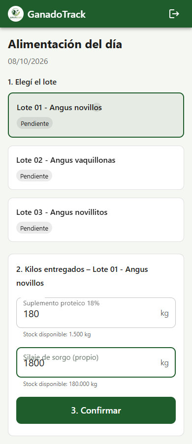 | 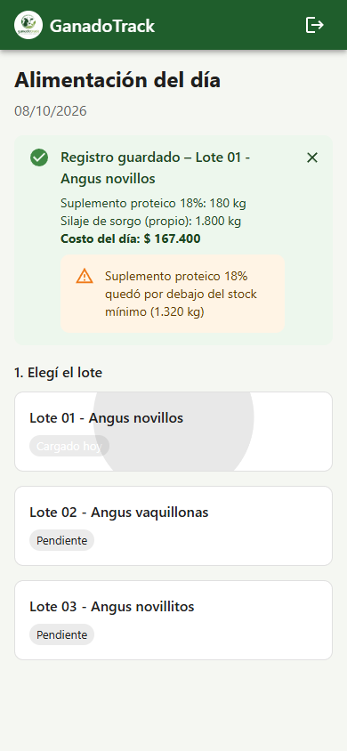 |

El sistema muestra el **costo del día** y avisa si algún insumo quedó por debajo del stock mínimo.

**Mensajes posibles:**
- *"Ingresá los kg de al menos un insumo"*: no se cargó ningún valor.
- *"Stock insuficiente…"*: hay menos insumo en stock que lo que se quiere registrar. Avisar al administrador para que registre la compra.
- *"Ya se registró … en esa fecha"*: ese insumo ya se cargó hoy para ese lote. Si fue un error, el administrador puede eliminar el registro.

---

## 3. Veterinario: sanidad

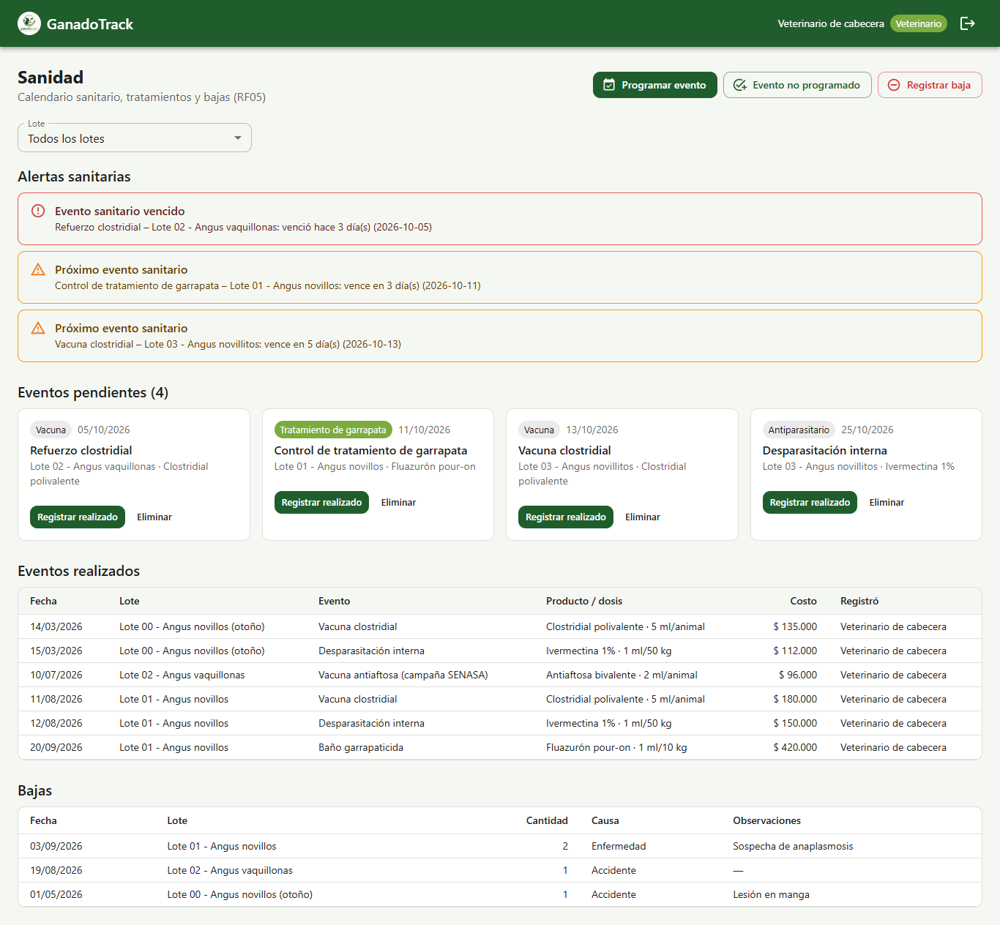

La pantalla muestra, de arriba hacia abajo:
- **Alertas sanitarias:** en rojo los eventos vencidos y en naranja los que vencen en los próximos 7 días.
- **Eventos pendientes:** el calendario de cada lote.
- **Historial** de eventos realizados y de bajas.

El selector **Lote** permite ver un solo lote.

### Programar un evento
**Programar evento** → elegir el lote, el tipo (vacuna, antiparasitario, tratamiento de garrapata, otro), el nombre, la fecha y el producto previsto.

### Registrar un evento realizado
En la tarjeta del evento pendiente, presionar **Registrar realizado** y cargar la fecha, el producto, la dosis y el costo.
- Si no se carga el costo, se guarda en $ 0 con una advertencia (el costo sanitario del lote queda incompleto).
- En un **tratamiento de garrapata** hay que indicar la **duración en días**: al terminar el tratamiento, el sistema programa automáticamente un control.

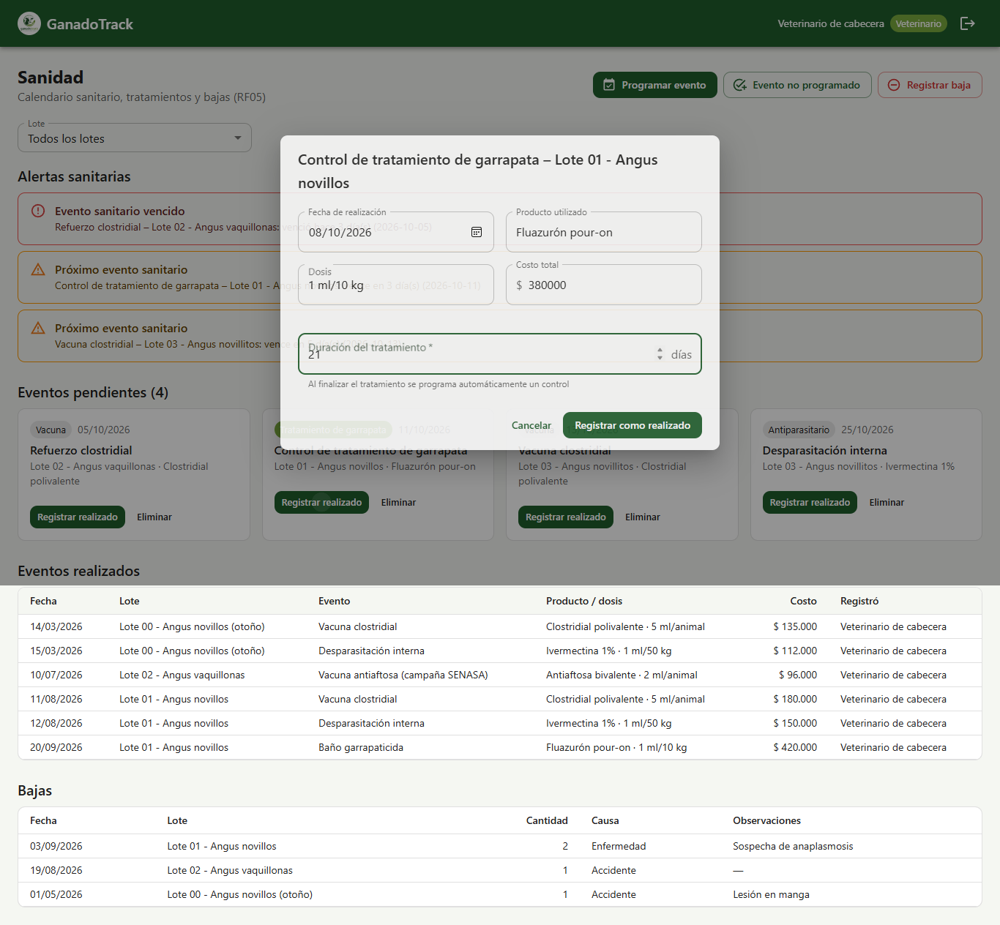

### Evento no programado
**Evento no programado** sirve para registrar algo que no estaba en el calendario, como un tratamiento de urgencia.

### Registrar una baja
**Registrar baja** → elegir el lote, la fecha, la cantidad de animales y la causa (enfermedad, accidente, sequía, otra). Las cabezas del lote se descuentan y los costos por kg se recalculan.

---

## 4. Administrador

### 4.1 Dashboard
Resumen del feedlot: cabezas, costo acumulado, carne estimada y margen. Debajo aparecen las tarjetas de cada lote activo (días, peso, GDP, costo, fecha estimada de llegada al objetivo y avance), las **alertas** y el **stock de insumos**. Tocar un lote abre su detalle.

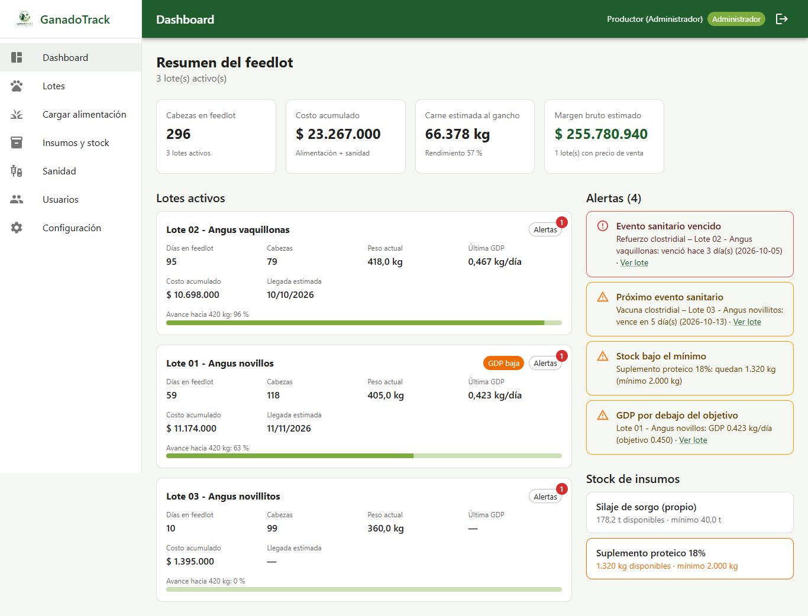

### 4.2 Lotes
- **Nuevo lote:** nombre, fecha de ingreso, cantidad de animales, peso de ingreso, peso objetivo y GDP objetivo (ganancia diaria esperada, por ejemplo 0,45 kg/día).
- Las pestañas *Activos / Cerrados / Todos* filtran la lista.

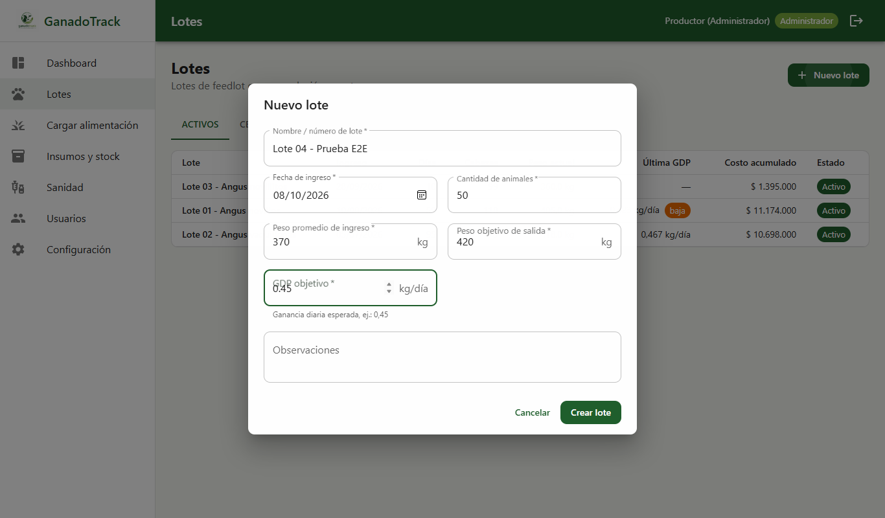

### 4.3 Detalle del lote
Muestra los indicadores principales y cuatro pestañas:
- **Pesadas:** gráfico de evolución del peso frente al objetivo y tabla con la GDP de cada pesada.
- **Alimentación:** registros diarios. El ícono 🗑 elimina un registro cargado por error y devuelve los kilos al stock.
- **Sanidad:** eventos y bajas del lote.
- **Costos:** desglose por insumo y por tipo de evento, kg de carne estimados, costo por kg y margen.

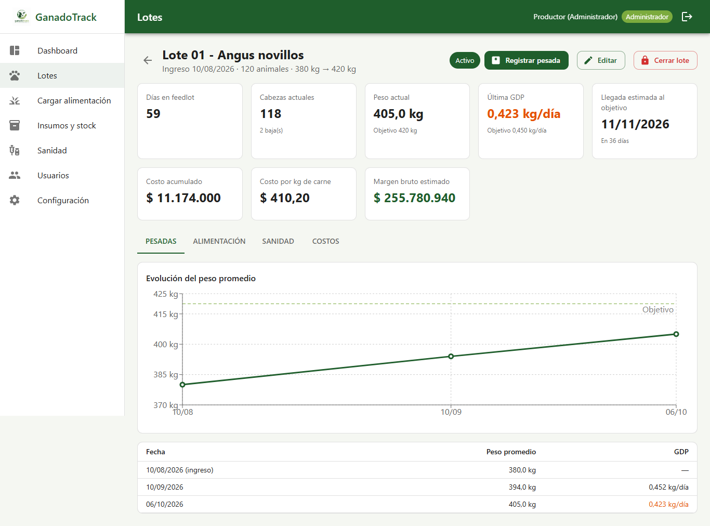

**Registrar pesada:** botón *Registrar pesada* → fecha y peso promedio del lote. El sistema calcula la GDP desde la pesada anterior y actualiza la fecha estimada de llegada al objetivo. Si la GDP es menor al objetivo, genera una alerta; si el lote llegó al peso objetivo, sugiere cerrarlo.

**Precio de venta:** con *Editar* se carga el precio de venta por kg al gancho, que se usa para calcular el margen.

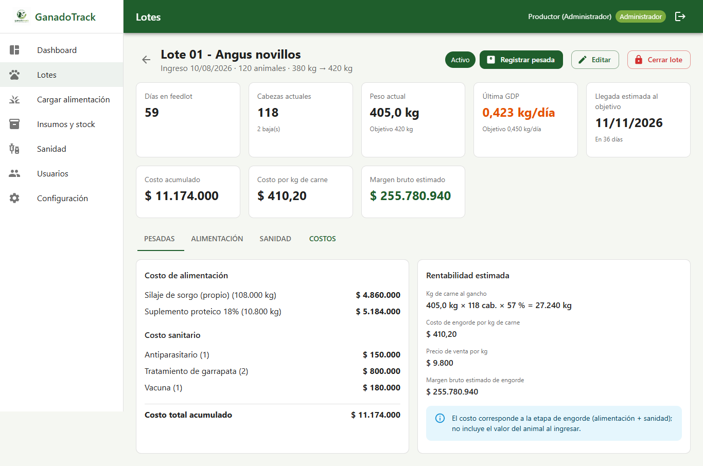

**Cerrar lote:** *Cerrar lote* → fecha de venta/faena, peso final y precio. Primero se muestra el **resumen final** y recién al presionar *Confirmar cierre* el lote pasa al historial. Un lote cerrado no admite más registros.

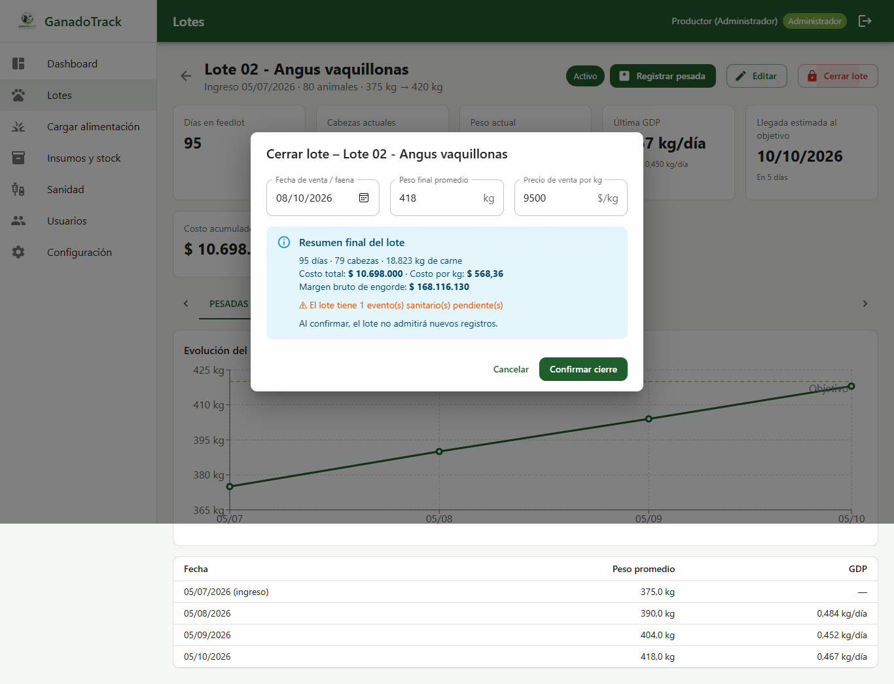

> **Cómo se calcula el costo por kg:** costo total (alimentación + sanidad) ÷ (peso promedio × cabezas actuales × 57 %). Es el **costo de engorde**: no incluye el valor del animal al ingresar al feedlot.

### 4.4 Insumos y stock
Muestra el stock actual (el silaje en toneladas), el mínimo y el precio vigente.
- **Registrar compra** (suplemento) o **Cargar silaje** (producción propia): cantidad en kg y precio o costo total. El stock aumenta y el precio por kg se actualiza.
- **Configurar:** permite modificar el stock mínimo que dispara la alerta y el precio por kg.

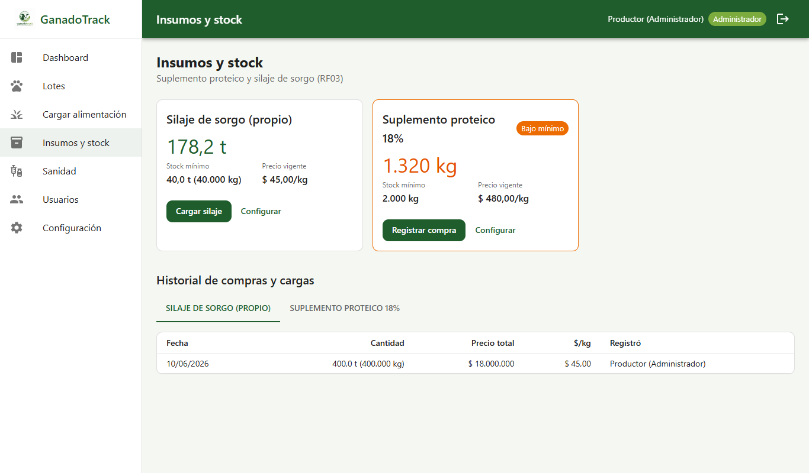

### 4.5 Usuarios
Alta de usuarios con su rol, cambio de rol, desactivación (el usuario pierde el acceso de inmediato) y cambio de contraseña.

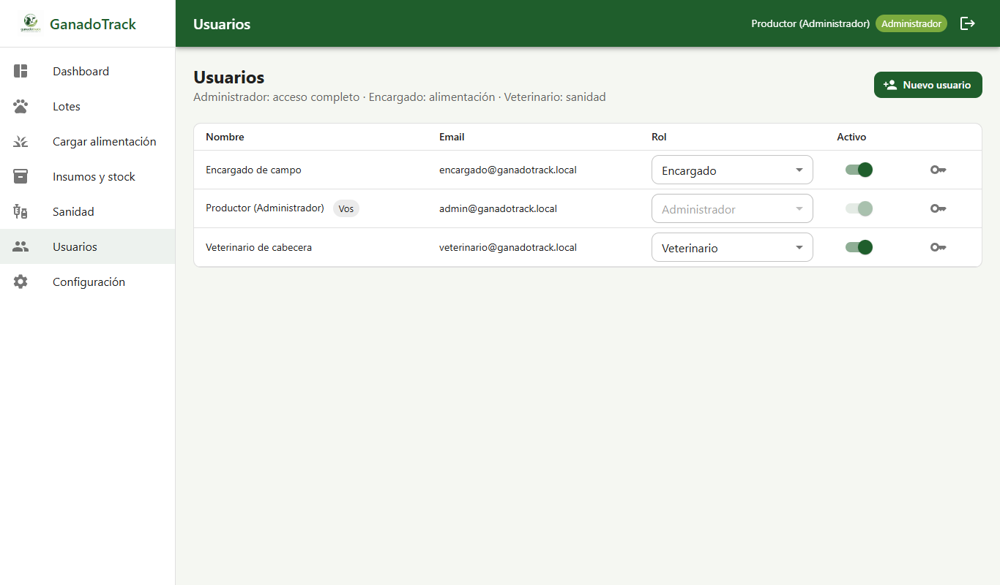

### 4.6 Configuración
Parámetros de cálculo: **rendimiento al gancho** (0,57) y **días de aviso** de las alertas sanitarias (7).

---

## 5. Uso en el celular

Todas las pantallas se adaptan al celular. En el caso del administrador, el menú se abre con el botón ☰.

| Dashboard en el celular | Menú |
|---|---|
| 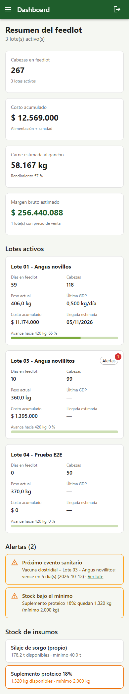 | 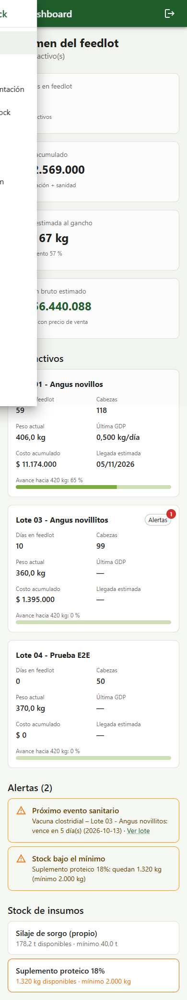 |
