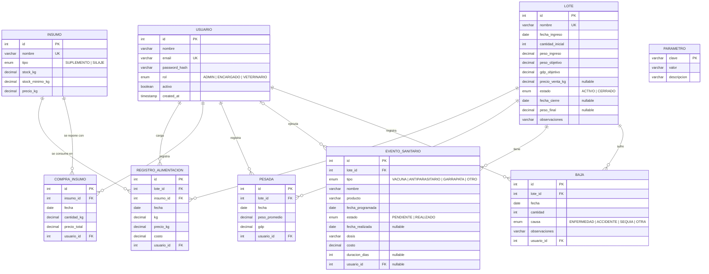

# Modelo de datos

## 1. Entidades principales

| Entidad | Representa | Requerimientos |
|---|---|---|
| USUARIO | Persona que usa el sistema, con su rol | RF08 |
| LOTE | Tropa de animales que ingresa al feedlot | RF01 |
| INSUMO | Suplemento proteico o silaje de sorgo, con su stock | RF03 |
| COMPRA_INSUMO | Compra (o carga de silaje propio) que suma stock | RF03 |
| REGISTRO_ALIMENTACION | Kg de un insumo entregados a un lote en un día | RF02 |
| PESADA | Pesada mensual del lote con la GDP calculada | RF04 |
| EVENTO_SANITARIO | Evento del calendario sanitario: programado o realizado | RF05 |
| BAJA | Muerte de animales del lote, con su causa | RF05 |
| PARAMETRO | Valores configurables (rendimiento al gancho, días de aviso) | RF04, RF05, RF06 |

## 2. Diagrama Entidad-Relación



> Para la entrega en Word: pegar en <https://mermaid.live> y exportar como PNG (reemplaza la figura del ER de la 1ª entrega).

### Cardinalidades

| Relación | Cardinalidad | Lectura |
|---|---|---|
| LOTE – REGISTRO_ALIMENTACION | 1 : N | Un lote recibe muchos registros diarios; cada registro es de un lote |
| INSUMO – REGISTRO_ALIMENTACION | 1 : N | Cada registro corresponde a un insumo |
| LOTE – PESADA | 1 : N | Un lote tiene una pesada mensual (0 al ingresar) |
| LOTE – EVENTO_SANITARIO | 1 : N | Calendario sanitario del lote |
| LOTE – BAJA | 1 : N | Un lote puede tener varias bajas |
| INSUMO – COMPRA_INSUMO | 1 : N | Historial de compras del insumo |
| USUARIO – registros | 1 : N | Auditoría: quién cargó cada dato. En EVENTO_SANITARIO es opcional (0..1) porque un evento programado todavía no tiene ejecutor |

**Relación N:M resuelta:** LOTE e INSUMO tienen una relación muchos a muchos (un lote consume varios insumos y un insumo alimenta varios lotes). Se resuelve con la entidad asociativa REGISTRO_ALIMENTACION, que además guarda los atributos propios de la relación: fecha, kg, precio aplicado y costo.

## 3. Normalización

El modelo está en **tercera forma normal (3FN)**:
- **1FN:** todos los atributos son atómicos; no hay listas dentro de un campo. Por ejemplo, cada insumo entregado en el día es una fila distinta.
- **2FN:** las tablas usan una clave primaria simple (`id`), por lo que no hay dependencias parciales.
- **3FN:** no hay dependencias transitivas. Los datos derivados (cabezas actuales, costo acumulado, días en feedlot, fecha proyectada) **no se guardan**: se calculan a partir de los datos base.

**Desnormalizaciones deliberadas:**

| Campo | Motivo |
|---|---|
| `registro_alimentacion.precio_kg` y `costo` | Guardan el precio **vigente al momento de la carga**. Si el precio del insumo cambia después, el costo histórico no debe cambiar |
| `pesada.gdp` | Se guarda calculada al registrar la pesada. Es un dato histórico que no debe variar si se corrige una pesada posterior |
| `insumo.stock_kg` | Saldo actual, mantenido en las mismas transacciones que lo modifican. Evita recalcular "compras − consumos" en cada consulta |

## 4. Diccionario de datos

Convenciones: claves `SERIAL`; importes en **ARS** (`NUMERIC(14,2)`); pesos y cantidades en **kg**; fechas de negocio `DATE`.

### USUARIO (`usuario`)
| Campo | Tipo | Nulo | Restricciones | Descripción |
|---|---|---|---|---|
| id | SERIAL | No | PK | Identificador |
| nombre | VARCHAR(100) | No | | Nombre visible |
| email | VARCHAR(150) | No | UNIQUE | Usuario de inicio de sesión (minúsculas) |
| password_hash | VARCHAR(100) | No | | Hash bcrypt de la contraseña; nunca se guarda en texto plano |
| rol | ENUM Rol | No | ADMIN, ENCARGADO, VETERINARIO | Define los permisos (RF08) |
| activo | BOOLEAN | No | DEFAULT true | Un usuario inactivo no puede iniciar sesión |
| created_at | TIMESTAMP | No | DEFAULT now() | Alta del registro |

### LOTE (`lote`)
| Campo | Tipo | Nulo | Restricciones | Descripción |
|---|---|---|---|---|
| id | SERIAL | No | PK | |
| nombre | VARCHAR(60) | No | UNIQUE | Nombre o número de tropa |
| fecha_ingreso | DATE | No | | Ingreso al feedlot |
| cantidad_inicial | INT | No | CHECK > 0 | Animales al ingreso |
| peso_ingreso | NUMERIC(7,2) | No | CHECK > 0 | Peso promedio de entrada (kg) |
| peso_objetivo | NUMERIC(7,2) | No | CHECK > peso_ingreso | Peso promedio de salida esperado (kg) |
| gdp_objetivo | NUMERIC(5,3) | No | CHECK > 0 | GDP esperada (kg/día); por debajo genera alerta |
| precio_venta_kg | NUMERIC(12,2) | Sí | CHECK > 0 | Precio de venta por kg al gancho, para el margen |
| estado | ENUM | No | ACTIVO, CERRADO · DEFAULT ACTIVO · índice | |
| fecha_cierre | DATE | Sí | CHECK ≥ fecha_ingreso; obligatorio si CERRADO | Venta/faena |
| peso_final | NUMERIC(7,2) | Sí | | Peso promedio al cierre |
| observaciones | VARCHAR(500) | Sí | | |

### INSUMO (`insumo`)
| Campo | Tipo | Nulo | Restricciones | Descripción |
|---|---|---|---|---|
| id | SERIAL | No | PK | |
| nombre | VARCHAR(80) | No | UNIQUE | |
| tipo | ENUM | No | SUPLEMENTO, SILAJE | |
| stock_kg | NUMERIC(12,2) | No | CHECK ≥ 0 | Stock actual (el silaje se muestra en toneladas) |
| stock_minimo_kg | NUMERIC(12,2) | No | CHECK ≥ 0 | Por debajo genera alerta |
| precio_kg | NUMERIC(12,2) | No | CHECK ≥ 0 | Precio vigente (última compra o costo de producción) |

### COMPRA_INSUMO (`compra_insumo`)
| Campo | Tipo | Nulo | Restricciones | Descripción |
|---|---|---|---|---|
| id | SERIAL | No | PK | |
| insumo_id | INT | No | FK → insumo | |
| fecha | DATE | No | índice (insumo_id, fecha) | |
| cantidad_kg | NUMERIC(12,2) | No | CHECK > 0 | |
| precio_total | NUMERIC(14,2) | No | CHECK ≥ 0 | |
| usuario_id | INT | No | FK → usuario | Quién la registró |

### REGISTRO_ALIMENTACION (`registro_alimentacion`)
| Campo | Tipo | Nulo | Restricciones | Descripción |
|---|---|---|---|---|
| id | SERIAL | No | PK | |
| lote_id | INT | No | FK → lote | |
| insumo_id | INT | No | FK → insumo | |
| fecha | DATE | No | UNIQUE (lote_id, insumo_id, fecha) | Un registro por insumo, lote y día |
| kg | NUMERIC(10,2) | No | CHECK > 0 | Kg entregados |
| precio_kg | NUMERIC(12,2) | No | | Precio aplicado (histórico) |
| costo | NUMERIC(14,2) | No | CHECK ≥ 0 | kg × precio_kg |
| usuario_id | INT | No | FK → usuario | Encargado que cargó |

### PESADA (`pesada`)
| Campo | Tipo | Nulo | Restricciones | Descripción |
|---|---|---|---|---|
| id | SERIAL | No | PK | |
| lote_id | INT | No | FK → lote | |
| fecha | DATE | No | UNIQUE (lote_id, fecha) | |
| peso_promedio | NUMERIC(7,2) | No | CHECK > 0 | |
| gdp | NUMERIC(6,3) | No | | (peso − peso anterior) / días; puede ser negativa |
| usuario_id | INT | No | FK → usuario | |

### EVENTO_SANITARIO (`evento_sanitario`)
| Campo | Tipo | Nulo | Restricciones | Descripción |
|---|---|---|---|---|
| id | SERIAL | No | PK | |
| lote_id | INT | No | FK → lote · índice | |
| tipo | ENUM | No | VACUNA, ANTIPARASITARIO, GARRAPATA, OTRO | |
| nombre | VARCHAR(100) | No | | Ej.: "Vacuna clostridial" |
| producto | VARCHAR(100) | Sí | | |
| fecha_programada | DATE | No | índice (estado, fecha_programada) | Base de las alertas |
| estado | ENUM | No | PENDIENTE, REALIZADO | |
| fecha_realizada | DATE | Sí | Obligatoria si REALIZADO | |
| dosis | VARCHAR(60) | Sí | | |
| costo | NUMERIC(14,2) | No | CHECK ≥ 0 · DEFAULT 0 | Suma al costo sanitario |
| duracion_dias | INT | Sí | CHECK > 0 | Duración del tratamiento de garrapata |
| observaciones | VARCHAR(500) | Sí | | |
| usuario_id | INT | Sí | FK → usuario | Quién lo ejecutó |

### BAJA (`baja`)
| Campo | Tipo | Nulo | Restricciones | Descripción |
|---|---|---|---|---|
| id | SERIAL | No | PK | |
| lote_id | INT | No | FK → lote | |
| fecha | DATE | No | | |
| cantidad | INT | No | CHECK > 0; ≤ cabezas actuales (validado en la API) | |
| causa | ENUM | No | ENFERMEDAD, ACCIDENTE, SEQUIA, OTRA | |
| observaciones | VARCHAR(500) | Sí | | |
| usuario_id | INT | No | FK → usuario | |

### PARAMETRO (`parametro`)
| Clave | Valor inicial | Uso |
|---|---|---|
| rendimiento_gancho | 0.57 | kg de carne = peso × cabezas × rendimiento (RF06) |
| dias_aviso_sanitario | 7 | Anticipación de las alertas sanitarias (RF05) |

## 5. Implementación física

El esquema se define en [`backend/prisma/schema.prisma`](../../backend/prisma/schema.prisma) y se crea con migraciones SQL versionadas en `backend/prisma/migrations/`:

| Migración | Contenido |
|---|---|
| `…_init` | Tablas, tipos ENUM, claves primarias y foráneas, índices y restricciones UNIQUE (generada por Prisma) |
| `…_checks_y_vistas` | **Escrita a mano:** restricciones CHECK, vista `v_resumen_lote` y trigger de lote cerrado |
| `…_vista_resumen_tipos` | Ajusta los tipos de la vista (las sumas de enteros devuelven `bigint`) |

### Vista `v_resumen_lote`

Concentra los acumulados de cada lote que usan el dashboard y el módulo de costos: cabezas actuales, peso de la última pesada, última GDP, costo de alimentación, costo sanitario y costo total. Evita repetir estas consultas en distintos lugares del código.

### Trigger `fn_validar_lote_activo`

Antes de insertar en `registro_alimentacion`, `pesada` o `baja`, verifica que el lote no esté CERRADO. La API ya valida esta regla; el trigger es una segunda barrera por si se intenta cargar datos por otra vía (verificado por la prueba CP-37).

### Seguridad de la información

- Contraseñas almacenadas solo como hash bcrypt.
- Las credenciales de la base de datos están en variables de entorno, no en el código.
- Se registra el usuario que realizó cada operación (auditoría).
- **Respaldo:** en producción se usan los respaldos automáticos de la plataforma. En local, el respaldo se hace con `docker exec ganadotrack-db pg_dump -U ganadotrack ganadotrack > respaldo.sql`.

## 6. Consultas de ejemplo

**a) Resumen de los lotes activos** (lo que muestra el dashboard):
```sql
SELECT nombre, cabezas_actuales, peso_actual, ultima_gdp, costo_total
FROM v_resumen_lote
WHERE estado = 'ACTIVO'
ORDER BY fecha_ingreso;
```

**b) Costo por kg de carne y margen de cada lote** (RF06):
```sql
SELECT r.nombre,
       r.costo_total,
       ROUND(r.peso_actual * r.cabezas_actuales * 0.57, 2)                      AS kg_carne,
       ROUND(r.costo_total / NULLIF(r.peso_actual * r.cabezas_actuales * 0.57, 0), 2) AS costo_por_kg,
       ROUND(l.precio_venta_kg * r.peso_actual * r.cabezas_actuales * 0.57 - r.costo_total, 2) AS margen
FROM v_resumen_lote r
JOIN lote l ON l.id = r.lote_id;
```

**c) Eventos sanitarios que vencen en los próximos 7 días o ya vencidos** (alertas, RF05):
```sql
SELECT l.nombre AS lote, e.nombre AS evento, e.fecha_programada,
       e.fecha_programada - CURRENT_DATE AS dias_restantes
FROM evento_sanitario e
JOIN lote l ON l.id = e.lote_id
WHERE e.estado = 'PENDIENTE' AND l.estado = 'ACTIVO'
  AND e.fecha_programada <= CURRENT_DATE + 7
ORDER BY e.fecha_programada;
```

**d) Insumos por debajo del stock mínimo** (RF03):
```sql
SELECT nombre, stock_kg, stock_minimo_kg FROM insumo WHERE stock_kg < stock_minimo_kg;
```

**e) Consumo y costo de alimentación por lote e insumo en el último mes:**
```sql
SELECT l.nombre, i.nombre AS insumo, SUM(r.kg) AS kg, SUM(r.costo) AS costo
FROM registro_alimentacion r
JOIN lote l ON l.id = r.lote_id
JOIN insumo i ON i.id = r.insumo_id
WHERE r.fecha >= CURRENT_DATE - 30
GROUP BY l.nombre, i.nombre
ORDER BY l.nombre, i.nombre;
```

**f) Bajas por causa** (relacionado con el caso de anaplasmosis del relevamiento):
```sql
SELECT causa, SUM(cantidad) AS animales FROM baja GROUP BY causa ORDER BY animales DESC;
```

Estas consultas se pueden ejecutar con `docker exec -it ganadotrack-db psql -U ganadotrack` o desde Prisma Studio (`npm run db:studio`).
